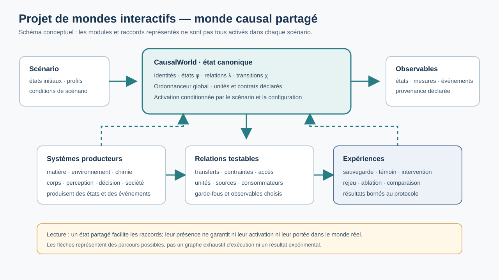
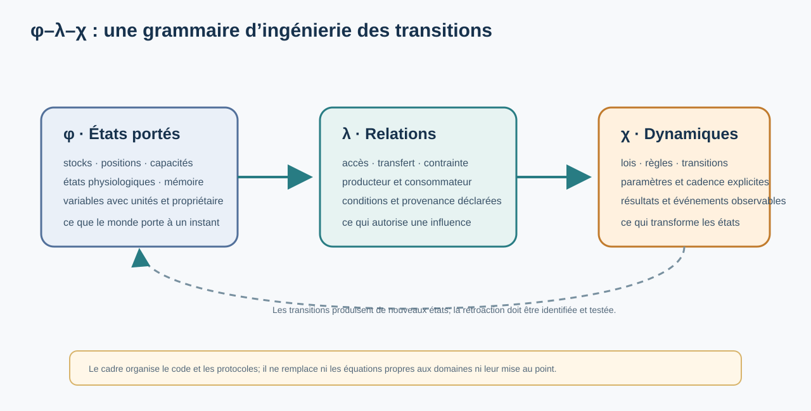
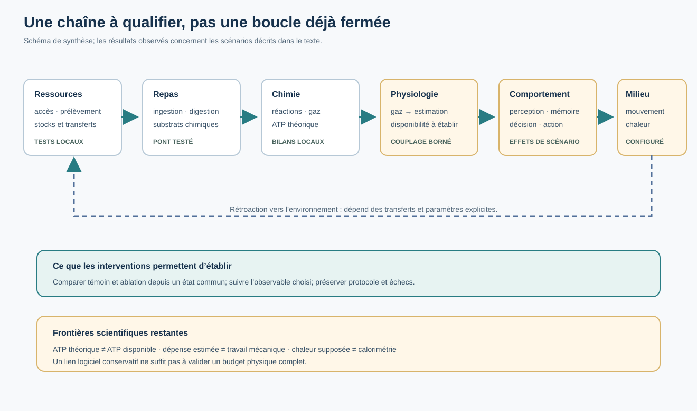

# Mondes interactifs — présentation courte

**Édition publique v1.1 · 24 novembre 2026**

**Langue :** français · [Read the English short edition](Interactive_Worlds_short_edition_v1.1.md) · [Accueil EN](index_en.html)

> **En 30 secondes** — Un projet propriétaire de mondes interactifs que l’on peut créer, habiter et observer. Le moteur et ses recettes restent privés. Ce dépôt contient uniquement de la documentation publique, des schémas de présentation et des résultats de haut niveau. Il ne contient ni code source, ni configuration, ni données brutes.

## L’idée

Un monde interactif ne se résume pas à une scène affichée à l’écran. Il comprend des lieux, des objets, des ressources, des habitants et des relations qui peuvent évoluer au fil d’une histoire. Le projet vise à réunir ces éléments dans un même environnement : une personne façonne un lieu, y place des habitants, lance une situation, puis observe ce qui a changé.

La vision produit tient en une boucle simple : **créer → habiter → faire évoluer → observer → modifier**. L’éditeur de monde sert à composer les espaces et leurs objets. L’habitat donne aux lieux des pièces, des passages et des contraintes d’accès. Les habitants peuvent percevoir, se déplacer, conserver des traces d’expérience et agir dans leur environnement. L’interface d’observation aide à parcourir les changements et les interactions consignées.

Ces éléments sont à des stades différents. Plusieurs fonctions et parcours sont construits et vérifiés séparément; ils ne sont pas encore tous réunis dans une expérience unique, continue et durable.

## Comment le système relie les mécanismes

### L’apport distinctif

Le projet transforme la composition de domaines spécialisés en boucle expérimentale : les mécanismes partagent un même monde, leurs conséquences consignées peuvent être suivies d’un domaine à l’autre, et des reprises ou comparaisons de branches permettent d’examiner la contribution d’un mécanisme à une action ultérieure. C’est cette continuité entre composition, provenance causale et intervention qui définit sa proposition technique.

Les résultats présentés portent sur les modules et scénarios effectivement raccordés. L’intégration automatique de n’importe quel modèle tiers et la généralité universelle de la grammaire ne sont pas revendiquées. Les contrats détaillés, paramètres et recettes restent privés.

Le runtime encadre ses composants par des contrats d’accès et de temps. L’inventaire statique couvre 44 phases et 71 composants; il décrit 49 mises à jour par pas de référence, 17 par temps écoulé et 5 régimes mixtes. Parmi les 32 qui ne reçoivent pas directement `dt`, 2 restent sans dt direct : une projection anatomique à retour différé et une étape de fabrication discrète, qui ne sont pas des taux directs. Trois mécanismes reçoivent maintenant une mise à l’échelle temporelle selon des hypothèses de taux non calibrées; l’un conserve une division à seuil discrète. L’ordre commun du monde relie les mécanismes sans leur imposer une cadence identique. Ce contrôle vérifie les frontières déclarées, pas la synchronisation physique ni le comportement complet de chaque chaîne.

La suite ciblée de subdivision, de seuils et de reprise passe **14/14 tests**. Les résultats sont limités aux cas définis : absorption sans division, cohésion sous cible constante, maintenance et récupération organisationnelles, et reprise checkpoint. Les divisions ne sont pas comparées sous toutes les partitions possibles; les taux demeurent non calibrés et l’équivalence générale des trajectoires n’est pas revendiquée.

Le système rassemble des domaines qui gardent leurs propres règles : matière et mouvement, eau et environnement, chimie, besoins du corps, perception, mémoire, locomotion et organisation collective. Ils partagent un même monde, mais leurs unités et leurs cadences ne sont pas rendues identiques par cette intégration.

Pour examiner une interaction, une expérience suit un état de départ, les relations qui permettent aux mécanismes d’agir, les changements produits et les observations disponibles. Une trace mémorisée, par exemple, ne modifie le comportement que si un mécanisme la relit et qu’une décision ou une action ultérieure en est affectée. De même, afficher une relation entre deux domaines ne suffit pas à établir qu’un effet est effectivement transmis.

Cette manière de décrire le système sert à poser des questions concrètes : quel élément porte l’état? Quel mécanisme le transforme? Quelle interaction relie deux parties? Quel changement peut être observé ensuite? Les lois et grandeurs propres à chaque domaine restent distinctes.

## Créer et explorer un monde

L’expérience produit recherchée commence avec un éditeur qui permet de composer un lieu, ses objets et ses conditions. Les espaces habitables ajoutent des pièces, des accès et des fonctions domestiques. Les habitants et les doubles incarnés donnent un point de vue situé : ils peuvent être représentés dans le lieu, recevoir des signaux, bouger et participer à certaines interactions.

Une interface d’observation rend les trajectoires consultables par des scènes, cartes, vues et événements déclarés. Elle aide à répondre à des questions d’usage comme : qu’est-ce qui a changé? Quel habitant ou quelle ressource est concerné? Quelle autre trajectoire peut servir de comparaison? L’image rend le monde plus lisible, mais ne remplace pas les états et événements qui la produisent.

À terme, la boucle doit permettre de créer un monde, de le sauvegarder, de le relancer, de suivre son histoire, puis de le modifier sans perdre la continuité utile. La persistance, la navigation, l’accès aux ressources et la fluidité des longues sessions font partie des chantiers de maturation.

## Ce que les essais ont déjà fait tourner

Le système n’est pas un module unique évalué par un score global. Il comprend un cadre états–relations–dynamiques, un moteur expérimental causal, des domaines spécialisés et des outils de création et d’observation. Le dossier complet cartographie 11 formulations théoriques de statuts différents, cinq questions de cascade, une carte de 23 échelles de recherche, les mesures synthétiques d’hystérésis, les identifiants d’événements, les points de contrôle et le rejeu, puis les familles de domaines, leurs raccords et leurs campagnes. Les 23 échelles ne sont pas toutes simulées et ces 11 formulations ne sont pas toutes validées. Les résultats courts ci-dessous illustrent plusieurs types de capacité; ils ne résument pas le corpus.

**Des mécanismes co-agissent dans un même monde.** Dans une campagne de jardin, une expérience conservée contribue à un trajet puis à une nouvelle irrigation. Des branches témoins où cette contribution est retirée ne produisent pas la même action; le contraste a été retrouvé dans plusieurs initialisations. D’autres parcours réunissent mémoire, corps et organisation. Un scénario collectif suit les effets d’une rétroaction sur l’attribution d’une ressource et sur la décision d’un membre.

**Les campagnes longues révèlent aussi les défaillances.** Dans un parcours de subsistance instrumenté pendant environ deux heures, les trajectoires divergent et le collectif finit par se dissoudre dans une branche au pas 1 855 d’un horizon de 2 160. Le post-mortem relie une partie de cette issue aux blocages de déplacement et à l’accès effectif aux ressources. Ce run a atteint près de **3,8 Go de mémoire vive** et produit plus d’un million d’événements dans la branche la plus instrumentée : c’est une mesure du coût de ce scénario et de sa journalisation, pas la capacité maximale du moteur.

**Des lots ciblés couvrent plusieurs domaines.** Parmi les lots terminés documentés : **122/122** contrôles de physique numérique; **80/80** contrôles dans des domaines domestiques, causaux et chimiques; **192/192** contrôles d’un lot corps, perception, mémoire et résident; **40/40** contrôles de l’espace de travail; **31/31** en hydrologie domestique; **11/11** sur la coordination du moteur. Les campagnes de locomotion, d’optique, d’écologie, d’audition et de vision apportent d’autres comparaisons, avec des résultats et des critères propres à chaque domaine. Par exemple, l’évaluation visuelle a retenu 50 scènes sur 75 et 2 répétitions sur 5 ont atteint le critère interne complet; six trajectoires articulaires évaluées se rapprochent davantage de la référence que la posture neutre.

Un inventaire général a recensé **1 635 cas**, sans produire de bilan complet. Les lots ciblés sont des relevés différents, parfois recouvrants : ils ne forment pas un total additionnable. Ils indiquent l’étendue du travail et des résultats internes sous conditions définies, pas la maturité uniforme de chaque mécanisme ni une évaluation indépendante du système entier.

Une mesure d’exécution distincte est publiée avec ses séries filtrées : **47,99 heures**, **2 873 mesures**, **416 ticks nets** sous surveillance (de **809 à 1 225**) et **0,87–1,32 Gio** de mémoire résidente. La mémoire privée a atteint **1,77 Gio**. Le processus a été signalé actif à chaque mesure, mais aucun tick n’a avancé durant les **9 dernières minutes** de la fenêtre surveillée. La trace distincte atteint le tick **1 274**, sans horodatage alignable sur le moniteur. La mesure s’arrête environ **50 secondes avant 48 heures**; elle approche ce seuil sans l’atteindre formellement. Les six instantanés publics ne qualifient pas la trajectoire complète des habitants. Cette observation renseigne sur cette exécution précise; elle ne remplace ni les campagnes de comportement intégré ni les mesures de charge ci-dessus.

## État actuel et limites

Le socle technique et plusieurs outils de création, d’observation, d’habitat et d’incarnation sont en développement ou vérifiés sur des parcours ciblés. Les démonstrations montrent les fonctions effectivement raccordées dans ces parcours; elles ne signifient pas que toute la vision produit est déjà disponible dans une application intégrée.

Les régimes temporels des composants sont maintenant recensés, mais les domaines ne sont pas encore harmonisés dans un contrat physique commun. Les mesures d’un domaine ne sont pas interchangeables avec celles d’un autre. Certains résultats dépendent de scénarios précis, et la durée d’une campagne ou le nombre de résidents ne suffit pas à établir la qualité de toutes les interactions. La mesure de l’endurance matérielle et la continuité des mondes restent des sujets de travail.

Les idées de variation causale, d’oubli sélectif et de reconstruction de souvenirs sont des pistes de conception. Elles ne sont pas présentées comme des capacités intégrées tant qu’elles ne modifient pas de façon observable des décisions ultérieures.

## Propriété et périmètre de cette édition

Le projet est propriétaire. Le moteur, le code source et les recettes d’implémentation restent privés. Ce dossier expose une architecture générale, une vision produit et des résultats de haut niveau afin de présenter le projet sans distribuer ses moyens de fabrication.

Cette édition ne fournit aucun code source, graine exacte, configuration, commande interne, trace brute, sauvegarde d’exécution, donnée personnelle ou chemin interne. Elle présente la vision du projet et son état d’avancement sans distribuer les moyens de fabrication.

## Figures et éditions

Les schémas sont conceptuels et illustrent les descriptions du dossier. La version complète conserve une présentation plus détaillée des domaines, des démonstrations et des limites. Les deux éditions portent la version publique **1.1 — 24 novembre 2026**.
