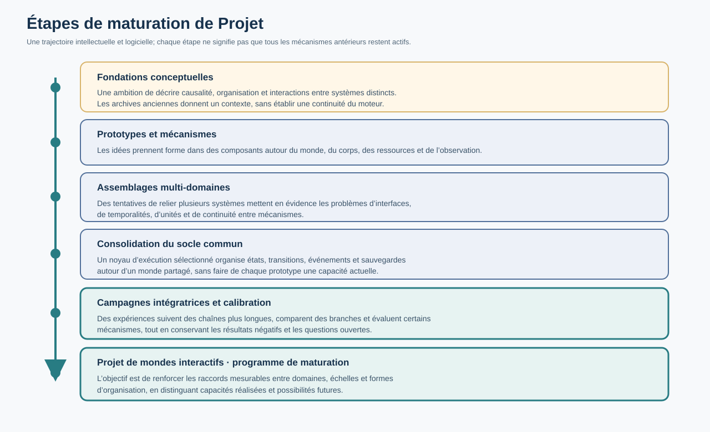
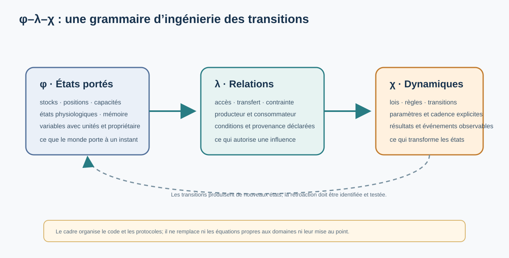
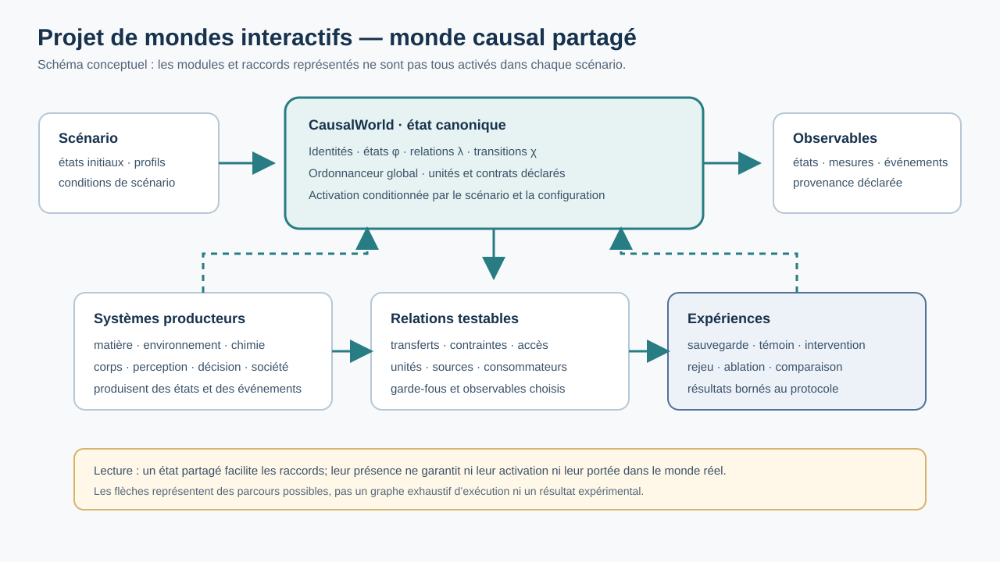
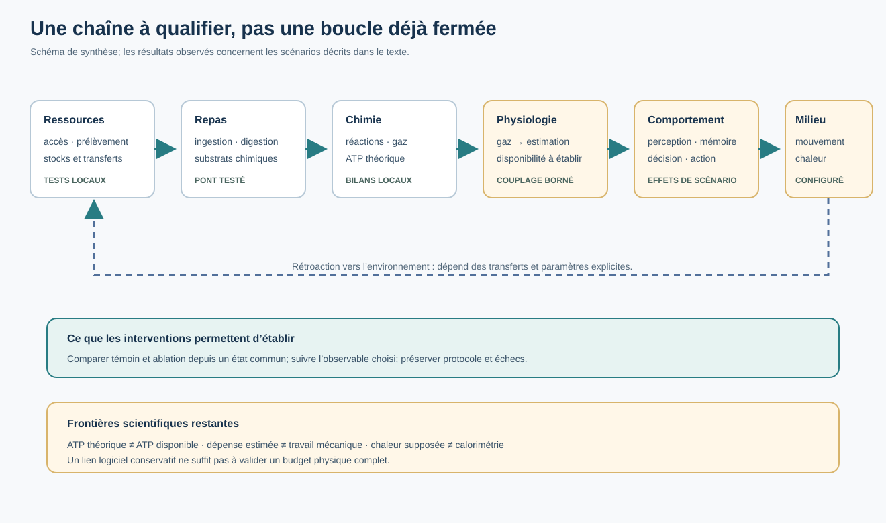
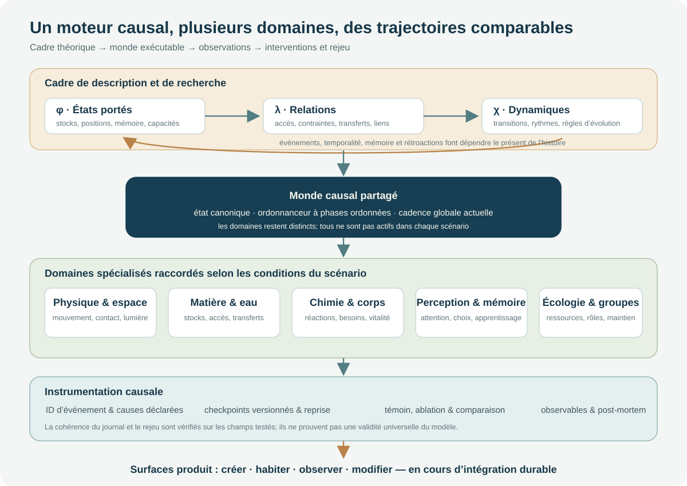

# Moteur de mondes causaux — dossier technique public

## Cadre états–relations–dynamiques, runtime expérimental, domaines et produit

**Rapport technique public · Édition 1.1 · 24 novembre 2026**

**Auteur et créateur du projet : Gaaboy**

Le moteur et ses recettes restent privés. Ce dossier présente l’architecture générale, les résultats de haut niveau et les limites observées.

**Statut propriétaire et périmètre.** Le moteur et ses recettes restent privés. Ce dossier décrit uniquement l’architecture générale, les fonctions produit et les résultats de haut niveau. Il ne fournit aucun code source, graine d’exécution, configuration, commande interne, trace ou donnée brute.

> **En 30 secondes** — Ce projet ne se résume pas à un décor interactif : c’est un programme théorique, un moteur d’expérimentation causale multi-domaines et un ensemble de surfaces produit. Il explore comment des états, des relations, des dynamiques, des budgets et une histoire commune peuvent relier matière, environnement, corps, mémoire, action et organisation. Le moteur et ses recettes restent privés; ce dossier expose les capacités construites, les résultats mesurés, les échecs conservés et les ambitions qui ne sont pas encore acquises.

> **Proposition.** Le système construit un environnement de mondes où l’on peut suivre comment un état devient une contrainte, comment une relation permet un transfert, et comment une transition transforme à son tour les possibilités du système. Sa question centrale n’est pas seulement ce qu’un agent ou un mécanisme sait faire, mais ce qui change lorsque les domaines agissent dans le même monde.

## Résumé exécutif

Le projet a quatre faces qu’il faut lire ensemble. **La théorie** formule un cadre commun pour décrire ce qu’un système porte, les relations qui lui permettent d’agir et les dynamiques qui transforment son état au fil du temps. **Le moteur** rend des mondes causaux exécutables, inspectables, sauvegardables et comparables par branche. **Le portefeuille de domaines** relie des mécanismes spécialisés de physique, matière, eau, écologie, chimie, physiologie, perception, mémoire, locomotion et organisation sociale. **Le produit** rend ces mondes créables, habitables et observables par des outils d’édition, d’incarnation et d’exploration.

La contribution recherchée est un runtime expérimental où des mécanismes spécialisés peuvent agir dans un monde commun tout en conservant leurs règles et mesures locales. L’apport observable est la boucle qui relie une interaction inter-domaines à ses événements consignés, puis permet de reprendre une situation, comparer des branches et tester si la présence ou le retrait d’un mécanisme change les conséquences ultérieures. La grammaire commune organise cette composition; le dossier n’en publie pas les contrats détaillés ni les recettes d’implémentation.

La valeur du programme se construit dans ce couplage : les mécanismes d’un domaine peuvent transformer les conditions d’un autre, leurs conséquences s’inscrivent dans une histoire consultable, et des reprises avec comparaison permettent d’évaluer la contribution d’une interaction. Les campagnes décrites donnent des exemples mesurés de cette boucle. Les raccords qualifiés aujourd’hui couvrent les domaines et scénarios de ce dossier; l’intégration automatique de tout modèle externe reste à établir.

Le socle canonique possède un état de monde partagé, un ordonnanceur déterministe à phases ordonnées, des événements munis d’identifiants et de causes déclarées, des checkpoints versionnés, une reprise et des outils de campagne. Les checkpoints permettent de partir d’un état commun, de comparer un témoin à une intervention, puis de vérifier les champs, l’ordre d’événements et les observables effectivement couverts par le test. La cadence actuelle reste globale : les mécanismes ne disposent pas encore tous d’un contrat multi-cadence et la subdivision temporelle d’un tick n’est pas équivalente par défaut.

La théorie est plus large que le logiciel actif. Son catalogue historique contient **11 formulations F**, **5 questions de cascade** et une carte de **23 échelles**, du microscopique au cosmologique. Ce catalogue constitue un programme de recherche et une mémoire des hypothèses; il ne signifie pas que ces lois sont toutes implémentées, ni que le moteur simule toutes ces échelles. L’hystérésis a fait l’objet d’expériences synthétiques comparant les effets des seuils, de la mémoire des rôles et des relations; ces chiffres ne proviennent pas de sociétés observées.

Le portefeuille de résultats dépasse les trois exemples de la page d’accueil. Il comprend des rejeux exacts sur des scénarios bornés, des ablations, des boucles mémoire–décision–navigation–irrigation reproduites sur plusieurs initialisations, une campagne de maintien collectif sur 720 ticks, des trajectoires plus longues qui échouent, des tests de physiologie et de chimie, des calibrations de locomotion et d’optique, des contrôles écologiques, des chemins sensoriels et des qualifications produit. Les résultats favorables et négatifs sont exposés par domaine avec leurs conditions et leurs limites.

La quantité d’archives doit elle aussi être décrite correctement. Un inventaire général a détecté **1 635 cas de test**, mais son exécution n’a pas abouti à un rapport final; les lots ciblés possèdent, eux, des résultats séparés. Un audit documentaire de novembre recense **84 rapports de campagne** et **53 artefacts de calibration**, avec recouvrements, historiques et domaines de portée différente. Ces comptes indiquent l’ampleur du travail documenté; ils ne sont ni un total de réplications indépendantes ni un verdict global vert. Le registre de modèles et le manifeste de vérification comptent des objets différents, donc leurs nombres ne sont pas additionnés.

La vision produit — éditeur de mondes, habitat, résidents incarnés, interface d’observation, conversation et mémoire choisie — est une couche réelle du projet, pas son unique objet. Plusieurs parcours ont des tests ciblés; l’expérience intégrée, durable et complète reste en construction. Les termes « mémoire », « apprentissage », « organisme », « société » et « vie » désignent des mécanismes logiciels bornés et ne valent pas preuve de cognition humaine, de vie autonome ou de validité scientifique externe.

**Mots-clés :** mondes causaux, simulation multi-domaines, états–relations–dynamiques, interactions, bioénergétique, expérimentation, traçabilité.

## 1. Origine et évolution du projet

L’histoire du projet est celle d’une question qui s’est progressivement transformée en architecture : comment relier des mécanismes hétérogènes sans perdre leurs différences, puis faire de leurs interactions un objet d’expérience? Les archives racontent des essais, des formulations théoriques, des prototypes et des assemblages. Elles ne décrivent pas une migration linéaire d’un seul moteur; la continuité la plus forte est celle de l’ambition d’intégration.

*Figure 1 — Chronologie de synthèse. Les repères antérieurs au noyau canonique sont documentés de manière inégale et leurs filiations logicielles restent provisoires.*

| Étape de maturation | Ce qui s’est construit | Ce que cette étape apporte |
|---|---|---|
| Fondations conceptuelles | Des intuitions sur la causalité, l’organisation et les formes d’interaction entre systèmes. | Une question structurante : comment décrire ensemble l’état, les relations et les dynamiques sans réduire les domaines à une loi unique? |
| Prototypes et mécanismes | Des explorations autour du monde, du corps, de la mémoire, des ressources et de l’observation. | Un terrain d’essai pour transformer les idées en composants et découvrir les difficultés d’intégration. |
| Assemblages multi-domaines | Des tentatives de relier des systèmes, des outils et des représentations dans des expériences plus larges. | La découverte que juxtaposer des modules ne suffit pas : leurs états, temps, unités et interfaces doivent réellement se raccorder. |
| Consolidation du socle commun | La sélection d’un noyau d’exécution, de transitions, d’événements et de sauvegardes autour d’un état de monde partagé. | Une frontière plus claire entre les mécanismes actifs, les prototypes historiques et les ambitions encore à construire. |
| Démonstrations et tests | Des scénarios relient plusieurs domaines, comparent des trajectoires et suivent les résultats observés. | Une méthode de développement qui aide à voir ce qui fonctionne et ce qui doit évoluer. |

Cette trajectoire est importante parce qu’elle révèle un changement de méthode. Le système ne cherche plus seulement à réunir des idées sous un même nom; il distingue les mécanismes historiques de ceux qui sont effectivement portés, appelés, testés et documentés dans le socle actuel. Les archives témoignent d’une continuité intellectuelle et de tentatives d’intégration; elles ne montrent pas la conservation de chaque ancien système. Cette distinction permet de raconter l’évolution du projet sans confondre vision, prototype et capacité présente.

## 2. La proposition théorique : relier sans confondre

### 2.1 La question qui traverse les échelles

Le système part d’une question d’organisation : comment des éléments distincts, en relation et soumis à des dynamiques, forment-ils un ensemble qui peut se maintenir, agir et garder les effets de son histoire ? Cette question s’applique à des systèmes très différents — un compartiment chimique, un organisme, un foyer ou un collectif — sans supposer qu’ils sont faits des mêmes choses. Le fil théorique n’est donc pas l’uniformité des objets, mais la possibilité de décrire ce qu’ils portent, ce qui les relie et ce qui les transforme.

### 2.2 Une grammaire pour décrire les mécanismes

états–relations–dynamiques condense cette proposition en trois questions qui doivent rester liées :

| Notion | Question de conception | Exemples de rôle dans ce système |
|---|---|---|
| **φ — état porté** | Qu’est-ce qui varie et où cet état est-il porté ? | Stock de matière, état corporel, position, mémoire, réserve ou capacité, chacun avec sa propre définition et unité. |
| **λ — relation opérante** | Par quel canal un état peut-il influencer un autre ? | Accès à une ressource, lien orienté, contact, appartenance, contrainte ou dépendance entre producteur et consommateur. |
| **χ — dynamique** | Quelle règle transforme l’état, sous quelles conditions et à quelle cadence ? | Réaction, mise à jour physiologique, transition comportementale ou évolution d’une relation. |

La comparaison entre domaines porte sur la structure de leur description, non sur l’identité de leurs lois. La « réserve » d’un organisme n’est pas l’énergie d’un champ; une relation sociale n’obéit pas automatiquement à la règle d’un lien mécanique; un pas de calcul n’est pas une seconde. Cette distinction permet au système de rechercher une organisation commune tout en laissant à chaque mécanisme ses grandeurs, paramètres et critères de portée.

Le cadre s’enrichit d’une exigence d’histoire : l’état présent peut dépendre de stocks épuisés, de traces mémorisées, de relations modifiées ou de contraintes héritées. La mémoire n’est pas une force mystérieuse du passé; elle agit lorsqu’une trace persistante est lue par une transition actuelle. De même, les changements entre échelles doivent être spécifiés : ce que les interactions agrègent, comment une organisation contraint ses unités, et comment les actions locales la transforment en retour. Le système formule ainsi cinq questions de cascade : l’agrégation des interactions, la fermeture effective d’une boucle, l’influence du collectif sur les trajectoires locales, le retour des actions locales sur le collectif, et la continuité des supports et des coûts lors d’un changement d’échelle. Ces questions organisent la théorie et les contrats de conception; elles ne sont pas cinq propriétés déjà acquises par chaque simulation.

### 2.3 Du cadre à une question testable

Une grammaire n’est utile que si elle aide à trouver les mécanismes et les mesures. Pour chaque lien, le système demande : quel état est lu, quel mécanisme écrit, quelle relation autorise le transfert, quelles unités et quelle cadence s’appliquent, quel événement en conserve la provenance, et quelle observation change lorsqu’on intervient ?

Cette perspective conduit à distinguer quatre situations qui sont souvent confondues :

| Situation | Ce qu’elle établit |
|---|---|
| Un composant existe | Le code ou le contrat correspondant est présent. |
| Un composant est activé | Le scénario configure les entrées et atteint ce chemin d’exécution. |
| Un effet local est testé | Une assertion précise est satisfaite dans un contexte déclaré. |
| Une chaîne est étayée | Les étapes et leurs transferts sont observés, et une intervention teste leur dépendance. |

Un mécanisme peut être présent sans participer à un scénario, ou produire un effet local sans entraîner toute la chaîne. Les comparaisons avec des références apportent des repères supplémentaires. Le système garde ces différences visibles pour expliquer ce qui a réellement été observé.

## 3. Une architecture unifiée : états, relations, transitions

### 3.1 états–relations–dynamiques comme cadre d’ingénierie

Dans le cadre utilisé par le système, **φ** désigne ce qu’un élément du monde porte à un instant donné; **λ** désigne les relations, contraintes et voies par lesquelles les éléments peuvent s’influencer; **χ** désigne les dynamiques qui transforment les états au fil de l’évolution. La théorie attire ainsi l’attention sur trois questions liées : qu’est-ce qui existe dans le monde, qu’est-ce qui relie ces éléments et par quels mécanismes ces liens produisent-ils des changements?

*Figure 2 — Schéma conceptuel, non une visualisation de données mesurées.*

Cette notation organise les questions à poser au modèle; elle ne remplace pas les lois propres à chaque domaine. Un stock de matière, une température, une réserve physiologique, un souvenir et une relation sociale sont tous des états du monde, mais ils n’ont ni la même unité ni le même sens. Le système cherche une manière commune de les situer sans les confondre. De même, une relation ne devient une interaction réelle que si un mécanisme la lit, agit sur elle et produit une conséquence observable. Une dynamique se comprend donc par ce qu’elle reçoit, ce qu’elle transforme et ce qu’elle rend possible ensuite.

La proposition théorique prend sa force dans cette articulation : l’état seul n’explique pas l’action; une relation sans mécanisme reste une possibilité abstraite; une dynamique perd son sens si l’on ignore ses conditions et son horizon. Le système traite états–relations–dynamiques comme une grammaire de conception et d’enquête, non comme une loi universelle déjà confirmée. Elle permet de demander où se trouve une grandeur, qui peut agir sur elle, quelles transformations sont prévues et quelles observations pourraient montrer qu’un raccord fonctionne.

Dans le logiciel, cette grammaire est une orientation d’architecture plutôt qu’une réalisation uniforme de chaque terme dans chaque mécanisme. Les représentations et mises à jour diffèrent selon les systèmes; certains raccords sont calculés ou projetés, d’autres demeurent propres à un domaine ou à un scénario. L’intérêt technique du cadre se mesure donc aux relations concrètement mises en œuvre et aux contrastes observables qu’elles permettent, non à la seule présence des symboles φ, λ et χ.

### 3.2 Le monde commun et son ordonnanceur

Un monde interactif n’apparaît pas spontanément à partir du vide. Il est préparé comme une expérience : on choisit les types d’entités et de milieux, les états de départ, les mécanismes actifs et les règles qui les relient. Le scénario n’est pas seulement un décor; il définit ce qui existe, quelles ressources peuvent être rencontrées, quels acteurs peuvent agir et quelles observations auront un sens. D’autres scénarios peuvent ensuite réutiliser les mêmes familles de mécanismes dans un contexte différent.

Quand le monde avance, son ordonnanceur appelle les systèmes dans un ordre défini. L’ordre compte : un mécanisme peut lire l’état produit par une phase précédente, mais ne pas voir un changement encore à venir. Ainsi, l’accès à une ressource, son traitement par un organisme et l’effet de ce traitement sur une décision ne sont pas des opérations isolées; leur enchaînement dépend de la manière dont le scénario fait circuler l’information et les ressources. L’ordonnanceur rend cette évolution exécutable et inspectable, mais son ordre logiciel ne montre pas à lui seul que toutes les échelles de temps physiques ou biologiques sont correctement synchronisées.

Le socle rassemble des mécanismes qui peuvent agir sur un même monde tout en conservant leurs calculs et leurs rythmes. Ils couvrent notamment la lumière, les contacts, le mouvement, l’eau, les transformations de matière, le corps, la mémoire, la décision et les relations collectives. Chaque scène active une partie de ces fonctions; les résultats présentés ici viennent des parcours réellement testés.

Les changements peuvent être consignés sous forme d’événements : une ressource est prélevée, un état évolue, une action est tentée, une relation est modifiée. Les événements peuvent indiquer un acteur, une source, une quantité ou une cause déclarée. Ils offrent une histoire consultable du monde, mais cette histoire n’est pas une transcription exhaustive de chaque calcul interne. Les contrats et invariants vérifient des propriétés définies — par exemple la cohérence d’un journal ou la conservation locale d’un transfert — sans certifier automatiquement que le modèle représente fidèlement la nature.

*Figure 3 — Synthèse architecturale conceptuelle; les flèches ne signifient pas que chaque liaison est activée dans chaque scénario.*

### 3.3 Contrats de domaine et contrat temporel

La boucle commune est maintenant encadrée par des contrats d’exécution. Pour les 71 composants recensés dans 44 phases, ces contrats indiquent les familles d’état qui peuvent être lues ou modifiées, les champs d’entité concernés, les événements consommés ou produits et, lorsque cela est nécessaire, les opérations d’enregistrement permises. Des vues runtime limitent ces accès. Des capacités système restent responsables des opérations qui doivent préserver l’horloge, l’ordre du journal causal et l’intégrité des registres. Le contrôle statique trouve une frontière d’accès déclarée pour chaque composant et aucun accès direct dans cet inventaire. Il vérifie la couverture des déclarations, pas le comportement dynamique de chaque raccord.

Le temps fait lui aussi partie du contrat. Dans l’inventaire actuel, 49 composants sont classés en mise à jour par pas de référence, 17 en temps écoulé et 5 en régime mixte; aucun n’est classé uniquement comme événementiel. La transmission du pas global est recensée séparément : 32 composants ne le reçoivent pas, 38 le reçoivent et 1 reçoit un forçage externe en temps écoulé. Parmi les 49 composants par pas de référence, 32 n’acceptent donc pas directement le pas global, 16 le reçoivent et 1 dépend d’un forçage externe. **Ne pas recevoir `dt` ne signifie pas être sans horloge**, et recevoir `dt` ne prouve pas que chaque opération interne l’utilise. La répartition des 32 composants sans `dt` direct distingue 12 opérations d’observation, d’échantillonnage ou de contrôle du tick; 2 politiques de support externe; 6 projections, décisions ou sorties inactives; 10 opérations déclenchées par état, événement, horloge ou curseur; et 2 opérations sans dt direct : une projection anatomique à retour différé et une étape de fabrication discrète. Trois mécanismes parmi les cinq initialement examinés reçoivent maintenant une mise à l’échelle temporelle selon des hypothèses de taux non calibrées; l’un conserve une division discrète à seuil. Ces catégories décrivent des conventions d’exécution, pas une mesure de leur justesse physique. L’ordonnanceur conserve un ordre commun, mais n’impose pas une cadence identique à tous les domaines. Les domaines peuvent donc transmettre des effets dans une même histoire sans observer nécessairement le même instant logique.

Cette mise en contrat rend les raccords plus lisibles et contrôlables; elle ne résout pas à elle seule leur synchronisation physique. Une déclaration temporelle ne calibre pas automatiquement un mécanisme, ne convertit pas des unités incompatibles et ne supprime pas les dynamiques historiques qui dépendent du nombre d’appels. Ces cas restent à qualifier, notamment pour les rétroactions entre échelles.

### 3.4 Sauvegardes, interventions et rejeu

Une sauvegarde d’état permet de conserver un point de départ et de reprendre une expérience dans des conditions contrôlées. Des branches peuvent alors partager une histoire initiale, puis diverger parce qu’un mécanisme, une relation ou une condition est modifié. Les comparaisons de rejeu sont interprétables dans les conditions effectivement conservées — version du moteur, état, entrées, hasard et ordre d’exécution — et ne garantissent pas une équivalence entre versions ni une répétition identique de tout module externe. Si une différence apparaît ensuite, elle fournit un indice sur la contribution du changement; elle ne montre que ce que le scénario de test a isolé.

Cette organisation rend possibles plusieurs formes d’enquête : vérifier qu’un mécanisme respecte un contrat local; observer si un raccord entre deux domaines transmet effectivement un effet; comparer des branches témoins et perturbées; suivre si un effet local persiste lorsqu’il traverse un organisme ou un collectif. La reprise d’un état peut soutenir la comparaison, mais elle ne garantit pas une portée inter-version ni une équivalence avec un phénomène réel. Le système distingue ainsi l’exécution cohérente d’une expérience et la portée technique de son interprétation.

## 4. Le monde comme chaîne causale traversant plusieurs domaines

Le système ne se réduit ni à un catalogue de modules ni à une liste d’agents. L’objet central est le raccord testable entre ce que les systèmes produisent et ce que d’autres systèmes consomment. Une chaîne intégratrice va des ressources et de leur accès aux transformations de matière, à la physiologie, aux choix et aux actions, puis aux modifications de l’environnement qui rétroagissent sur les possibilités futures.

*Figure 4 — Schéma de synthèse conceptuel; les états de maturité sont bornés par les scénarios de test cités dans le texte.*

La valeur du schéma se lit dans les trajectoires qu’il aide à penser. Considérons un organisme qui dépend d’une ressource située dans son environnement. L’environnement définit les conditions d’accès; un mécanisme de prélèvement change les stocks; l’apport peut ensuite rejoindre une chaîne de digestion et de transformation. Les produits et les réserves internes contraignent les capacités du corps. Ces capacités influencent à leur tour l’attention, les choix et les actions possibles. Une action peut modifier l’environnement ou les stocks, ce qui transforme les conditions de la prochaine décision. La causalité se construit ainsi en boucle, et non dans une variable isolée appelée « énergie », « besoin » ou « intelligence ».

Une deuxième trajectoire relie l’expérience à l’anticipation. Un changement du monde est perçu ou enregistré; une trace peut demeurer disponible après que la situation immédiate a disparu; cette trace peut peser sur une intention future. La décision n’est toutefois pas l’action : elle doit encore traverser les capacités du corps et les contraintes de l’environnement. Une action tentée peut échouer, n’avoir qu’un effet partiel ou modifier la situation d’une autre entité. Chaque transition ajoute donc une question expérimentale : l’effet attendu est-il transmis, dans quelles conditions, et que devient-il lorsqu’il rencontre les autres mécanismes?

Une troisième trajectoire apparaît à l’échelle collective. Des individus accèdent à des ressources, partagent ou transforment des stocks, coordonnent des actions et entretiennent des relations. Des régularités locales peuvent contribuer à une organisation, mais leur présence ne garantit pas sa stabilité. Les campagnes le système montrent précisément cet écart : un raccord local entre mémoire, accès à l’eau et intention a produit un contraste dans un scénario ciblé, tandis qu’une expérience prolongée de subsistance n’a pas maintenu le collectif. Le résultat négatif ne contredit pas le résultat local; il montre que la continuité à l’échelle du groupe dépend d’autres boucles encore ouvertes.

Ces chaînes donnent au socle commun une portée concrète. Un événement peut être suivi d’un état physiologique, puis d’une décision et d’une modification environnementale; des sauvegardes permettent de comparer des histoires à partir d’un point commun; des interventions aident à examiner la contribution d’un lien. Une campagne intégratrice a fait coexister plusieurs familles de mécanismes et produit des dizaines de milliers d’événements consultables, avec une reprise rapportée identique dans le périmètre examiné. Cette coexistence est une réalisation importante, mais elle ne signifie pas que chaque flèche du schéma a été isolée ou confirmée.

## 5. Domaines qui composent le système

Le système réunit des familles de mécanismes plutôt qu’un modèle unique. Elles se distinguent par les grandeurs qu’elles portent, les transformations qu’elles appliquent et le type de conséquences qu’elles rendent accessibles. La liste ci-dessous décrit leur rôle dans l’ensemble et les raccords recherchés; elle ne signifie pas que tous ces systèmes sont actifs dans chaque monde.

#### Le monde, ses états et son évolution

Le monde partagé fournit le cadre dans lequel les entités, les milieux et les relations prennent place. Il conserve un état de scénario, organise l’ordre d’évolution des mécanismes et permet de consulter des changements au fil du temps. L’ordonnanceur joue un rôle de chef d’orchestre logiciel : il détermine quelles familles de mécanismes sont appelées et dans quel ordre elles peuvent lire ou transformer l’état. Le temps de cette orchestration est d’abord un temps de simulation; il ne devient pas automatiquement une seconde physique ou biologique.

Cette organisation offre une continuité à l’échelle du scénario. Un mécanisme n’a pas besoin de reconstruire tout le monde pour agir : il reçoit les états et les informations rendus disponibles par son environnement logiciel. Mais cette commodité rend les interfaces importantes. Une phase appelée peut ne rien produire si ses conditions ne sont pas réunies; une phase ultérieure peut ne pas consommer une sortie attendue si le raccord n’est pas configuré. Le récit causal doit donc suivre ce qui s’est réellement transmis, pas seulement la présence de modules.

#### Matière, ressources, eau et environnement

Les familles de matière et de ressources décrivent des stocks, leur disponibilité et les transferts qui les font passer d’un compartiment ou d’un acteur à un autre. Elles permettent de représenter qu’une quantité existe dans un lieu sans être nécessairement accessible, qu’un prélèvement réduit un stock et qu’une transformation ou une production peut en modifier la forme. Cette distinction entre présence, accès et usage est fondamentale : une ressource présente dans le monde n’aide pas automatiquement un organisme si aucun mécanisme ne la rend atteignable ou assimilable.

L’eau et l’écologie ajoutent des stocks, des transferts et des interactions entre ressources et organismes. Les essais entre contextes donnent des résultats variables; chaque résultat reste lié aux situations examinées. Ces domaines permettent de relier environnement et comportement sans prétendre représenter un cycle naturel complet.

Les mécanismes physiques et environnementaux apportent d’autres conditions au monde : interactions mécaniques, contacts, rayonnement, chaleur ou champs selon les systèmes configurés. Ils rendent possible une scène où les actions ne se produisent pas dans un espace abstrait sans contraintes. Les modèles disponibles restent sélectifs et d’échelles variées; ils ne constituent pas une résolution physique universelle ni une fermeture complète de tous les transferts dans un environnement réaliste.

#### Chimie, organisme et capacités d’agir

La chimie représente des transformations de matière et leurs effets sur les états du corps. Ces mécanismes sont reliés à la digestion et à certaines capacités d’action dans des scénarios définis. Les indicateurs produits restent des grandeurs de simulation; ils ne constituent pas une mesure nutritionnelle ou physiologique humaine.

Le corps rassemble des états, des besoins et des limites qui influencent les décisions et les mouvements. Plusieurs mécanismes relient matière, digestion, capacités et dépense estimée. Cette continuité reste partielle : les indicateurs internes ne forment pas un bilan complet d’un organisme réel.

Cette séparation conduit à une idée centrale de maturité : une loi locale peut être cohérente et testée sans que l’organisme complet soit confirmé. Un contrat de conservation indique qu’un transfert respecte le bilan codé dans ses frontières; une référence thermochimique soutient une valeur dans une substance et des conditions données; une estimation de dépense dépend de ses entrées et hypothèses. Le passage entre ces niveaux exige des raccords explicites et des mesures compatibles.

#### Perception, mémoire, décision et action

Les systèmes perceptifs sélectionnent des informations du monde et les rendent pertinentes pour un acteur. L’attention ne signifie pas que tout ce qui existe est perçu : un mécanisme transforme des signaux disponibles en éléments utilisables. La mémoire peut conserver certaines expériences ou événements au-delà de leur présence immédiate; cette persistance peut ensuite participer à une intention ou à une décision.

La planification, la décision et l’action forment des étapes distinctes. Une intention représente une orientation ou un choix; elle ne garantit pas que le corps puisse l’exécuter, que la ressource soit encore accessible ou que l’environnement réponde comme prévu. Le mécanisme moteur et les contraintes spatiales font le lien entre décision et transformation du monde. Les retours issus de cette action peuvent à leur tour alimenter perception et mémoire. Cette boucle est ce qui permet d’étudier un comportement comme une trajectoire située plutôt que comme une étiquette attachée à un agent.

Des expériences ciblées ont montré qu’une trace mémorisée pouvait contribuer à un changement d’intention dans un scénario particulier. Ce résultat porte sur un mécanisme interne et un contraste défini; il ne vaut ni comme théorie générale de la mémoire, ni comme résultat d’autonomie générale ou de cognition humaine. Les sorties de ces systèmes sont observables et comparables, mais leur interprétation doit rester liée aux tâches et mécanismes effectivement éprouvés.

#### Relations, organisation et vie collective

À plusieurs acteurs, les interactions deviennent des ressources, des contraintes et des dépendances mutuelles. Les mécanismes de relations et d’organisation permettent de représenter des liens, des routines, des formes de coordination et des changements collectifs. Une relation peut influencer l’accès ou la décision; une action collective peut modifier un stock commun; la disponibilité de ce stock peut ensuite modifier les relations et les choix.

Le passage du comportement individuel à la persistance d’un groupe dépend de plusieurs mécanismes couplés. Les essais courts qualifient des boucles locales; la campagne prolongée mesure comment besoins, déplacements, stocks et disponibilité des membres modifient la trajectoire du collectif. Ces observations orientent les travaux sur les budgets de ressources, l’accès aux repas et les rétroactions entre individu et organisation.

#### Observation, interfaces et outils d’expérimentation

Les outils servent à préparer un scénario, suivre des états, consulter des événements, sauvegarder un point de départ et comparer des trajectoires. On peut voir ce qui a changé et quelles causes déclarées accompagnent ce changement. Voir un état ne suffit pas à confirmer le mécanisme; une interface réussie ne garantit pas à elle seule la justesse du monde simulé.

Les surfaces produit — éditeurs de monde, observatoires, espaces interactifs et outils de création — avancent à des rythmes différents. Certaines combinent des habitants scénarisés, des entrées perceptives et des dialogues spécialisés; elles ne sont pas présentées comme une intelligence générale. Une démonstration visuelle donne à voir un parcours, tandis que les tests indiquent ce que les mécanismes réalisent effectivement.

### 5.1 Ce que signifie un socle causal commun

Le socle commun du projet n’impose pas une même équation à la matière, au vivant et aux organisations. Il leur fournit un cadre d’exécution dans lequel un scénario sélectionne des mécanismes, leur donne un état de départ, puis coordonne leurs transitions autour d’un monde inspectable. Les domaines gardent leurs propres variables, unités, paramètres et résolutions; ils se rencontrent aux interfaces où un état est lu, un transfert autorisé et un résultat rendu observable.

Une expérience commence par une question et un monde configuré pour la rendre observable. Les systèmes concernés évoluent sur un état commun; l’expérimentateur suit les changements déclarés, conserve un état de référence, puis compare une trajectoire témoin à une variante où une condition ou une relation a été modifiée. Le journal et les sauvegardes aident à examiner cette différence et à retrouver les causes indiquées par les mécanismes. Ils ne garantissent ni la compltest de l’histoire causale ni la portée du modèle, mais rendent les hypothèses d’intégration plus directement examinables.

| Propriété du socle | Ce qu’elle rend possible | Ce qu’elle n’établit pas à elle seule |
|---|---|---|
| État de monde partagé | Faire agir plusieurs domaines sur une même histoire de scénario. | Que tous les mécanismes soient configurés ensemble, ou partagent les mêmes unités et échelles de temps. |
| Phases et ordre explicites | Déterminer quand les mécanismes lisent et modifient l’état. | Une synchronisation physique multirate ou l’équivalence d’un découpage temporel. |
| Événements et provenance déclarée | Inspecter des transferts et retrouver les causes enregistrées. | L’enregistrement de toute dépendance computationnelle ou une causalité complète par simple ordre du journal. |
| Sauvegardes et reprises | Comparer des branches à partir d’un état commun et examiner la continuité d’une exécution reprise. | La compatibilité universelle entre versions ou la portée externe d’une trajectoire. |
| Contrats et campagnes ciblées | Qualifier un mécanisme, une interface ou un effet sur un observable donné. | La vérification de tous les domaines, ni un verdict global de l’ensemble du logiciel. |

### 5.2 La portée : des mécanismes composables, des mondes distincts

Ce socle élargit l’unité de construction au-delà d’un agent ou d’un phénomène isolé. Il permet de concevoir des expériences où matière et environnement contraignent un organisme; où un corps et une mémoire contribuent à des décisions; où des actions modifient des stocks ou des relations collectives; et où ces changements forment ensuite de nouvelles conditions pour les actions suivantes. Des assemblages comme ceux-ci deviennent des objets de recherche comparables plutôt qu’une juxtaposition de démonstrations sans état ni histoire partagés.

La même architecture peut accueillir plusieurs mondes sans fusionner leurs histoires. Un foyer, un environnement territorial ou un espace collectif peut réutiliser certaines fonctions tout en gardant des états et des trajectoires distincts. On peut comparer des contextes ou des branches pour comprendre ce qui change lorsqu’une relation ou une fonction est modifiée. Cette séparation évite de confondre les histoires ou les mémoires de mondes différents.

Au-delà des campagnes déjà réalisées, cette architecture ouvre un espace de construction : des mondes expérimentaux reliant plusieurs domaines, des tests de dépendance entre échelles, des scénarios comparatifs et des tests de trajectoires avec reprise et intervention. Elle peut aussi servir de support à de nouvelles familles de modèles ou de questions, à condition de les porter dans la frontière canonique, d’en préciser les interfaces et de les qualifier. Ce sont des possibilités offertes par une architecture et un programme de recherche — pas l’affirmation que tous ces mondes ou parcours existent déjà comme produits complets.

L’ambition est donc plus large qu’une expérience intégratrice particulière : faire du monde causal commun une infrastructure réutilisable pour construire des questions spécialisés différentes. Le gain attendu n’est pas l’universalité des réponses, mais la possibilité de réunir dans un même scénario de test des mécanismes auparavant étudiés séparément, de tester leurs raccords et d’identifier exactement où la continuité casse. Cette portée dépendra de contrats plus complets pour les unités, les temps, les flux et les changements d’échelle, et de campagnes qui mesurent ces raccords dans des domaines variés.

Les mécanismes, composants et scènes n’ont pas tous le même rôle. Un inventaire de fonctions ne signifie pas qu’elles sont actives ensemble. Les résultats et réglages restent liés au domaine où ils ont été examinés et ne s’appliquent pas automatiquement à tout le monde simulé.

## 6. Repères techniques et limites connues

Le système rassemble des domaines spécialisés : matière et mécanique, eau et environnement, chimie, physiologie, locomotion, lumière et perception. Chaque domaine s’appuie sur ses propres unités et repères. Le système évite de réduire ces mesures à une seule jauge, et compare certaines sorties à des références adaptées au mécanisme concerné.

| Domaine | Ce que les travaux actuels examinent | Limite connue |
|---|---|---|
| Physique et matériaux | Propriétés locales, contacts et transferts dans des scénarios ciblés | Pas de monde physique complet qualifié de bout en bout |
| Eau et environnement | Stocks, passages entre réservoirs et comportements de scénarios | Le transfert entre contextes et la fermeture globale des flux restent en cours |
| Corps et mouvement | États corporels, poses et trajectoires articulaires sélectionnées | Pas de modèle biomécanique humain complet |
| Chimie et physiologie | Réactions, digestion et estimations de flux | Pas de bilan énergétique complet d’un organisme réel |
| Lumière et perception | Chemins de signaux et comportements visuels ou auditifs ciblés | Pas de perception libre et générale |

Ces vérifications internes guident le développement et aident à préciser l’état d’avancement. Les références et données détaillées ne sont pas reproduites dans ce dossier; elles ne sont pas nécessaires pour comprendre la vision du produit et les résultats de haut niveau.

## 7. Démonstrations et résultats observés

Les tests internes couvrent plusieurs échelles : une propriété précise d’un mécanisme, un lien entre deux domaines, une scène où plusieurs systèmes coexistent, puis des trajectoires prolongées. Les tests ciblés donnent des résultats réussis sur plusieurs familles; les campagnes longues permettent de voir comment les besoins, déplacements et ressources modifient la suite de l’histoire.

Quelques résultats illustrent cette démarche : une expérience mémorisée peut influencer une action ultérieure dans un jardin; une organisation peut modifier l’attribution d’une ressource; les sauvegardes peuvent permettre de reprendre certaines histoires; des trajectoires de mouvement, des signaux perceptifs et des modèles de matière font l’objet de tests dédiés. Les chiffres détaillés et les périmètres sont regroupés dans la section « Démonstrations et tests internes ».

Ces essais décrivent l’état d’avancement des mécanismes concernés. Ils ne signifient pas que chaque domaine est réuni dans un produit complet, ni que les comportements simulés reproduisent toute la complexité du monde réel.

## 8. Habiter, façonner et comprendre un monde

Le moteur de simulation est une partie du projet, mais pas toute l’expérience. Le système cherche aussi à donner une forme vécue au monde : un espace avec des pièces et des passages, des objets qui ont une fonction, des habitants situés dans cet espace, et des outils qui permettent à une personne de le transformer puis d’en observer les conséquences.

Il faut distinguer ici trois choses. Le modèle décrit ce qui peut arriver; le monde configuré choisit les mécanismes et les objets effectivement présents; l’interface rend certaines actions compréhensibles et accessibles à une personne. Une porte visible dans une scène n’est intéressante que si elle contraint réellement le passage. Un objet présenté comme fonctionnel doit participer au monde selon un mécanisme défini. Une pièce décorée et un habitat simulé peuvent se ressembler visuellement tout en ayant des capacités causales très différentes.

### 8.1 L’habitat comme milieu d’action

La maison constitue un exemple concret de monde habité. Les pièces ne sont pas seulement des fonds visuels : leur agencement peut organiser la circulation, les portes et les marges de passage peuvent conditionner les déplacements, et certains objets peuvent participer aux routines ou à l’accès à une ressource. L’eau, les usages domestiques, la lumière et le cycle du jour ouvrent des liens entre l’habitat, les besoins des habitants et l’environnement immédiat.

Cette scène domestique permet de poser des questions plus riches qu’une navigation abstraite : où une personne peut-elle se rendre, que peut-elle atteindre, comment les objets disponibles modifient-ils une routine, et quels changements du milieu influencent ensuite les actions? Des éléments comme le réemploi de l’eau ou le cycle lumineux deviennent intéressants lorsqu’ils sont reliés à des usages et à des conséquences, pas simplement affichés comme propriétés de décor.

La frontière reste toutefois celle d’un habitat de scénario. Une maison fonctionnelle à certains égards n’équivaut ni à une simulation complète d’un bâtiment ni à un modèle exhaustif de l’environnement territorial. Les objets, circulations, ressources et cycles ont des fonctions limitées par les mécanismes effectivement configurés. L’objectif de maturité est de réduire l’écart entre ce que l’interface laisse croire et ce que le monde sait réellement faire.

### 8.2 L’habitant incarné et l’idée du double

L’habitant du projet est conçu comme un ensemble de capacités reliées : perception d’une situation, états du corps, mémoire de certaines expériences, formation d’une intention, décision, action et retour des conséquences. Cette décomposition permet de raconter pourquoi un comportement survient sans attribuer à l’agent une intelligence indifférenciée. Il peut manquer une information, ne pas se souvenir d’un événement, choisir une action que son corps ne réalise pas ou rencontrer un obstacle du monde.

Autour de cette architecture se dessine l’idée d’un double associé à un espace personnel. Une personne pourrait y retrouver un résident incarné, engager un échange, puis choisir quelles expériences racontées ou retenues ont une place dans son histoire. Cette proposition donne une dimension humaine au projet : la mémoire n’est pas seulement une variable de laboratoire, elle devient aussi une question de continuité, de sélection et de contrôle par la personne concernée.

Il est important de ne pas présenter cette vision comme un compagnon biographique complet déjà réalisé. Les briques de mémoire, de dialogue, d’identité, de présence dans un espace et de comportement incarné ont des histoires et des niveaux de maturité distincts. Leur assemblage en une expérience unifiée, fiable et respectueuse de la vie privée demeure une ambition produit. Un résident scénarisé ou un dialogue spécialisé ne montre pas une compréhension générale de la personne ni une reproduction fidèle de sa vie.

### 8.3 Créer une scène, puis la laisser agir

éditeur de monde porte une autre facette du projet : permettre de composer une scène, d’y placer ou modifier des objets fonctionnels, de définir des conditions de départ, puis de sauvegarder et faire évoluer le monde. Cette capacité change le rôle de l’utilisateur. Il n’est plus seulement spectateur d’une simulation prédéfinie; il peut devenir l’auteur d’une question en décidant ce qui existe, quelles relations sont établies et quelles conséquences il souhaite observer.

Un éditeur de monde doit cependant distinguer la représentation de l’autorité causale. Ajouter un objet à une scène ne suffit pas à lui donner une fonction. Modifier une condition de départ n’est utile que si cette condition est réellement prise en compte par les mécanismes. L’expérience recherchée suit donc un cycle intelligible : construire, sauvegarder, lancer, observer, puis comparer ce qui change. Les formes de création et de placement documentées sont bornées; elles ne signifient pas que chaque élément du catalogue soit utilisable ou que l’éditeur soit déjà un outil universel.

### 8.4 l’interface d’observation : rendre l’histoire d’un monde lisible

l’interface d’observation et les surfaces associées donnent accès à une autre question : comment comprendre une simulation quand ses effets se répartissent entre de nombreux systèmes? La réponse du projet consiste à exposer l’état, les entités, les événements, les relations et, lorsque le parcours le permet, l’histoire causale déclarée. L’expérimentateur peut alors passer d’une impression visuelle à une enquête : qu’est-ce qui a changé, quel événement est associé à ce changement, quel acteur est concerné, et quelle autre trajectoire peut servir de comparaison?

Un espace de travail peut aussi soutenir des essais « et si? » : partir d’un état commun, modifier une condition et comparer les deux histoires. Cela rend l’exploration plus claire. Les événements affichés ne décrivent pas nécessairement tous les calculs internes; l’interface d’observation aide à comprendre le monde sans en expliquer chaque détail.

Cette distinction aide également à séparer les couches du projet. Le moteur fait évoluer l’état; les mécanismes expriment les transformations possibles; les outils aident à préparer le scénario et à consulter l’histoire; les interfaces rendent une partie de ce parcours accessible. Une visualisation réussie ne valide pas la loi affichée, tandis qu’un mécanisme testé localement ne garantit pas la stabilité de toute l’interface.

### 8.5 Plusieurs mondes, plusieurs histoires

La vision du projet ne suppose pas que tous les habitants et toutes les expériences partagent une identité ou une mémoire unique. Elle explore au contraire des espaces et des mondes distincts : une chambre personnelle, une vie historique rejouée, un monde commun, un lieu où l’on revisite des événements ou un espace immersif à venir. Chaque instance doit pouvoir conserver sa propre histoire; l’identité, la mémoire et les permissions ne doivent pas être fusionnées simplement parce que plusieurs mondes utilisent un même socle logiciel.

Cette séparation a une portée à la fois technique et humaine. Elle permet de comparer des mondes différents sans confondre leurs trajectoires, mais elle impose aussi de décider qui peut créer, consulter, partager ou modifier une histoire. Les notions de mémoire privée, de partage collectif et de continuité personnelle appartiennent donc au cœur du produit, pas seulement à sa présentation. Elles restent des exigences de conception à émontrer, et non une garantie de confidentialité tirée de la seule séparation des scénarios.

La feuille de route produit imagine une progression de l’espace et du double vers des histoires plus riches, des usages partagés, l’exploration de souvenirs et, à terme, des environnements plus immersifs. Il s’agit d’une direction, pas d’une promesse de livraison ou d’un inventaire des fonctions déjà disponibles. Les priorités de protection, de séparation des identités, de fiabilité et de performance accompagnent cette vision; les étapes ne deviennent des capacités que lorsqu’elles sont construites et qualifiées.

### 8.6 Des domaines techniques variés

Les besoins domestiques et le jardin ne sont qu’une manière d’explorer le socle. Le système comprend aussi des mécanismes de mouvement, de contact, de matière, de lumière, de chaleur, d’eau, de chimie et d’écologie. Ces domaines enrichissent les mondes et permettent de créer des situations variées, chacun avec ses règles et ses limites propres.

Ces mécanismes ne sont pas tous actifs ensemble. Certains sont des bases du monde partagé; d’autres s’activent dans des scénarios spécialisés. Les essais de transfert d’eau, les réseaux écologiques illustratifs et les trajectoires articulaires ont chacun une portée délimitée et ne représentent pas, à eux seuls, un environnement complet.

Le système cherche à permettre que des domaines distincts se rencontrent dans une même histoire sans effacer leurs règles. Cette composition relie l’habitat, la matière, le corps, l’action et l’organisation tout en gardant les mesures et limites propres à chaque domaine.

### 8.7 Coopération et organisation collective

À l’échelle sociale, le système explore comment des capacités complémentaires et des relations apprises peuvent modifier des choix ultérieurs, ou comment une organisation peut redistribuer une ressource partagée. Ces mécanismes déplacent la question de l’agent isolé vers celle de la coordination : qui peut aider qui, quelles dépendances se forment, comment une décision collective transforme les possibilités individuelles, et comment les actions des individus reconfigurent le groupe?

Ces expériences sont précieuses parce qu’elles traitent les relations comme des éléments susceptibles d’avoir des conséquences, et non comme de simples étiquettes. Elles restent cependant liées à des tâches et à des mondes précis. Une coopération simulée ne valide pas une théorie générale de la confiance; une allocation collective qui fonctionne dans un scénario ne montre ni stabilité sociologique ni autonomie humaine. L’échec documenté de persistance à long terme rappelle que l’organisation et les ressources peuvent se défaire même lorsque des sous-boucles fonctionnent.

### 8.8 Un socle commun et une expérience produit

Le système relie deux ambitions : améliorer les mécanismes et leurs raccords, puis rendre les mondes habitables, composables et observables. La première demande si les effets attendus apparaissent dans les tests; la seconde demande si une personne peut comprendre, façonner et parcourir le monde de manière fiable.

Le système est un socle de mondes en maturation, des domaines de simulation variés et une expérience produit qui relie personnes, habitants et lieux. Les fonctions actuelles forment des fondations; la feuille de route décrit les parcours plus larges à réunir.

## 9. Contribution et positionnement du projet

Le système se définit par son objet : concevoir un socle où des mécanismes de plusieurs domaines peuvent agir sur un monde commun, tout en gardant leurs grandeurs et leurs lois propres. La grammaire états–relations–dynamiques donne une forme aux questions de conception; l’atelier logiciel les rend manipulables à travers des états, des relations, des transitions, des événements, des sauvegardes et des interventions.

Cette ambition dépasse un modèle particulier. Le socle peut accueillir des questions différentes parce que chaque monde sélectionne ses entités, ses mécanismes et ses relations. Un scénario peut se concentrer sur une chaîne physiologique; un autre peut étudier l’effet de la mémoire dans une interaction avec l’environnement; un troisième peut observer la stabilité d’un collectif. Ce qui demeure commun n’est pas le contenu technique de leurs lois, mais la possibilité de les inscrire dans une histoire de monde et d’examiner leurs raccords.

Le système fournit un socle réutilisable pour composer des scénarios et relier plusieurs domaines. Il ne s’agit pas d’un simulateur universel; chaque fonction garde son propre état d’avancement. La maturité se mesure aux parcours déjà construits, aux liens observés et aux points qui restent à améliorer.

## 10. Limites connues et priorités

Les limites ci-dessous définissent la frontière de portée actuelle, et servent à choisir les prochains scénarios de test.

### Temps et synchronisation

Les contrats temporels recensent maintenant le régime et la source de temps déclarés pour les composants du noyau. L’ordonnanceur organise leurs appels dans un ordre commun, mais les mécanismes ne partagent pas encore une synchronisation physique universelle. Les phénomènes mécaniques, physiologiques, domestiques et écologiques peuvent évoluer selon des conventions différentes, dont certaines restent liées au nombre d’appels.

Le temps et l’espace d’un scénario servent de repères à certains mécanismes, sans fixer automatiquement l’échelle de tous les autres. Les contrats rendent ces différences visibles; ils ne les harmonisent pas automatiquement. Les domaines conservent encore des cadences et des unités différentes.

### Conservation et unités

Des contrats locaux peuvent assurer la conservation d’un transfert ou la fermeture d’un bilan défini dans le logiciel. Cela ne signifie pas que toutes les grandeurs sont calibrées dans des unités physiques, ni que tous les compartiments forment déjà un budget global. Chaque chaîne demande une frontière explicite : ce qui entre, ce qui sort, ce qui est transformé, ce qui est stocké et ce qui demeure non comptabilisé.

### Physiologie et énergie

Les indicateurs de chimie et de physiologie sont propres au modèle. Ils ne forment pas encore un bilan complet reliant matière, capacités corporelles, mouvement et chaleur.

### Comparaison avec des situations réelles

Les comparaisons avec des références sont propres à leur domaine; certaines données ont aussi été consultées pendant le développement. Les résultats sur le mouvement, l’anatomie, l’eau ou l’écologie ne décrivent pas l’ensemble du moteur ni tous les contextes réels.

### Cognition et sociétés

Les états de perception, de mémoire, d’intention et de relation sont des constructions logicielles définies par des mécanismes. Ils ne montrent ni conscience, ni compréhension générale, ni apprentissage humain, ni portée sociologique. L’échec de persistance communautaire observé dans une campagne prolongée doit guider les prochains diagnostics plutôt que d’être masqué par des réussites locales.

### Suite de tests et produit

Les résultats ciblés ne remplacent pas un bilan final de l’ensemble des tests. Une incohérence physiologique reste à réconcilier et plusieurs parcours produit demandent une qualification complète. Une revendication de stabilité doit toujours être attachée à un périmètre d’observation explicite.

### Priorités opérationnelles

- Compléter une chaîne entre apport, digestion, réaction et physiologie avec des mesures synchronisées et des unités cohérentes.
- Distinguer les indicateurs internes des mesures expérimentales auxquelles ils sont comparés.
- Réconcilier les écarts physiologiques ouverts avant d’étendre les raccords thermiques.
- Comprendre les causes de disparition des habitants et de rupture de l’organisation dans les expériences prolongées.
- Évaluer les domaines empiriques sur des données indépendantes et conserver les résultats négatifs dans le bilan.
- Renforcer l’intégration des interfaces sans confondre réussite d’un parcours avec portée du modèle.

## 11. Propriété et périmètre public

Le moteur et ses recettes restent privés. Ce dossier présente l’architecture générale, les fonctions produit, les démonstrations et les résultats de haut niveau. Il ne contient aucun code, graine exacte, configuration, commande interne, trace brute, sauvegarde d’exécution ou donnée personnelle.

Ce dossier ne donne aucun droit d’accès ou de réutilisation du moteur. Les noms, illustrations et contenus tiers restent soumis à leurs droits respectifs; les fichiers retenus pour une version publique doivent être vérifiés avant diffusion.

## Partie II — Comment le monde fonctionne

### 12. Le trajet d’une expérience, de la question au résultat

Une expérience le système commence par une question circonscrite. Par exemple : une expérience conservée par un résident contribue-t-elle à un choix ultérieur? Une organisation change-t-elle la façon dont une ressource est attribuée? Un modèle optique reproduit-il la tendance d’une référence instrumentale? La question détermine les états qui doivent être observés et les variantes qui peuvent la distinguer d’une explication concurrente.

Le monde à explorer est ensuite préparé. Le scénario définit les entités présentes, leurs conditions de départ, les milieux et les mécanismes disponibles. Les conditions initiales sont définies avant le lancement; les résultats sont décrits dans le cadre de ce scénario.

Pendant l’exécution, le moteur coordonne les opérations qui font évoluer le scénario. Les domaines lisent les informations auxquelles ils ont accès et produisent des changements lorsque leurs conditions sont réunies. Une position, un stock d’eau, un état corporel, une trace de mémoire et une relation collective gardent leurs propres unités et représentations, même lorsqu’ils participent au même monde.

Le moteur de monde et les services de l’application ont des rôles distincts, même s’ils partagent certains mécanismes. Ils ne sont pas encore réunis dans chaque parcours. Les domaines gardent aussi des rythmes et des unités différents; une mise à jour commune ne les rend pas identiques.

Les événements peuvent référencer des changements antérieurs. Les outils permettent alors de suivre les différences entre deux histoires et de reprendre une scène depuis une sauvegarde. Dans certains parcours, cette reprise reproduit le même résultat logiciel; elle ne garantit pas que le modèle représente à lui seul toute la complexité du monde réel.

Enfin, le test compare une scène témoin à une variante, par exemple lorsque l’une de ses fonctions est désactivée. Si le résultat change, cela indique que cette fonction contribue à cette situation. Cela ne signifie pas qu’elle agit de la même manière dans tous les mondes.

| Moment de l’expérience | Fonction | Question de contrôle |
|---|---|---|
| Question et observable | Définir l’effet à mesurer | Quel résultat ferait réellement la différence entre l’hypothèse et son témoin? |
| Monde initial | Fixer le scénario et ses conditions | Les branches comparées partent-elles du même état utile? |
| Exécution | Faire interagir les mécanismes activés | Le producteur a-t-il réellement produit une sortie consommée par la suite? |
| Trace et état | Conserver les événements et observables disponibles | Quelles causes sont déclarées, et quelles dépendances ne sont pas observées? |
| Comparaison | Mesurer le témoin, l’intervention ou la référence | Le contraste porte-t-il sur une seule contribution identifiable? |
| Conclusion | Borner le résultat | Quelles populations, durées, scénarios et grandeurs restent hors portée? |

Ce cycle est un cadre expérimental, pas une garantie automatique de méthode technique. Il faut encore choisir des mesures pertinentes, prévenir les biais de sélection, documenter les exclusions, utiliser des témoins adéquats et faire répéter les résultats par des équipes indépendantes.

### 13. Les grands systèmes et leur travail dans la boucle

#### 13.1 Monde, état, causalité et persistance

Le socle conserve un monde de référence auquel les scénarios et les outils se rattachent. Il organise les états des entités, les relations qui les relient, les transformations autorisées par les modèles et l’avancement temporel du scénario. Ce socle rend possible l’interaction entre domaines sans imposer une loi commune à la matière, au vivant et aux organisations.

Le journal causal relie certains transferts, perceptions et actions à des événements antérieurs. Il aide à retrouver les changements enregistrés et à voir quelles causes le système leur associe. Il ne contient pas chaque calcul interne et ne décrit pas toute l’histoire du logiciel.

Les sauvegardes conservent un état du monde afin de reprendre certaines histoires ou d’en comparer les suites. La reprise fonctionne dans les versions et scénarios examinés; elle ne garantit pas à elle seule la continuité de toutes les versions du produit.

#### 13.2 Espace, matière, objets et ressources

Les modèles d’espace et de matière décrivent des objets situés, des stocks identifiables, des relations d’accès et des transferts. Les opérations de récolte, de transport, de stockage ou de fabrication ont un intérêt causal parce qu’elles peuvent modifier ce qui reste disponible pour un autre acteur ou une autre étape.

La distinction entre « présent », « accessible », « transféré » et « consommé » est centrale. Un objet dans une pièce peut être inaccessible à un résident; un stock de nourriture peut exister sans avoir été préparé, servi ou ingéré; l’eau d’un réservoir peut ne pas être reliée au pool utilisé par une organisation. Les états ne doivent être considérés comme équivalents que si un mécanisme explicite réalise le passage.

Les bilans conservatifs disponibles sont locaux à certaines transactions et modèles. Ils ne garantissent pas un bilan complet de toute matière et de toute énergie à travers le monde. Des conversions de scénario peuvent servir à fermer une expérience logicielle, tout en restant des proxys qui ne mesurent pas directement des quantités réelles.

#### 13.3 Physique numérique et milieu

Les familles physiques disponibles représentent des contraintes spatiales et des phénomènes sélectionnés : mouvement et contacts, mécanique articulée, propagation radiative, chaleur et diffusion, ou champs électromagnétiques simplifiés. Elles donnent au monde des conditions plus riches que des listes d’états indépendants. Une action peut dépendre d’une collision, d’un contact, d’une géométrie, d’un échange thermique ou d’une observation de lumière.

Ces modèles ont des niveaux et des échelles différents. Certains sont des solveurs numériques spécialisés; d’autres sont des approximations de scénario. Les qualifications internes couvrent des propriétés précises, comme la stabilité ou la comparaison à une solution analytique ou à une référence déterminée. Elles ne valident pas une physique générale tridimensionnelle, une scène complète dans les unités du monde réel, ou tous les transferts possibles entre les modèles.

La lumière et les capteurs peuvent fournir des données à un système perceptif; le contact et la géométrie peuvent limiter une action; la température peut constituer un état d’environnement. Cette disponibilité représente un chemin de couplage. Seules les campagnes où ce chemin a été activé, observé et comparé permettent de parler d’un raccord testé.

#### 13.4 Eau, sol, jardin et écologie

Le dépôt contient des modèles d’eau à plusieurs niveaux : réserves domestiques, transferts par pompage, citerne et irrigation, humidité du sol, conditions de croissance, compartiments hydrologiques et réseaux écologiques agrégés. Ces outils permettent d’étudier comment la disponibilité d’une ressource se transforme en action et comment une action modifie les possibilités ultérieures.

Les modèles ne forment pas automatiquement un unique cycle hydrologique complet. Un débit issu d’un benchmark hydrologique n’est pas nécessairement branché sur le réservoir domestique; l’eau du sol n’est pas automatiquement un apport au collectif; les apports météorologiques prescrits ne sont pas une météorologie générée par le monde. Les campagnes distinguent donc l’effet d’une intervention locale de la fermeture des budgets entre tous les réservoirs.

Les modèles écologiques utilisent des groupes fonctionnels et des stocks agrégés pour examiner des interactions et des bilans. Une vérification de conservation interne teste la comptabilité du modèle retenu. Elle ne constitue pas une vérification de terrain de l’abondance des espèces, de la biodiversité d’un site ou de l’évolution d’un écosystème réel.

#### 13.5 Chimie, digestion et besoins du corps

La chimie représente des compartiments, des réactifs, des produits et des transformations quantitatives déclarées. Des ponts de scénario peuvent relier un repas à des substrats, puis à une réaction et à des états physiologiques. L’intérêt est de rendre les étapes visibles et d’éviter qu’une jauge unique appelée « énergie » résume implicitement tous les processus.

Les quantités de matière, les besoins du corps, le mouvement et la chaleur restent des aspects distincts. Les tests actuels vérifient des transformations et des passages ciblés; ils ne forment pas un bilan complet d’un organisme réel.

Une portion de nourriture peut alimenter des stocks et des mécanismes chimiques selon une correspondance déclarée par le modèle. Cela ne transforme pas cette correspondance en analyse nutritionnelle d’un aliment réel. Les tests les plus solides portent sur des contrats locaux, des bilans de réactions et l’ordre dans lequel les sorties d’une étape deviennent disponibles à une autre.

#### 13.6 Corps, physiologie et locomotion

Les habitants disposent de structures corporelles et d’états physiologiques agrégés. Des articulations, des segments et des capacités de mouvement peuvent relier une décision à une posture ou à un déplacement. Les réserves, besoins, fatigue et états vitaux modulent certains comportements dans les scénarios qui les activent.

Un corps représenté n’est pas un humain reconstruit à l’échelle cellulaire. Un mouvement affiché n’établit pas à lui seul que la commande, l’articulation, le contact, les retours sensoriels et le coût physiologique sont tous fermés. Les évaluations de locomotion confrontent certaines trajectoires articulaires à des données de marche, mais elles ne qualifient pas les forces, l’équilibre, l’énergie, la sécurité ou une capacité à marcher comme une personne.

La mortalité et la persistance dépendent des règles et des conditions du scénario. Une politique de scène non mortelle, un soutien vital proxy ou une réserve initiale ne doivent pas être décrits comme une survie biologique. Dans les campagnes prolongées, les disparitions des habitants et la dissolution d’un collectif sont des résultats que le système peut enregistrer et que les analyses doivent conserver.

#### 13.7 Perception, mémoire, apprentissage et décision

Les voies perceptives rendent certaines caractéristiques du monde disponibles à l’acteur. La vision peut traiter des régions ou des indices fournis par une scène; l’audition peut traiter des signaux sonores définis et en tirer un proxy d’activité ou de direction. La quantité d’information accessible au scénario n’équivaut pas à une perception humaine complète. Une scène contenant des objets étiquetés ne montre pas que le système les a reconnus à partir de pixels bruts. Les ressources nécessaires à la perception visuelle, à sa mémoire de travail et à sa restitution constituent aussi un enjeu d’équilibrage : comparer les modalités exige de mesurer le coût de calcul, la quantité d’information conservée et leur effet sur les décisions, sans supposer que les voies perceptives sont déjà équilibrées.

La mémoire de travail est bornée et peut subir de la concurrence entre éléments. Des traces épisodiques et des valeurs liées aux actions peuvent durer au-delà de la situation qui les a produites. Les campagnes d’irrigation montrent qu’une trace d’expérience peut contribuer à un choix ultérieur dans des conditions contrôlées. Elles ne montrent pas un mécanisme humain d’oubli émotionnel ni une généralisation libre à des tâches nouvelles.

Les intentions, les choix et les actes sont des états distincts. Une intention peut ne pas aboutir si le trajet est bloqué, la ressource indisponible, le corps incapable ou un autre besoin prioritaire. Cette dissociation est techniquement utile : elle permet de diagnostiquer un écart entre « choisir d’aller manger » et « atteindre la nourriture ». Elle interdit aussi de présenter toute décision interne comme une action réalisée.

Les pistes de variation causale, d’oubli sélectif et de reconstruction d’un souvenir restent des idées de conception. Elles ne sont pas présentées comme des fonctions intégrées : il faudra montrer qu’elles changent une décision ou une action future dans le monde.

#### 13.8 Foyer, organisations et société

Les systèmes sociaux décrivent des acteurs, des relations, des groupes, des besoins organisationnels, des tâches et des transferts partagés. Une organisation peut influencer l’attribution d’une ressource à un individu; les décisions individuelles peuvent à leur tour modifier les ressources ou la forme du collectif. Les expériences ciblées montrent que certaines rétroactions micro–macro–micro sont instrumentées et modifient effectivement une décision dans leur scénario de test.

Ce résultat ne signifie pas que le système possède une économie complète, une civilisation générale ou des institutions autonomes. Une routine, un métier affiché ou un groupe créé ne garantit pas la production utile, l’apprentissage, la distribution stable, la résolution des conflits et la survie à long terme. Les campagnes de subsistance ont révélé des ruptures entre choix de besoins, navigation et accès réel aux repas ou à l’eau.

#### 13.9 Observation, édition et surfaces produit

Les interfaces d’observation et les moteurs de rendu traduisent le monde canonique en cartes, scènes, vues caméra, captures et éléments explicatifs. Leur rôle est de rendre les états lisibles et de relier une image aux données qui la produisent. Le rendu est une projection : il n’ajoute pas au monde des phénomènes que le modèle n’a pas calculés.

éditeur de monde explore la création et l’édition de scènes, les personnages, la géométrie, les ressources graphiques et la persistance. L’API et les vues de monde visent à maintenir une source d’état commune entre l’interface et le moteur. Ces surfaces ont des tests de contrat et des régressions ciblées; leur état produit global ne peut pas être déduit d’un seul écran réussi ni d’une suite de tests ciblée.

Le système explore aussi des doubles incarnés, l’expression faciale, l’animation de la mâchoire et des voies vocales internes. La chaîne fonctionnelle peut relier un état ou un événement à des commandes d’expression, à un rig, à un rendu et à une sortie audio. Les tests de ces éléments ne montrent pas à eux seuls la ressemblance photométrique, la fidélité vocale, l’intelligibilité robuste ou l’acceptabilité par l’utilisateur.

Le chat local actuel doit être distingué du petit décodeur textuel expérimental. Les réponses actives s’appuient sur des règles, des sources et des fonctions de recherche locale; le décodeur est resté un candidat non qualifié parce que ses sorties évaluées étaient incohérentes. Il n’est pas le cerveau autonome qui commande les actions du monde.

## Partie III — Les grandes boucles examinées

### 14. Une boucle humaine simulée : besoin, choix, trajet et consommation

Cette famille d’expériences suit un besoin corporel simulé vers une activité, un déplacement, un accès à une ressource et une mise à jour de l’état du résident. Elle aide à séparer plusieurs choses que les démonstrations visuelles tendent à confondre : sélectionner une destination, planifier un trajet, progresser dans l’espace, atteindre une ressource et la consommer.

Ces observations montrent où un parcours peut s’arrêter. Un résident peut choisir la cuisine, rester bloqué dans une porte ou arriver sans qu’une consommation soit enregistrée. L’examen des traces a relié certains trajets interrompus à des blocages et à un accès insuffisant à la nourriture. Les corrections ont ensuite ciblé la progression et l’accès.

Cette boucle montre une chaîne comportementale de scénario et fournit des diagnostics de parcours. Les indices nutritionnels restent des proxies internes; ils ne mesurent pas une nutrition humaine et ne ferment pas la bioénergétique.

### 15. Jardin, expérience conservée et seconde action

Une famille de campagnes compare des branches démarrant d’un état commun. Dans la branche où une expérience d’irrigation est conservée, cette trace peut contribuer à une route et à une décision d’irriguer à nouveau. Dans le témoin où la contribution mémorielle est retirée, l’action correspondante n’apparaît pas pendant l’horizon du scénario de test. L’action modifie l’état du jardin, puis une observation ultérieure peut alimenter le traitement de l’expérience.

Le trajet fonctionnel examiné est donc : expérience préparée → trace disponible → choix ultérieur → déplacement et transaction → changement du sol → observation. La désactivation de fonctions de mémoire et d’observation modifie le trajet; des répétitions ont reproduit le contraste dans plusieurs initialisations. Cet exemple montre comment une trace disponible peut contribuer au comportement dans un scénario le système.

Les limites sont aussi importantes que le résultat. L’expérience de départ et les conditions qui rendent les choix discriminants sont préparées par le scénario de test. La démonstration ne montre ni apprentissage spontanément déclenché dans un monde ouvert, ni transfert de politique vers un nouveau lieu, ni comportement général. Les métriques de soutien du collectif et les réservoirs d’eau demeurent des proxies lorsqu’aucun transfert physique explicite ne les relie.

### 16. Co-activation de jardin, mémoire et collectif

Une autre test fait fonctionner ensemble jardin, mémoire, corps et organisation sur un horizon intermédiaire. Dans la requalification conservée, plusieurs branches appariées atteignent la durée définie par le scénario; les branches avec mémoire produisent l’action d’irrigation observée, tandis que le témoin sans cette contribution ne la produit pas. Les résidents et l’organisation restent présents à la fin de l’horizon qualifié.

Cette démonstration suit une trajectoire de plusieurs centaines de pas de simulation et plusieurs conditions initiales. Elle réunit plusieurs domaines et met en évidence des comportements différents lorsque certaines fonctions sont désactivées dans ce scénario.

Elle ne montre pas que l’irrigation maintient le collectif, que l’eau est intégralement suivie entre toutes les réserves, ni qu’une société simulée se maintient sans aide. Ce résultat à horizon intermédiaire est à lire avec les trajectoires distinctes observées dans la campagne longue.

### 17. Subsistance prolongée : le post-mortem qui compte

Une campagne prolongée met en jeu un forçage hydrologique, les stocks, le jardin, les repas, les besoins corporels, la mémoire, les déplacements et une organisation. Elle conserve le contraste ciblé entre mémoire et action de jardin : la trace change la route et contribue à une irrigation de suivi. Elle documente aussi des trajectoires de subsistance différentes selon les branches et permet de suivre jusqu’à la dissolution du collectif dans l’une d’elles.

Le post-mortem est instructif. Les traces indiquent que certains besoins sont correctement sélectionnés, mais que des résidents ne parviennent pas toujours à atteindre les ressources. Des collisions entre occupants et une route qui reste bloquée expliquent une partie des retards observés. Les enregistrements montrent aussi que la disponibilité d’un stock brut ne garantit ni sa préparation, ni son service, ni son accès, ni sa consommation. La dissolution du groupe est liée à l’indisponibilité de ses membres dans la campagne; elle ne doit pas être confondue avec un effondrement de l’indicateur de soutien environnemental.

Une exécution documentée a duré environ deux heures, atteint un pic proche de 3,8 Go de mémoire vive et produit plus d’un million d’événements dans la branche la plus instrumentée. Ces chiffres caractérisent ce run et cette instrumentation; ils ne fixent pas la capacité maximale du moteur. Le coût du journal montre néanmoins qu’une instrumentation exhaustive peut devenir un facteur d’échelle. Toute réduction doit préserver les observations requises par l’hypothèse.

Le résultat rassemble plusieurs observations : la sous-boucle mémoire–route–irrigation fonctionne dans son périmètre, les corrections locales passent leurs tests ciblés, et la campagne longue distingue les trajectoires des branches jusqu’à la dissolution observée dans la branche mémoire. C’est un résultat intégrateur utile pour orienter les prochaines mesures sur l’accès, les trajets et la disponibilité des membres.

### 18. Du collectif vers l’individu et retour

Des expériences sociales ciblées examinent comment un historique d’interactions contribue à la formation d’une organisation, puis comment une allocation collective peut modifier le bénéficiaire d’une décision individuelle. Le transfert change les états du pool partagé, le besoin modélisé du membre et les traces accessibles aux acteurs. Une branche appariée où la rétroaction organisationnelle est retirée produit une décision différente; une reprise du point sauvegardé reproduit la trajectoire observée dans ce test.

Cette boucle établit qu’un niveau collectif représenté peut influencer un choix individuel dans le scénario de test. Elle ne montre pas l’émergence spontanée d’une société complète : les acteurs, la ressource et la situation sont contrôlés, le nombre d’allocations observées est limité, et les stocks sociaux sont des variables de scénario. Le schéma collectif–individu décrit un mécanisme à tester, pas une théorie générale de l’économie ou de la coopération.

### 19. Environnement et état vital

Un pont expérimental relie un état environnemental agrégé à un indicateur de soutien individuel au pas suivant. Une intervention appariée modifie cette charge proxy et fait apparaître un effet sur l’indicateur corporel. Ce type de test est précieux pour vérifier que l’environnement n’est pas seulement un décor et qu’une sortie de domaine peut être consommée par une autre couche.

L’effet observé porte sur un indicateur interne, dans un scénario très court et contrôlé. Il ne mesure pas une toxicité réelle ni un effet écologique sur la santé. Les prochaines étapes sont d’élargir l’horizon et de comparer ce mécanisme à des observations adaptées.

### 20. Perception auditive, réponse et incarnation

Des parcours contrôlés relient une onde sonore construite, un traitement auditif limité et une réponse du résident; une reprise de la scène reproduit le résultat évalué. Un pipeline vocal distinct relie des commandes de parole à un modèle de production locale, à une sortie audio et aux événements visibles par l’interface.

Le résultat est un test de chaîne sensorielle et logicielle sur des stimuli définis. Il ne montre pas une reconnaissance robuste de parole libre, un dialogue oral général, la compréhension du langage parlé ou la qualité d’un clone vocal. Toute publication de média de voix, de visage, de landmarks ou d’éléments biométriques requiert une revue spécifique des consentements et des droits; ces éléments ne sont pas nécessaires au présent dossier.

### 21. Regard, indices visuels et sélection d’action

Une campagne visuelle compare un sélecteur appris à deux témoins. Le sélecteur présente un signal favorable sur les scènes conservées, mais **50 scènes sur 75** seulement ont pu être évaluées, et **2 répétitions sur 5** atteignent le critère interne complet. Ce résultat reste préliminaire et ne représente pas une perception générale.

Cette expérience doit donc être présentée comme un signal encourageant et une campagne à améliorer, pas comme une démonstration générale de perception visuelle. La mesure est une géométrie de regard après un pas; elle ne montre pas la reconnaissance d’objets dans des images non structurées, l’attention humaine ou un comportement autonome général.

### 22. Mouvement et trajectoires articulaires

Le module locomoteur compare des sorties articulaires à des trajectoires de marche issues de données publiques. Six trajectoires articulaires évaluées sont meilleures que la posture neutre de référence; des tests conditionnels explorent aussi l’effet de contraintes de mobilité. Les données et certaines personnes ayant été consultées pendant le développement, l’évaluation n’est pas une répétition aveugle indépendante.

La portée est limitée aux trajectoires articulaires et aux sujets évalués. Elle ne s’étend pas à la dynamique complète, aux contacts et forces au sol, à l’équilibre, au coût énergétique ou à la vérification biomécanique générale. Une suite crédible devra utiliser une séparation de développement/vérification strictement documentée et des mesures compatibles avec la question posée.

### 23. Matière, lumière, chaleur et réactions

Les essais internes couvrent aussi des contacts entre matériaux, des phénomènes lumineux et thermiques, et des réactions chimiques. Certains comparent des sorties ciblées à des références publiques; d’autres vérifient que les quantités et transferts restent cohérents dans un scénario. Ils montrent que le moteur peut accueillir des mécanismes spécialisés sans réduire tout le monde à une seule règle. Ils ne constituent pas un modèle complet d’un organisme, d’un bâtiment ou d’un environnement naturel.

### 24. Démonstrations et tests internes

Le système dispose de nombreux rapports de campagne et de tests internes répartis entre plusieurs domaines. Un inventaire général recensait **1 635 cas**; cette exécution n’a pas produit de bilan complet. Parmi les lots ciblés terminés figurent **122/122** vérifications de physique numérique, **80/80** dans plusieurs domaines domestiques, causaux et chimiques, **192/192** dans un lot corps, perception, mémoire et le résident simulé, **40/40** sur les fonctions de l’espace de travail, **31/31** en hydrologie domestique et **11/11** sur la coordination du moteur. Ces campagnes se recouvrent et ne s’additionnent pas en un compte unique.

Ces travaux couvrent les mondes intégrés, les jardins et les habitats, les ressources partagées, la mémoire, l’organisation, le mouvement, la perception, la voix, les matériaux et l’environnement. Les nombres décrivent l’étendue des tests consignés; ils ne garantissent pas que toutes les fonctions soient déjà réunies dans un produit unique.

Les campagnes n’ont pas toutes la même portée. Certaines ont des résultats détaillés; d’autres sont des synthèses, des explorations ou des essais historiques. Comme la découverte générale n’a pas été terminée, ce dossier ne présente pas de verdict unique sur toute la suite.

| Type de test | Exemple de résultat observé | Ce que cela montre | Limite connue |
|---|---|---|---|
| Fonction ciblée | Une règle, une transition ou une sauvegarde passe le contrôle prévu | Le comportement vérifié fonctionne dans ce scénario | Ne donne pas un verdict sur tout le système |
| Comparaison de branches | Le résultat change lorsqu’une contribution est retirée | La contribution affecte cette situation précise | Ne montre pas qu’elle intervient partout |
| Rejeu | Même départ et même version reproduisent la trajectoire | Stabilité logicielle dans le périmètre testé | Correspondance générale avec le monde réel |
| Comparaison à une référence | Une sortie est rapprochée d’une mesure ou d’un repère public | Accord limité aux conditions considérées | Transfert automatique à d’autres contextes |
| Parcours prolongé | Les états et actions sont suivis au fil de l’histoire | Ce qui persiste et les points où la trajectoire change | Endurance générale, 48 heures ou population maximale |
| Interface | Le parcours d’édition ou d’observation est testé | Le parcours ciblé répond à ses critères | Exactitude du modèle ou maturité du produit complet |

## Partie IV — Le système et l’expérience produit

### 25. Un résident simulé dans ce système : un exemple parmi les mondes possibles

Un résident simulé sert d’exemple central pour étudier l’interaction entre perception, état corporel, mémoire, attention, choix et action. Il rassemble plusieurs familles du projet dans un espace partagé et rend concrète une question : une expérience antérieure peut-elle modifier ce que l’habitant fera ensuite dans le monde?

Mais le système inclut aussi des expériences sans le résident simulé : transferts de ressources, foyers et jardins, modèles physiques, références thermochimiques, écologie agrégée, allocations collectives et outils de création. L’intérêt de ce résident est d’illustrer certains raccords cognitifs et incarnés; il ne résume ni l’inventaire du moteur ni tout le programme technique.

### 26. Les surfaces visibles et ce qu’elles rendent possible

**éditeur de monde** est une surface de création et d’inspection. Elle donne accès à des scènes, à des objets et à des habitants, et explore des flux de sauvegarde et de reprise. Le travail important n’est pas seulement le rendu : il faut que l’édition reste cohérente avec l’état canonique, que les objets persistés soient restaurés correctement et que les parcours d’usage soient testés. Des régressions connues montrent pourquoi des vérifications ciblées et une suite complète ne doivent pas être confondues.

**l’interface d’observation** rend les trajectoires consultables grâce aux vues, caméras, cartes, snapshots et narrations factuelles. Son rôle est de faciliter l’inspection d’un scénario et l’analyse de ses événements. Les vues doivent rester des lectures du monde; elles ne créent pas une vérité physique indépendante.

**Les doubles incarnés** explorent l’identité, les expressions, les poses, les mouvements, la voix et les souvenirs explicitement conservés. C’est une voie produit prometteuse, distincte du niveau de vérification technique. Les données personnelles, les captures, les visages, les voix et les mémoires demandent une gouvernance dédiée : consentement, correction, export, suppression, contrôle de partage et droits sur les contenus.

**Le cerveau textuel local** comprend un prototype neuronal en évaluation et un système de dialogue actif de nature différente. Le prototype neuronal n’a pas atteint un niveau de qualité conversationnelle qui justifie son activation. Ce constat négatif est important : il évite de présenter une expérience d’entraînement comme une capacité produit opérationnelle.

### 27. D’où vient la cohérence du projet

La cohérence du projet ne vient pas du fait que tous ses domaines obéiraient à la même équation. Elle vient de la possibilité de poser les mêmes questions d’ingénierie à chaque passage : quelle entité porte l’état? quel canal permet son influence? quelle dynamique le transforme? quel événement ou observable permet de suivre le changement? quelle intervention pourrait montrer que le raccord compte?

Cette discipline permet de rapprocher des mondes différents sans assimiler leurs unités. Elle aide à construire des expériences composées et à préserver des distinctions importantes entre un mécanisme théorique, un appel de code, un effet observé, une calibration, une répétition indépendante et une expérience utilisateur.

### 28. Ce qui reste à construire pour qu’un monde tienne

Les prochaines étapes structurantes sont les raccords de temps entre domaines, l’optimisation de la mémoire du journal, l’accès robuste aux ressources, les budgets matériels entre réservoirs, la progression après blocage, les coûts de mouvement et la persistance des groupes. Une cadence logicielle commune ne garantit pas que chaque mécanisme interprète le temps de la même manière; un travail de découplage temporel doit être défini et qualifié avant de revendiquer une simulation multirate.

La suite ciblée de qualification temporelle passe **14/14 tests** : subdivisions d’absorption protocellulaire sans division, épuisement plafonné et seuils multiples; relaxation de cohésion à cible constante; maintenance et récupération organisationnelles; reprises checkpoint. Dans les partitions comparées, les états testés sont cohérents avec le temps écoulé et les reprises reproduisent les résultats attendus. La portée reste circonscrite : les divisions protocellulaires ne sont pas comparées sous toutes les partitions, les cibles variables de cohésion et les changements de support restent à éprouver, et les taux ne sont pas calibrés. Ces résultats ne démontrent pas une synchronisation physique universelle.

Il faut aussi améliorer la séparation entre traces nécessaires à l’analyse et événements très nombreux qui pèsent sur la mémoire vive. Une stratégie d’agrégation ou de stockage doit préserver les causes et invariants utiles, et être comparée à la trace complète sur les mêmes assertions.

Enfin, les comportements visés par la variation causale, l’oubli sélectif et la reconstruction du souvenir exigent des scénarios de test propres : définir les mécanismes autorisés à varier, distinguer probabilité d’occurrence et taille de variation, mesurer ce qui persiste dans la mémoire, comparer souvenir et événement source, puis vérifier si une divergence mémorielle influence une action future. Aucune de ces propositions ne doit être annoncée comme intégrée avant qu’une telle boucle soit démontrée.

### 29. État d’avancement par volet

| Volet | Ce qui est présent ou testé | Limite structurante |
|---|---|---|
| Monde et sauvegardes | État partagé, exécution ordonnée, événements déclarés et reprises ciblées | Journal non exhaustif; reprise exacte bornée aux versions et scénarios testés |
| Physique numérique | Solveurs spécialisés et tests de propriétés locales | Échelles et profils hétérogènes; aucune vérification globale du monde physique |
| Matière, eau et environnement | Stocks, accès et transactions dans plusieurs scénarios | Flux inter-réservoirs incomplets; pas de cycle hydrologique général qualifié |
| Chimie et physiologie | Réactions, compartiments et ponts de scénario testés | Bilan énergie–travail–chaleur du corps non fermé; un cas physiologique reste ouvert |
| Corps et locomotion | Articulations, pose, actions et comparaisons de trajectoires | Pas de vérification biomécanique complète ni d’évaluation indépendante aveugle |
| Cognition et mémoire | Plusieurs boucles appariées où une trace affecte un choix/action | Amorçage contrôlé, généralisation étroite, pas de cognition humaine générale |
| Collectifs | Création d’organisation et effets de rétroaction ciblés | Les scénarios longs peuvent échouer à maintenir résidents et organisation |
| Vision et audition | Parcours ciblés sur des entrées structurées ou contrôlées | Perception libre et robuste non qualifiée; attrition dans une campagne visuelle |
| Interface et incarnation | Prototypes et régressions ciblées de certaines surfaces | Produit unifié et durable non établi; voix/visage sans vérification indépendante |
| Modèle textuel neuronal | Candidat local exploratoire, resté séparé du chat actif | Sorties insuffisantes pour l’usage; aucune commande autonome du monde |
| Endurance et échelle | Relevé de 47,99 h proche du seuil de 48 h | Seuil strict de 48 h, agents maximum et capacité sous charge générale |

### 30. La vision d’ensemble

Le système permet de créer des mondes interactifs où matière, environnement, corps, habitants et relations peuvent évoluer ensemble. L’éditeur de monde sert à créer ces espaces, l’interface d’observation sert à suivre leur évolution, et les expériences d’habitat et de doubles incarnés à explorer la vie dans ces mondes.

Les tests internes montrent déjà plusieurs raccords concrets : une expérience peut contribuer à une action future, une organisation peut changer l’attribution d’une ressource et une histoire sauvegardée peut être reprise dans des conditions ciblées. Les campagnes prolongées suivent les conséquences de ces choix sur les habitants et leur environnement.

Le monde complet et toutes les surfaces produit ne sont pas encore réunis dans une expérience durable. Le travail actuel porte sur la continuité, l’accès aux ressources, la performance, la séparation des histoires et la clarté de ce qui se passe dans chaque monde.

## Partie V — Vision produit et état d’avancement

### 31. Ce que le système veut rendre possible

Le système construit un socle pour des mondes que l’on peut créer, habiter, faire évoluer et explorer. Une personne doit pouvoir partir d’un lieu, y placer des objets et des habitants, lancer une histoire, puis comprendre ce qui a changé et pourquoi.

Le parcours produit relie plusieurs surfaces :

| Surface | Rôle dans l’expérience |
|---|---|
| **éditeur de monde** | Créer et modifier des scènes, des objets et des lieux habitables. |
| **Habitat** | Donner aux espaces des pièces, passages, objets utilisables et contraintes d’accès. |
| **Habitants et doubles incarnés** | Explorer des présences situées, des expressions, des mouvements, des perceptions et des souvenirs. |
| **interface d’observation** | Parcourir l’histoire du monde, voir les changements et suivre les interactions déclarées. |
| **Mondes multiples** | Garder des histoires et des identités distinctes selon les espaces et leurs usages. |

La vision est une boucle de création et de découverte : construire un monde, le lancer, observer ses habitants, modifier l’environnement et voir comment l’histoire évolue. Les fonctions ne sont pas toutes réunies dans un produit unique; les surfaces et mécanismes sont à des stades différents.

### 32. Démonstrations et tests internes

Le portefeuille de tests est résumé dans la section 24, qui distingue les cas recensés par la découverte générale des lots ciblés terminés. Certains lots se recouvrent; leurs nombres ne s’additionnent donc pas en un total unique.

Parmi les démonstrations de haut niveau : une trace d’expérience d’irrigation peut contribuer à un choix futur dans un scénario contrôlé; une scène intégratrice peut réunir matière, corps, lumière, mouvement et organisation; et les outils peuvent sauvegarder puis rejouer certaines trajectoires. Une campagne communautaire prolongée montre des trajectoires différentes entre branches, jusqu’à la dissolution du groupe dans l’une d’elles. Chaque exemple concerne un scénario précis.

### 33. État d’avancement produit

éditeur de monde, les vues de l’interface d’observation, les expériences d’habitat, les outils d’incarnation et plusieurs parcours de création sont en développement ou testés sur des fonctions ciblées. Les résultats indiquent ce qui fonctionne dans ces parcours précis; ils ne signifient pas que toutes les surfaces sont reliées dans une application complète et durable.

Les priorités de maturation sont la continuité entre création, sauvegarde, lancement et observation; la persistance des objets et des histoires; l’accès fiable aux ressources; la séparation entre mondes et identités; ainsi que la fluidité des interfaces sur des sessions longues.

Le prototype de modèle neuronal local reste distinct du dialogue actif. Il n’est pas présenté comme le cerveau opérationnel de ce résident ni comme un agent conversationnel général.

### 34. Limites connues et chantiers

Les mondes partagés ont des mécanismes actifs et d’autres encore spécialisés ou expérimentaux. Les horloges, unités et stocks ne sont pas encore uniformisés entre tous les domaines. Les résultats de locomotion, d’écologie, d’hydrologie, de perception ou de physiologie restent limités aux parcours testés. Un relevé d’endurance proche de 48 h mesure la tenue de ce scénario; la stabilité générale et la capacité sous d’autres charges restent à établir.

Les idées de variation causale, d’oubli sélectif et de reconstruction de souvenirs sont des pistes de conception; elles ne sont pas annoncées comme des fonctions intégrées. Elles devront modifier des décisions observables avant d’être présentées comme des capacités du système.

### 35. Préparer une version publique sur Git

Le dépôt public de ce dossier contient uniquement les fichiers de présentation listés dans le README. Le moteur et ses recettes restent propriétaires. Aucun code source, graine exacte, configuration, commande interne, trace brute, sauvegarde d’exécution, donnée personnelle ou chemin interne n’est fourni ici.

Cette version porte le numéro **1.1 — 24 novembre 2026**. Les liens de téléchargement et le périmètre de cette édition sont indiqués dans le README.

## Annexe — Démonstrations publiques

Les identifiants ci-dessous servent uniquement à retrouver les grandes familles de résultats dans ce dossier. Ils ne donnent accès ni au code, ni aux configurations, ni aux données brutes.

| Repère | Démonstration | Résultat observé | Limite connue |
|---|---|---|---|
| C-01 | Monde intégrateur et reprise | Plusieurs domaines coexistent dans un même scénario; une reprise restitue la trajectoire contrôlée. | Résultat borné au scénario et à la version testés. |
| C-02 | Mémoire et irrigation | Une trace d’expérience contribue à un choix ultérieur dans le jardin. | Expérience préparée dans un contexte délimité. |
| C-03 | Jardin, mémoire et collectif | Plusieurs branches atteignent l’horizon intermédiaire; l’action observée dépend de la présence de la mémoire. | Les transferts d’eau entre tous les réservoirs ne sont pas encore fermés. |
| C-04 | Subsistance communautaire prolongée | Les trajectoires des branches divergent; l’organisation se dissout dans la branche mémoire au pas 1 855 d’un parcours de 2 160 pas. | Ce parcours ne résume pas les résultats des autres domaines. |
| C-05 | Organisation et attribution | La modification d’une rétroaction collective change l’attribution d’une ressource dans le scénario contrôlé. | Nombre limité de décisions observées. |
| C-06 | Besoins et accès | Le scénario suit la différence entre choisir une ressource, l’atteindre et l’utiliser. | Indicateurs internes de simulation. |
| C-07 | Perception auditive | Une réponse suit un signal sonore contrôlé et peut être rejouée. | Ne couvre pas la parole libre. |
| C-08 | Regard et sélection d’action | Une comparaison rapporte un signal favorable sur les scènes conservées. | 50 scènes sur 75 ont été retenues; les cas de contact restent à traiter. |
| C-09 | Mouvement articulé | Six trajectoires évaluées se rapprochent davantage des références que la posture neutre. | Ne mesure pas toute la dynamique corporelle. |
| C-10 | Lumière et matériaux | Un mécanisme optique est comparé à une référence matérielle publique. | Résultat limité au profil examiné. |
| C-11 | Réseaux écologiques | Des contrôles internes passent sur 48 mondes illustratifs. | Ne représente pas un inventaire de terrain. |
| C-12 | Transfert d’eau entre bassins | Les résultats varient selon le contexte cible. | La généralisation entre bassins reste à améliorer. |
| C-13 | Modèle neuronal textuel local | Un prototype est exploré séparément du dialogue actif. | Il n’est pas présenté comme le modèle opérationnel de ce résident. |

## Carte complète du programme — ce qui existe, ce qui a tourné, ce qui reste ouvert

*Schéma de présentation : il montre les familles et leurs relations, pas un plan de classes ni la recette d’implémentation.*

La table C-01 à C-13 était un index de lecture courte; elle ne représentait pas l’inventaire complet du travail. Les sections suivantes rapprochent le cadre théorique, le moteur, les grands domaines et les campagnes quantifiées afin qu’un résultat local ne réduise pas le projet entier à un exemple.

### 36. Les onze formulations théoriques et leur statut

Le catalogue F est l’héritage théorique du programme. Les références F-01 à F-11 ne sont pas onze lois naturelles validées : elles réunissent des contraintes de conception, des hypothèses, des mesures internes et des équations dont certaines ont des usages logiciels bornés.

| Repère | Question couverte | Portée défendable aujourd’hui |
|---|---|---|
| F-01 | Comment comptabiliser contraintes, échanges et écarts de budget ? | Des contrôles ou projections internes; pas un budget physique universel du monde. |
| F-02 | Une relation peut-elle définir une proximité ou une géométrie ? | Une hypothèse de représentation relationnelle, à distinguer des distances mesurées. |
| F-03 | Comment un état évolue-t-il sous l’effet des autres états et des relations ? | Une famille de transitions; son updater historique n’est pas appelé dans la séquence canonique examinée. |
| F-04 | Comment les relations se renforcent-elles, s’affaiblissent-elles ou se transforment-elles ? | Une dynamique de liens existe dans le noyau; sa généralité reste à établir domaine par domaine. |
| F-05 | Comment rythmes, phases et synchronisation interagissent-ils ? | Une dynamique inspirée de modèles de synchronisation; coefficients et unités restent propres au modèle. |
| F-06 | Comment l’accumulation de dette ou de fragilité influe-t-elle sur le changement ? | Hypothèse de fragilité, non loi universelle démontrée. |
| F-07 | Comment résumer la cohérence d’une organisation ? | Agrégat interne ou proxy, pas mesure directe d’une propriété naturelle. |
| F-08 | Comment décrire une dispersion ou un désordre des rythmes ? | Indicateur interne dont normalisation et domaine d’emploi doivent être précisés. |
| F-09 | Quel observable résume l’ordre d’un ensemble de phases ? | Observable utile dans des conditions déclarées; sa valeur dépend de la population et du protocole. |
| F-10 | Peut-on étudier une propagation de type onde dans ce cadre ? | Modèle candidat inspiré d’équations connues; son emploi dans le projet ne valide pas une théorie cosmologique. |
| F-11 | Comment vérifier l’écart d’un budget numérique choisi ? | Critère de contrôle logiciel pour le budget défini; ce n’est pas une validation empirique du phénomène. |

Dans le runtime actuel, ces repères ne sont pas tous des phases actives. Les notes d’architecture distinguent notamment des mises à jour présentes, des projections restreintes et une transition d’état qui existe historiquement sans être appelée dans le chemin canonique audité. Le cadre sert donc à formuler et tester les raccords, pas à déclarer le moteur complet par simple présence du vocabulaire F.

### 37. Les cinq questions de cascade

La théorie décrit cinq passages entre niveaux d’organisation. Chacun correspond à une question expérimentale différente :

1. **Agrégation :** quelles interactions locales composent la grandeur collective, et comment la mesure change-t-elle si l’on modifie l’agrégation ?
2. **Fermeture :** quelle boucle maintient un régime, et que devient-il si une étape de cette boucle est coupée ?
3. **Macro vers micro :** comment une organisation ou une règle collective modifie-t-elle les options d’un membre à état local égal ?
4. **Micro vers macro :** comment un changement local se propage-t-il jusqu’à modifier l’organisation ?
5. **Continuité :** quels supports, ressources, relations, coûts et traces doivent persister quand une organisation se forme, se maintient ou se dissout ?

Les campagnes de jardin et de mémoire éclairent certains passages individu–environnement; les expériences d’allocation testent une rétroaction collectif–membre; les tests de maintien montrent aussi des boucles ouvertes. Les cinq règles sont une grille de questions, pas cinq capacités garanties par tous les scénarios.

### 38. Hystérésis : mesures synthétiques de l’effet de l’histoire

L’hystérésis désigne ici un écart entre formation et maintien : deux systèmes ayant un état présent comparable peuvent suivre des trajectoires différentes parce qu’ils ont traversé des histoires distinctes. La théorie consolidée rapporte une campagne synthétique qui compare seuils instantanés, mémoire des rôles, mémoire des relations et deux manières de les agréger. L’observable est l’aire de la boucle de trajectoire; les nombres ci-dessous appartiennent à ce protocole synthétique précis.

| Variante comparée | Aire de boucle rapportée | Lecture permise |
|---|---:|---|
| Témoin à seuil unique instantané | 0,000 | Référence sans boucle dans ce protocole. |
| Deux seuils, sans mémoire dynamique | 0,200 | Les seuls seuils distincts produisent déjà une boucle. |
| Mémoire des rôles seule | 0,594 | La mémoire fonctionnelle contribue à la dépendance au chemin. |
| Mémoire des relations seule | 0,583 | La mémoire relationnelle contribue également. |
| Rôles et relations, agrégation compensatoire | 0,644 | Aire la plus élevée dans cette comparaison; une composante peut compenser l’autre. |
| Rôles et relations, agrégation complémentaire | 0,582 | La composante la plus faible limite l’agrégat dans cette variante. |
| Agrégation avec seuils rendus égaux | 0,417 | Une boucle subsiste même lorsque l’écart des seuils est retiré. |

Une surface de 121 états synthétiques rapporte 36 cas où le modèle compensatoire maintient l’organisation alors que la variante complémentaire ne le fait pas. Sur cinq perturbations synthétiques tenues à l’écart, la variante combinant rôles et relations atteint une RMSE de 0,0937 contre 0,2278 pour la mémoire des rôles seule. En stress hors de la famille synthétique, l’avantage n’est pas robuste : elle gagne 2 cas sur 3 en erreur brute et 1 sur 3 lorsque la pénalité prévue est appliquée.

**Ce résultat apporte une expérience mesurée sur l’hystérésis et la mémoire structurelle.** Il ne provient pas d’une population observée, ne mesure pas la formation d’une vraie société et ne prouve pas que le modèle plus riche soit toujours meilleur. Sa valeur est de rendre comparables plusieurs mécanismes et de montrer où le résultat cesse de se généraliser.

### 39. La carte des 23 échelles : programme, pas simulation de bout en bout

La théorie conserve un inventaire historique de 23 niveaux. Il couvre : quarks; leptons; hadrons et atomes; molécules; macromolécules et ADN; protocellules comme transition auxiliaire; cellules; tissus et organes; neurones et cerveau; individu et expérience; groupes sociaux; communautés; nations; civilisations; écosystèmes; planète et biosphère; systèmes stellaires; étoiles; milieu interstellaire; galaxies; groupes de galaxies; filaments cosmiques; horizons, constantes et univers.

Cette liste cartographie des questions, du microscopique au cosmologique. Elle n’impose pas une chronologie, ne signifie pas que chaque niveau est implémenté et ne décrit pas un monde unique qui simule automatiquement le Big Bang jusqu’à la société. Les niveaux biologiques, cognitifs, sociaux et environnementaux disposent de prototypes et de scénarios ciblés; les étages subatomiques et cosmologiques restent surtout des repères théoriques ou des modèles séparés. Le programme de recherche consiste à formuler les variables et les données propres à chaque échelle, puis à tester des passages déterminés entre elles.

### 40. Checkpoint, identifiants causaux et comparaison de branches

Un checkpoint est un point de reprise versionné, pas une simple capture d’écran. Le format documenté sérialise l’état canonique et les métadonnées nécessaires au chemin testé; le runtime y conserve notamment le tick, le temps de scénario, l’état pseudo-aléatoire et le journal. Le lecteur vérifie la version, la signature du moteur et le chemin de migration. Un format plus récent que celui pris en charge, une signature incompatible ou une migration absente entraîne un refus plutôt qu’une reprise silencieusement altérée.

Les événements du journal reçoivent des identifiants ordonnés. Lorsqu’un mécanisme déclare un événement causal, il peut référencer un événement source déjà enregistré. Cela permet de comparer une chaîne précise — événement source, décision, déplacement, transfert, observation — et d’auditer les références une à une. Le contrôle valide la cohérence du graphe déclaré; il ne prétend pas reconstruire toutes les dépendances internes d’un programme.

Une campagne appariée suit généralement ce raisonnement :

1. créer un état de départ et en conserver le checkpoint;
2. lancer un témoin et une branche avec une intervention déclarée;
3. faire évoluer les branches par le scheduler prévu pour la question;
4. vérifier les identifiants et causes des événements, les invariants et les observables choisis;
5. restaurer le checkpoint et comparer l’empreinte finale ainsi que le journal ordonné;
6. conserver les cas où l’action n’apparaît pas, où une route bloque ou où l’organisation se dissout.

Des campagnes de 30 et de 180 ticks ont rapporté des empreintes et journaux de rejeu identiques dans leurs conditions. Une requalification jardin–mémoire–foyer–organisation a été menée sur trois initialisations et deux branches par initialisation jusqu’à 720 ticks; le contraste mémoire–irrigation est observé dans les trois paires et les résidents ainsi que l’organisation restent présents à l’horizon testé. Ces résultats établissent la reprise et les différences mesurées dans ces protocoles, pas la compatibilité universelle entre versions ni une réplication indépendante.

### 41. Carte des domaines : capacités reliées et limites

| Domaine | Ce que le système représente ou relie | Résultats et portée à retenir |
|---|---|---|
| Monde, temps et causalité | État canonique, phases ordonnées, événements identifiés, causes déclarées, checkpoints, reprise et comparaisons. | Rejeu exact rapporté sur des campagnes ciblées; cadence produit globale, temps des domaines non uniformisé et graphe causal déclaré non exhaustif. |
| Physique numérique et espace | Unités, mouvements, contacts, articulation, rayonnement, thermique et champs dans des solveurs bornés. | Lot ciblé de 122/122 vérifications numériques et mécaniques; plusieurs mécanismes sont en unités de scénario, en une dimension ou activés par option. |
| Matière, objets et fabrication | Stocks typés, transferts, prélèvements, dépôts, récolte, recettes de fabrication et régénération limitée par des stocks déclarés. | Transactions et invariants locaux testés; le stock disponible ne garantit pas préparation, accès ou consommation, et le bilan SI global n’est pas fermé. |
| Eau, sols et écologie | Réseaux d’eau de scénario, puits, citernes, irrigation, états de sol, ressources, guildes et biodiversité fonctionnelle. | Quota renouvelé et irrigation reprise par le scheduler dans trois comparaisons ciblées; 48 mondes écologiques illustratifs avec 10/10 contrôles rapportés; transferts de réservoirs et généralisation hydrologique restent bornés. |
| Chimie et thermochimie | Compartiments, réactions, digestion simplifiée, stœchiométrie, gaz et références d’enthalpie. | Une référence NIST de combustion du glucose solide est exécutée et testée comme telle; le glucose corporel aqueux n’est pas assimilé à ce solide. Les réactions peuvent alimenter une estimation conditionnelle, pas mesurer directement ATP disponible ou chaleur corporelle. |
| Corps et physiologie | Besoins, vitalité, respiration, organes agrégés, digestion, états corporels et retours de mouvement. | Un parcours repas modifie un indicateur nutritionnel interne; les ponts chimiques et physiologiques sont testés par contrat. Les grandeurs restent des proxies, sans validation clinique ni bilan énergie–travail–chaleur fermé. |
| Locomotion et adaptation motrice | Pose et sorties articulaires, routes, contraintes d’accès, états de mobilité et primitives de mouvement. | 180 traces articulaires de cycles de marche sur six sorties ont été comparées; le profil libre réduit l’erreur face à la pose neutre de 47,3 à 82,5 % selon la sortie, mais certaines conditions appareillées dégradent avec le profil libre. Des profils dédiés améliorent les articulations ciblées; forces, équilibre et coût énergétique ne sont pas qualifiés. |
| Perception, attention et audition | Accès géométrique, vision structurée, signal auditif contrôlé, regard et sélection d’action. | La campagne visuelle conserve 50 scènes sur 75 et 2 répétitions sur 5 atteignent le critère complet. Un banc audiovisuel contrôlé rapporte 8 épisodes d’apprentissage, 10 scènes d’évaluation et un gain moyen de 1,0507° sur son témoin uniforme, avec victoire 10/10; ni l’un ni l’autre ne constitue une perception libre générale. |
| Mémoire, apprentissage et décision | Épisodes, mémoire de travail, valeur apprise, intention, choix, action et retour d’observation; apprentissages moteurs, lexicaux, simulés et candidat neuronal restent séparés. | L’expérience d’irrigation peut changer une route et une action futures dans le scénario apparié. Les mécanismes d’oubli sélectif et de reconstruction causale voulus restent des propositions tant qu’ils ne produisent pas une divergence mesurée et utile dans une décision suivante. |
| Organisations et relations sociales | Rôles, relations, formation, maintien, allocation de ressources et influence macro–micro. | Une rétroaction d’organisation change l’attribution d’une ressource dans un protocole à décision contrôlée; les tests d’hystérésis synthétiques quantifient mémoire et seuils. Cela ne constitue pas une société autonome ni une sociologie validée. |
| Conversation, voix et identité | Dialogue local, mémoire choisie, récit rapporté, contrôles d’oubli, voix et un décodeur neuronal local séparé. | Les tests ciblés relient conversation et checkpoint; le dialogue actif est à règles/capacités locales, le candidat neuronal n’est pas qualifié comme générateur opérationnel et la voie vocale live n’est pas validée de bout en bout. |
| Édition, observation et incarnation | Composition de scènes, habitat, objets, vues d’observation, résidents représentés, commandes et sauvegarde. | Des parcours de Studio, d’API et d’interface passent des tests ciblés; la boucle navigateur complète création–sauvegarde–lancement–observation–reprise n’est pas encore qualifiée comme expérience durable unique. |

### 42. Expériences intégrées : ce que plusieurs domaines ont réellement fait

Les exemples ci-dessous viennent de campagnes différentes. Les réunir dans un tableau rend la portée comparable; ils ne forment pas un run unique et leurs nombres ne s’additionnent pas.

| Expérience | Mesure ou résultat rapporté | Ce que cela établit | Ce que cela ne ferme pas |
|---|---|---|---|
| Repas et état corporel | Après récolte, transport, préparation, service et consommation, l’indicateur interne de nutrition passe d’environ 0,3215 à 0,5015. | Une chaîne domestique produit un changement d’état corporel simulé. | Équivalence nutritionnelle humaine, autonomie générale, digestion complète. |
| Mémoire, route et irrigation | Sur trois initialisations appariées, la trace source influence l’intention et la branche avec mémoire réalise une irrigation ultérieure; l’ablation ne réalise pas l’action dans l’horizon. | Un épisode mémorisé peut participer à une décision et à une transaction futures dans ce protocole. | Découverte spontanée de la situation, transfert à un monde nouveau, causalité générale de la mémoire. |
| Coactivation avec organisation | Jardin, mémoire, corps et organisation tournent ensemble dans un même monde; le contraste d’irrigation est visible, mais l’organisation se dissout dans les deux branches sur l’horizon intermédiaire. | Coexistence logicielle de domaines et différence locale d’action. | Causalité irrigation→organisation ou persistance collective. |
| Subsistance à 720 ticks | Trois initialisations, deux branches par paire; irrigation liée à la mémoire dans chaque paire et résidents/organisation présents à la fin de l’horizon. | Maintien et contraste comportemental pour ces conditions, ce scénario et cet horizon. | Stabilité universelle ou transfert matériel fermé entre tous les pools. |
| Subsistance prolongée à 2 160 ticks | Dans une campagne plus longue, les trajectoires divergent; une organisation se dissout à 1 855 dans une branche. Le post-mortem relie une partie de l’issue aux blocages de déplacement et à l’accès aux ressources. | La durée met au jour des modes d’échec que l’horizon court ne révèle pas. | Que toute organisation ou toute configuration échoue de la même façon. |
| Quota d’eau et changement de jour | Sur trois paires de branches, le scheduler traverse la frontière journalière; la branche mémoire reprend une route puis irrigue, le témoin sans contribution mémorielle ne le fait pas dans l’horizon. | Le renouvellement temporel du quota et la reprise d’une action sont raccordés dans le scénario préparé. | Découverte spontanée, généralisation hydrologique, bilan d’eau universel. |
| Allocation collective | Une rétroaction macro change le membre bénéficiaire d’une allocation dans une comparaison contrôlée; la reprise du checkpoint reproduit la trajectoire testée. | Une règle d’organisation peut modifier une décision individuelle dans ce modèle. | Coopération générale, économie empirique ou maintien d’une société. |
| Boucle environnement–individu | Une intervention sur une charge environnementale proxy crée une petite différence dans un indicateur vital du tick suivant. | Une sortie d’environnement est consommée par un mécanisme individuel dans le scénario. | Toxicité réelle, débit physique ou effet écologique sur la santé. |
| Stress-test de journalisation | Une exécution intégrée d’environ deux heures atteint près de 3,8 Go de RAM et dépasse un million d’événements dans sa branche la plus instrumentée. | La trace exhaustive et les croisements de domaines ont un coût matériel mesurable dans ce run. | Capacité maximale du moteur, nombre maximal d’habitants ou performance sans instrumentation. |

Les campagnes de perception, locomotion, voix, eau, optique, chimie et interfaces sont détaillées plus loin dans les sections de domaine. Elles constituent des qualifications et calibrations distinctes, pas des preuves interchangeables d’une capacité globale.

### 43. Couverture des tests, calibrations et état scientifique

| Inventaire ou lot | Chiffre daté | Lecture correcte |
|---|---:|---|
| Découverte générale des tests | 1 635 cas détectés au 16 novembre | L’exécution a été interrompue avant un rapport final; la suite entière n’est pas déclarée verte. |
| Contrôles numériques et mécaniques ciblés | 122/122 | Assertions ciblées réussies pour les solveurs et contrats couverts. |
| Foyer, produit, chimie, protocellules et frontière publique | 80/80 après correction | Lot ciblé réussi; ne couvre pas chaque scénario ni toute l’interface. |
| Tests d’intégration Bureau et provenance | 40/40 après mise à disposition de Git | Contrats et dépôts temporaires testés; cela n’est pas une campagne du moteur causal. |
| Locomotion, PWA, Studio, perception et domaines voisins | Plusieurs lots distincts, notamment 28/28, 15/15, 11/11 et 18/18 | Chaque total a son propre périmètre; les lots se recouvrent parfois et ne forment pas un total global. |
| Rapport de qualification produit | 58 entrées de modèles dans le manifeste de vérification, 0 validation externe déclarée | Un manifeste produit n’est pas le registre scientifique et ses entrées ne sont pas 58 études indépendantes. |
| Registre scientifique historique | 32 entrées au relevé du 31 octobre : 24 modèles internes, 2 dérivés de littérature, 6 calibrés, 0 validé extérieurement | Inventaire d’un registre daté; il ne faut pas le confondre avec le manifeste de 58 entrées ni avec les profils de calibration. |
| Archives de preuves examinées en novembre | 84 rapports de campagne et 53 artefacts de calibration indexés | Corpus documentaire incluant historiques, rapports qui se recouvrent et objets de nature différente; pas 84 réplications indépendantes. |

Les nombres 58, 32, 84 et 53 décrivent des inventaires différents et datés. Les présenter comme une seule statistique ferait perdre leur sens. À la date des rapports examinés, aucune validation indépendante du système entier n’est revendiquée. Des paramètres calibrés sur une référence ne valident que le mécanisme et les conditions couvertes par cette calibration.

### 44. Résultats prédictifs : succès circonscrits et échecs à conserver

Les références externes ne produisent pas toutes un résultat favorable. Le transfert d’un modèle hydrologique à un autre bassin obtient un Nash–Sutcliffe de **−4,1115**, alors que la climatologie de débit du bassin cible obtient environ **−0,0555**. Le candidat échoue donc à ce transfert face à un témoin simple malgré un bilan numérique interne faible. Un autre écran CAMELS-GB ne satisfait son critère conjoint que sur **3 bassins sur 5**; son verdict est mixte ou négatif selon les métriques pré-déclarées.

La campagne visuelle conserve 50 scènes sur 75 et seulement deux répétitions sur cinq atteignent le critère complet. La marche non appareillée améliore six sorties angulaires face à la pose neutre dans l’évaluation rapportée, alors que des profils libres transfèrent mal à certaines conditions appareillées; des profils dédiés corrigent une partie de cet écart. Ces résultats mixtes montrent pourquoi un score moyen ou un nom de module ne suffit pas : il faut exposer la tâche, le comparateur, les scènes retenues et les cas qui régressent.

### 45. Endurance, progression et trajectoire observée

Le relevé d’endurance filtré distinct du stress-test à 3,8 Go couvre **47,99 heures**, avec **2 873 mesures**, une progression nette de **416 ticks** sous surveillance (de **809 à 1 225**) et une mémoire résidente de **0,87 à 1,32 Gio**. La mémoire privée atteint **1,77 Gio**. Le processus est signalé actif à tous les échantillons, mais aucun tick n’a avancé pendant les **9 dernières minutes** de la fenêtre mesurée. La trace du monde contient des enregistrements jusqu’au tick **1 274**, mais elle n’est pas horodatée et ne peut pas être alignée sur le relevé de ressources. La fenêtre surveillée s’arrête environ **50 secondes avant 48 heures** : elle s’en approche sans franchir formellement le seuil strict. Ces mesures ne démontrent pas une progression correcte à chaque instant.

Le fichier public des sorties du monde contient **six instantanés agrégés**, dont le dernier est au tick 1 274; il ne donne pas la trajectoire complète des quatre habitants. L’instantané final vient d’une trace distincte sans horodatage commun avec le moniteur. Ces points permettent de comparer quelques états, mais pas d’établir la continuité des actions, besoins ou états entre eux. Les mesures de ressources sont plus denses que ces instantanés, mais elles ne remplacent pas des observations du monde à chaque tick. Le rapport HTML expose les séries filtrées et ces limites.

### 46. Apprentissage, mémoire et surfaces produit

Le système contient plusieurs familles d’adaptation qui ne partagent pas un « cerveau » unique : adaptation de primitives motrices; mémoire neuronale simulée et mémoire de travail; apprentissage lexical et progression pédagogique; candidat de décodeur neuronal local. Une famille peut modifier une valeur d’action, une trace, un statut lexical ou un checkpoint de poids, mais ces effets ne sont pas interchangeables. Les critères de rappel, de transfert et de correction locale servent à éviter qu’une exposition soit annoncée comme une compétence acquise.

Les parcours de conversation relient une entrée, une analyse locale, des épisodes mémorisés avec provenance, une réflexion, des capacités consultées, une réponse et un événement de bilan. Le dialogue actif décrit dans les rapports reste une politique locale à règles et capacités; le candidat neuronal local demeure séparé et n’est pas qualifié comme générateur général. Les tests d’opt-in, de reprise et d’oubli montrent un contrôle local des récits conservés, mais n’établissent pas un effacement exhaustif de toutes les données dérivées ni une sécurité réseau complète.

Les outils de création, d’habitat, d’observation et d’incarnation donnent au programme une direction produit concrète : composer un espace, y placer objets et habitants, lancer une situation, suivre les événements, sauvegarder et reprendre. Plusieurs surfaces existent et des contrats ciblés passent; leur intégration dans un parcours navigateur stable et durable demeure un chantier. La variation causale, l’oubli sélectif et la reconstruction d’un souvenir que le système présenterait ensuite comme un choix restent des pistes de recherche. Pour les annoncer comme capacités, il faudra montrer l’écart entre événement source, souvenir reconstruit et croyance, puis une conséquence sur une action future.

## Conclusion

Le projet comprend un cadre théorique états–relations–dynamiques, un runtime causal à cadence globale, des familles de modèles physiques, matériels, biologiques, perceptifs, cognitifs et sociaux, ainsi qu’un outillage de campagne. Le journal d’événements, les identifiants causaux, les points de contrôle versionnés, les relectures comparées, les ablations et les diagnostics post-mortem servent à examiner comment un résultat apparaît et où une chaîne se rompt.

Le corpus public décrit des milliers de contrôles ciblés et de nombreuses campagnes, sans les additionner abusivement : plusieurs lots se recouvrent, certains essais sont synthétiques, et plusieurs résultats négatifs ou incomplets sont conservés. Il documente entre autres la mémoire qui contribue à une action ultérieure, les boucles de subsistance, les tests synthétiques d’hystérésis, les calibrations de domaines, des reprises déterministes sous conditions testées et les coûts du journal causal. Chaque résultat doit rester attaché à son protocole et à sa portée : une campagne longue n’est pas automatiquement une trajectoire réussie, et un test vert n’est pas une validation externe.

Côté produit, l’ambition relie création de mondes, habitat, doubles incarnés, observation, mémoire et parcours de dialogue. Plusieurs surfaces et contrats sont déjà présents; leur intégration durable et fluide reste un chantier. Les pistes de mutation causale, d’oubli sélectif et de reconstruction de souvenirs ne sont pas présentées ici comme des capacités acquises.

Ce dossier donne donc une vue d’ensemble substantielle du programme sans publier le moteur ni ses recettes. Il distingue ce qui est formulé, implémenté, testé, calibré, observé en campagne et encore ouvert — pour que la richesse du système soit visible sans transformer les résultats internes en promesses plus larges qu’ils ne le permettent.

---

## À propos et contact

**Gaaboy** — auteur et créateur du projet.

- **GitHub :** <https://github.com/Gaaboy>
- **Zenodo :** DOI à réserver dans le brouillon Zenodo et à reporter ici avant la publication.
- **X :** <https://x.com/Gaaboy35>
