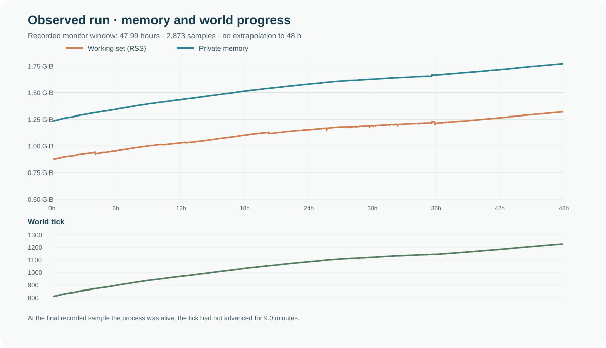

# Portée des résultats et priorités de maturation

Cette note complète le dossier public. Elle explique comment lire ses résultats sans réduire le projet à ses limites ni présenter des essais internes comme des validations universelles. Le moteur, ses recettes, ses configurations et ses journaux bruts restent privés.

## Ce qui constitue l’apport central

Le projet réunit quatre volets qui se renforcent :

1. **Un cadre de description** — états, relations et dynamiques permettent de poser des questions comparables à des domaines différents sans leur imposer les mêmes lois ni les mêmes unités.
2. **Un runtime de monde partagé** — des mécanismes spécialisés peuvent lire ou transformer un état commun au cours d’une exécution ordonnée.
3. **Une boucle d’enquête** — événements avec provenance déclarée, points de contrôle, reprise, comparaison de branches et ablations rendent certains raccords examinables dans des scénarios définis.
4. **Un portefeuille large** — physique, matière, eau, chimie, corps, perception, mémoire, action, relations collectives et outils de création et d’observation sont couverts à des niveaux de maturité différents.

La différenciation recherchée réside dans leur combinaison : composer des domaines hétérogènes dans un même monde, suivre les transferts que le système consigne, puis intervenir sur une branche pour observer si une conséquence ultérieure change. Ce programme est plus large qu’un test unique ou qu’une démonstration de longue durée. La présente note précise la portée actuelle de ses éléments les plus importants.

## Comment interpréter les cinq questions ouvertes

| Question | Ce qui est déjà disponible | Ce que les résultats permettent de dire | Prochaine priorité |
|---|---|---|---|
| **Temps et synchronisation** | Une boucle ordonnée et un inventaire statique de 44 phases et 71 composants : 49 classés par pas de référence, 17 par temps écoulé et 5 mixtes. | Les appels et leurs régimes sont recensés. Cela ne signifie pas que les cadences et unités de tous les domaines sont déjà harmonisées. | Compléter les contrats temporels aux frontières de domaines et comparer les trajectoires sous des partitions temporelles différentes, en commençant par les mécanismes sensibles à `dt` et aux seuils. |
| **Attribution causale** | Provenance d’événements, points de contrôle, relecture déterministe dans des cas qualifiés, comparaisons de branches et ablations dans plusieurs campagnes. | Un lien enregistré aide à retrouver la provenance déclarée. Une comparaison contrôlée peut montrer qu’un mécanisme contribue à un résultat local dans les conditions testées; le journal seul ne démontre pas une causalité complète. | Étendre les interventions appariées aux raccords inter-domaines et conserver leurs observables, témoins et limites avec chaque résultat. |
| **Endurance** | Un relevé de ressources de 47,99 h, 2 873 mesures et 416 ticks nets, accompagné d’un jeu distinct de six instantanés agrégés du monde. | Le processus est resté présent aux échantillons, mais aucun nouveau tick n’a été consigné durant les neuf dernières minutes. La fenêtre s’arrête environ 50 secondes avant 48 h; les instantanés ne décrivent pas la trajectoire complète des habitants. | Mesurer séparément la durée du processus, l’avancement des ticks et les états du monde, avec des horodatages permettant de les aligner. Cette observation est un indicateur d’endurance matériel, pas le résultat intégrateur principal. [Relevé détaillé et graphique](evidence/run-record-01/RUN_RECORD.html) |
| **Reproductibilité** | Des milliers de contrôles ciblés et de nombreuses campagnes; certains essais de reprise et de rejeu sont déterministes sous des conditions explicites. Les lots qui se recouvrent restent distincts. | Il existe une base conséquente de vérifications internes. Les comptes ne forment pas un total additif, et ils ne valent pas réplication indépendante ni validation par un tiers. | Garder les protocoles, comparateurs, versions et critères liés à chaque campagne; étendre les répétitions indépendantes là où le résultat en dépend. |
| **Généralisation** | Des mécanismes couplés et des résultats observés dans un éventail de domaines et de scénarios, avec des échecs et des résultats mixtes conservés. | Les résultats décrivent les conditions effectivement essayées; ils ne promettent pas qu’un modèle arbitraire s’intègre ou qu’un effet se transfère à tout monde. | Élargir progressivement les scénarios et les conditions de transfert, sans confondre l’extensibilité de l’architecture avec une compatibilité automatique universelle. |

La mesure d’endurance est consultable dans son contexte, avec les séries filtrées et le relevé détaillé : [rapport public](evidence/run-record-01/RUN_RECORD.html), [données du moniteur](evidence/run-record-01/resource-monitor-public.csv), [instantanés du monde](evidence/run-record-01/observed-world-output-public.csv).

## Ordre de travail

Les priorités ne sont pas équivalentes. Les deux premières renforcent directement la proposition technique centrale :

1. **Contrat temporel des raccords** — expliciter et qualifier ce qu’un mécanisme lit et écrit, à quelle cadence, avec quelles unités et quels effets de subdivision.
2. **Causalité par intervention** — relier provenance, témoin, intervention et conséquence mesurée dans les scénarios intégrés les plus représentatifs.
3. **Progression en longue durée** — distinguer processus actif, monde qui avance et trajectoire des entités; aligner les journaux avant d’annoncer une endurance de monde.
4. **Répétitions et reproductibilité** — renforcer les comparaisons appariées et les reprises sous les conditions qui comptent pour chaque résultat.
5. **Transfert et généralisation** — élargir les domaines et les mondes à mesure que les contrats temporels et causaux sont mieux établis.

La mesure de 47,99 h mérite d’être conservée parce qu’elle renseigne sur la tenue du processus et l’usage mémoire. Elle ne doit ni être effacée ni prendre la place des résultats de composition, des campagnes par domaine et des comparaisons interventionnelles. De même, l’absence de validation externe borne la nature des affirmations actuelles; elle n’annule pas les essais internes, les outils de reprise ni les capacités observées.

## Formulation publique recommandée

Le dossier décrit un runtime expérimental multi-domaines et une boucle d’observation et d’intervention déjà exercée dans des scénarios définis. Ses résultats internes couvrent des campagnes intégrées, des calibrations de domaine, des tests ciblés et des trajectoires longues, avec des issues favorables, mixtes et négatives. Les contrats temporels ne sont pas encore harmonisés partout, la causalité doit être étayée par des interventions propres à chaque question, l’endurance de 47,99 h n’établit pas 48 h de progression continue, et les résultats ne valent pas validation indépendante ni généralisation à tout modèle.

Cette formulation montre l’étendue du travail tout en gardant chaque affirmation à la mesure de ses observations. Aucun détail d’implémentation propriétaire n’est requis pour cette distinction.

