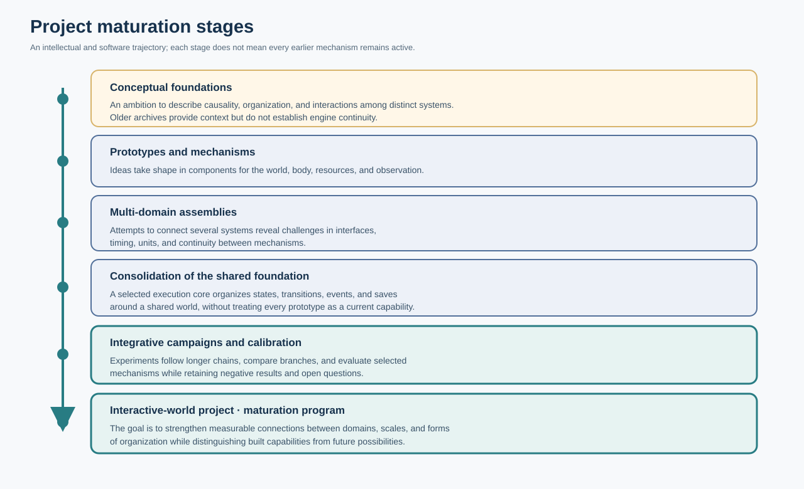
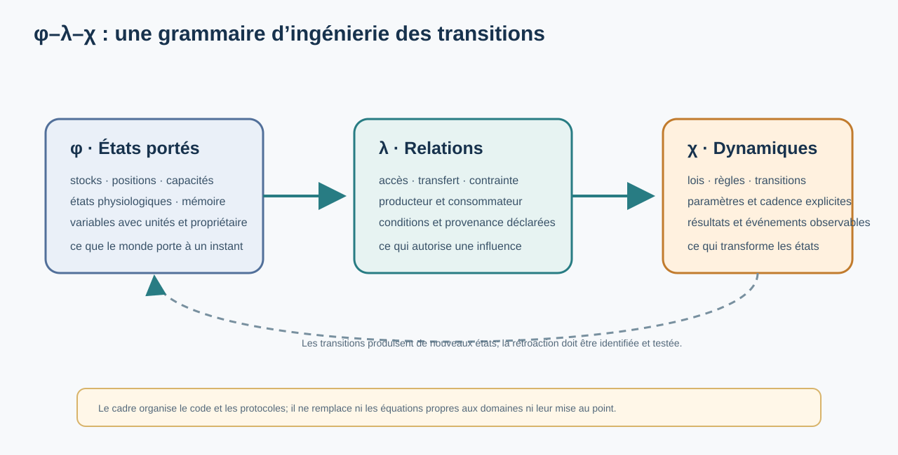
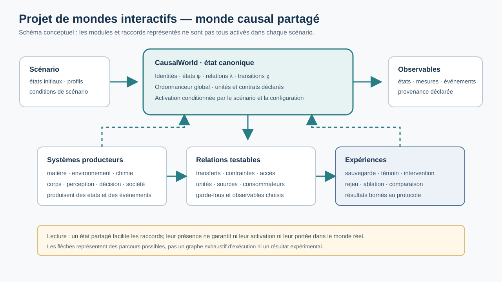
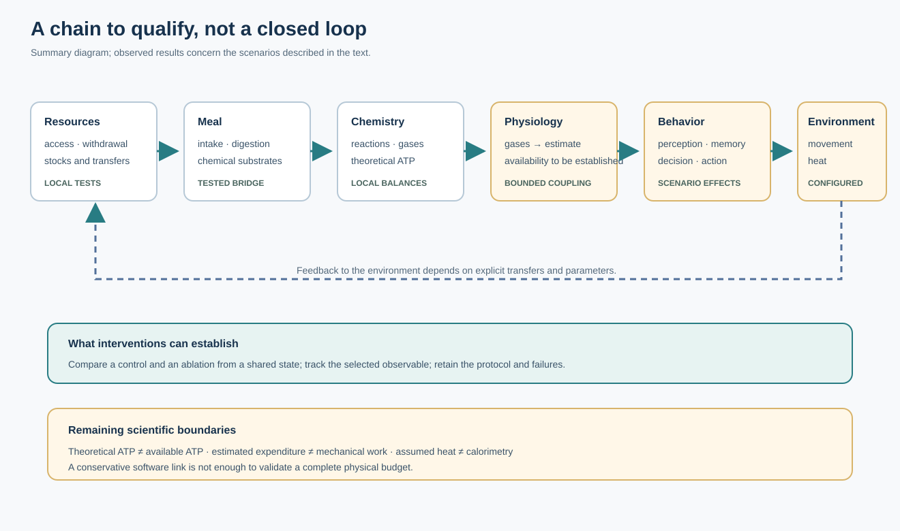
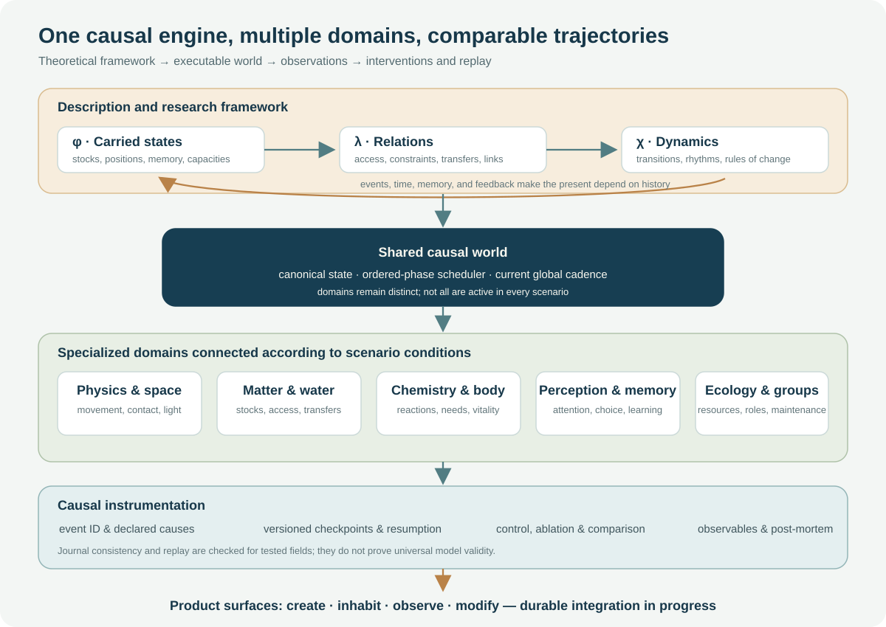

# Causal Worlds Engine — public technical dossier

## States–relations–dynamics framework, experimental runtime, domains, and product

**Public technical report · Edition 1.1 · 24 November 2026**

**Author and project creator: Gaaboy**

The engine and its implementation recipes remain private. This dossier presents the general architecture, high-level results, and observed limitations.

**Proprietary status and scope.** The engine and its implementation recipes remain private. This dossier describes only the general architecture, product functions, and high-level results. It includes no source code, run seeds, configuration, internal commands, traces, or raw data.

> **In 30 seconds** — This project is more than an interactive setting: it is a theoretical program, a multi-domain causal-experiment engine, and a set of product interfaces. It explores how states, relations, dynamics, budgets, and shared history can connect matter, environment, bodies, memory, action, and organization. The engine and its recipes remain private; this dossier describes capabilities built, measured results, retained failures, and ambitions that have not yet been achieved.

> **Proposal.** The system builds an environment of worlds in which one can follow how a state becomes a constraint, how a relation enables a transfer, and how a transition in turn changes the system’s possibilities. Its central question is not only what an agent or mechanism can do, but what changes when domains act in the same world.

## Executive summary

The project has four aspects that must be read together. **The theory** formulates a shared framework for describing what a system carries, the relations that let it act, and the dynamics that transform its state over time. **The engine** makes causal worlds executable, inspectable, saveable, and comparable by branch. **The domain portfolio** connects specialized mechanisms for physics, matter, water, ecology, chemistry, physiology, perception, memory, locomotion, and social organization. **The product** makes these worlds creatable, inhabitable, and observable through editing, embodiment, and exploration tools.

The intended contribution is an experimental runtime in which specialized mechanisms can act in a shared world while retaining their local rules and measures. The observable contribution is a loop that links cross-domain interaction to recorded events, then allows a situation to be resumed, branches compared, and the effect of adding or removing a mechanism on later consequences to be tested. The shared grammar organizes this composition; this dossier does not disclose detailed contracts or implementation recipes.

The program’s value comes from this coupling: mechanisms in one domain can transform the conditions of another, their consequences are recorded in an inspectable history, and resumed comparisons can assess an interaction’s contribution. The campaigns described here provide measured examples of this loop. The integrations qualified so far cover the domains and scenarios in this dossier; automatic integration of arbitrary external models remains to be established.

The canonical foundation has a shared world state, a deterministic scheduler with ordered phases, events carrying identifiers and declared causes, versioned checkpoints, resume support, and campaign tools. Checkpoints make it possible to start from a shared state, compare a control with an intervention, then check the fields, event order, and observables actually covered by the test. The current cadence remains global: mechanisms do not all yet have multi-rate contracts, and subdividing a tick is not equivalent by default.

The theory is broader than the active software. Its historical catalogue contains **11 F-formulations**, **5 cascade questions**, and a map of **23 scales**, from the microscopic to the cosmological. This catalogue is a research program and a record of hypotheses; it does not mean all these laws are implemented or that the engine simulates all these scales. Synthetic experiments have examined hysteresis by comparing the effects of thresholds, role memory, and relations; those figures do not come from observed societies.

The results portfolio extends beyond the three examples on the home page. It includes exact replays in bounded scenarios, ablations, memory–decision–navigation–irrigation loops reproduced across several initializations, a 720-tick collective-maintenance campaign, longer trajectories that fail, physiology and chemistry tests, locomotion and optics calibrations, ecological checks, sensory pathways, and product qualifications. Positive and negative results are presented by domain, with their conditions and limitations.

The archive volume must also be described accurately. A general inventory detected **1,635 test cases**, but its run did not produce a final report; targeted batches have separate results. A November documentary audit lists **84 campaign reports** and **53 calibration artifacts**, with overlap, historical material, and domains of differing scope. These counts indicate the scale of documented work; they are neither a total of independent replications nor an overall green verdict. The model registry and verification manifest count different things, so their counts are not added together.

The product vision—world editor, habitat, embodied residents, observation interface, conversation, and chosen memory—is a real layer of the project, but not its only subject. Several user flows have targeted tests; the integrated, durable, complete experience is still being built. The terms “memory,” “learning,” “organism,” “society,” and “life” refer to bounded software mechanisms and do not constitute evidence of human cognition, autonomous life, or external scientific validity.

**Keywords:** causal worlds, multi-domain simulation, states–relations–dynamics, interactions, bioenergetics, experimentation, traceability.

## 1. Origin and evolution of the project

The project’s history is that of a question gradually becoming an architecture: how can heterogeneous mechanisms be connected without erasing their differences, and how can their interactions become an object of experimentation? The archives record trials, theoretical formulations, prototypes, and assemblies. They do not describe a linear migration of one engine; the strongest continuity is the ambition to integrate.

*Figure 1 — Summary timeline. Milestones before the canonical core are documented unevenly, and their software lineage remains provisional.*

| Maturation stage | What was built | What this stage contributed |
|---|---|---|
| Conceptual foundations | Ideas about causality, organization, and forms of interaction between systems. | A central question: how can states, relations, and dynamics be described together without reducing domains to a single law? |
| Prototypes and mechanisms | Explorations of the world, body, memory, resources, and observation. | A testbed for turning ideas into components and discovering integration challenges. |
| Multi-domain assemblies | Attempts to connect systems, tools, and representations in broader experiments. | The discovery that placing modules side by side is not enough: their states, times, units, and interfaces must actually connect. |
| Consolidation of a shared foundation | Selection of an execution core, transitions, events, and saves around a shared world state. | A clearer boundary between active mechanisms, historical prototypes, and ambitions still to be built. |
| Demonstrations and tests | Scenarios connect several domains, compare trajectories, and track observed results. | A development method that helps show what works and what needs to change. |

This trajectory matters because it reveals a change in method. The system no longer aims only to gather ideas under one name; it distinguishes historical mechanisms from those actually carried, invoked, tested, and documented in the current foundation. The archives show intellectual continuity and integration attempts; they do not show that every earlier system was preserved. This distinction makes it possible to describe the project’s evolution without confusing vision, prototype, and present capability.

## 2. The theoretical proposal: connect without conflating

### 2.1 A question that spans scales

The system starts from a question about organization: how do distinct elements, linked and subject to dynamics, form a whole that can persist, act, and retain the effects of its history? This question applies to very different systems—a chemical compartment, an organism, a household, or a collective—without assuming they are made of the same things. The theoretical thread is therefore not uniformity of objects, but the possibility of describing what they carry, what connects them, and what transforms them.

### 2.2 A grammar for describing mechanisms

States–relations–dynamics condenses this proposal into three questions that must remain linked:

| Concept | Design question | Examples of its role in this system |
|---|---|---|
| **φ — carried state** | What varies, and where is that state carried? | A material stock, bodily state, position, memory, reserve, or capacity—each with its own definition and unit. |
| **λ — operative relation** | Through what channel can one state influence another? | Resource access, a directed link, contact, membership, a constraint, or a dependency between producer and consumer. |
| **χ — dynamics** | What rule transforms the state, under which conditions and at what cadence? | A reaction, physiological update, behavioral transition, or change in a relation. |

Comparison across domains concerns the structure of their descriptions, not the identity of their laws. An organism’s “reserve” is not a field’s energy; a social relation does not automatically follow the rule for a mechanical link; a computational step is not a second. This distinction lets the system seek a shared organization while leaving each mechanism its own quantities, parameters, and scope criteria.

The framework adds a requirement to account for history: the present state may depend on depleted stocks, remembered traces, modified relations, or inherited constraints. Memory is not a mysterious force from the past; it acts when a persistent trace is read by a current transition. Changes across scales must likewise be specified: what interactions aggregate, how an organization constrains its units, and how local actions transform it in return. The system therefore formulates five cascade questions: aggregation of interactions; effective closure of a loop; influence of the collective on local trajectories; feedback from local actions to the collective; and continuity of supports and costs during a change of scale. These questions organize the theory and design contracts; they are not five properties already achieved by every simulation.

### 2.3 From a framework to a testable question

A grammar is useful only if it helps identify mechanisms and measurements. For each link, the system asks: which state is read, which mechanism writes, which relation permits the transfer, which units and cadence apply, which event preserves its provenance, and which observation changes when an intervention is made?

This perspective distinguishes four situations that are often conflated:

| Situation | What it establishes |
|---|---|
| A component exists | The corresponding code or contract is present. |
| A component is activated | The scenario configures its inputs and reaches that execution path. |
| A local effect is tested | A specific assertion holds in a declared context. |
| A chain is supported | Its steps and transfers are observed, and an intervention tests their dependence. |

A mechanism may be present without participating in a scenario, or may produce a local effect without driving the entire chain. Comparisons with references provide additional benchmarks. The system keeps these distinctions visible to explain what was actually observed.

## 3. A unified architecture: states, relations, transitions

### 3.1 States–relations–dynamics as an engineering framework

In the framework used by the system, **φ** denotes what an element of the world carries at a given moment; **λ** denotes the relations, constraints, and pathways through which elements can influence one another; **χ** denotes the dynamics that transform states as the world evolves. The theory thus draws attention to three linked questions: what exists in the world, what connects those elements, and through which mechanisms do those links produce changes?

*Figure 2 — Conceptual diagram, not a visualization of measured data.*

This notation organizes questions to ask of a model; it does not replace the laws of each domain. A material stock, a temperature, a physiological reserve, a memory, and a social relation are all states of the world, but they do not share a unit or meaning. The system seeks a common way to locate them without conflating them. Likewise, a relation becomes a real interaction only when a mechanism reads it, acts on it, and produces an observable consequence. A dynamic is therefore understood by what it receives, what it transforms, and what it makes possible next.

The theoretical proposal draws strength from this articulation: state alone does not explain action; a relation without a mechanism remains an abstract possibility; a dynamic loses meaning if its conditions and horizon are ignored. The system treats states–relations–dynamics as a design and inquiry grammar, not as a universal law already confirmed. It helps ask where a quantity resides, who can act on it, what transformations are expected, and which observations could show that a connection works.

In the software, this grammar is an architectural orientation rather than a uniform implementation of every term in every mechanism. Representations and updates differ between systems; some connections are computed or projected, while others remain specific to a domain or scenario. The framework’s technical value is therefore measured by the relations actually implemented and the observable contrasts they make possible—not by the mere presence of the symbols φ, λ, and χ.

### 3.2 The shared world and its scheduler

An interactive world does not spontaneously appear from nothing. It is prepared as an experiment: one chooses entity and environment types, initial states, active mechanisms, and the rules connecting them. A scenario is more than a backdrop; it defines what exists, which resources can be encountered, which actors can act, and which observations will be meaningful. Other scenarios can then reuse the same mechanism families in a different context.

As the world advances, its scheduler calls systems in a defined order. Order matters: a mechanism may read a state produced by an earlier phase but may not see a change that has not yet occurred. Thus, access to a resource, its processing by an organism, and the effect of that processing on a decision are not isolated operations; their sequence depends on how the scenario moves information and resources. The scheduler makes this evolution executable and inspectable, but software ordering alone does not show that all physical or biological timescales are correctly synchronized.

The foundation brings together mechanisms that can act on the same world while retaining their own calculations and rhythms. These include light, contacts, movement, water, material transformations, the body, memory, decisions, and collective relations. Each scene activates only part of this functionality; the results presented here come from paths that were actually tested.

Changes can be recorded as events: a resource is taken, a state changes, an action is attempted, or a relation is modified. Events may identify an actor, source, quantity, or declared cause. They provide an inspectable history of the world, but that history is not an exhaustive transcription of every internal calculation. Contracts and invariants check defined properties—for example, journal consistency or local conservation of a transfer—without automatically certifying that the model faithfully represents nature.

*Figure 3 — Conceptual architectural summary; arrows do not mean that every connection is active in every scenario.*

### 3.3 Domain contracts and the temporal contract

The shared loop is now bounded by execution contracts. For the 71 components inventoried across 44 phases, these contracts identify the state families that may be read or changed, the entity fields involved, the events consumed or produced, and, when necessary, the permitted recording operations. Runtime views restrict these accesses. System capabilities remain responsible for operations that must preserve the clock, causal-journal ordering, and registry integrity. Static checking finds a declared access boundary for every component and no direct access in this inventory. It checks coverage of declarations, not the dynamic behavior of every connection.

Time is also part of the contract. In the current inventory, 49 components are classified as reference-step updates, 17 as elapsed-time updates, and 5 as mixed; none is classified as exclusively event-driven. Global-step propagation is inventoried separately: 32 components do not receive it, 38 do, and 1 receives external elapsed-time forcing. Thus, among the 49 reference-step components, 32 do not directly accept the global step, 16 receive it, and 1 depends on external forcing. **Not receiving `dt` does not mean having no clock**, and receiving `dt` does not prove that every internal operation uses it. The 32 components without direct `dt` are divided into 12 observation, sampling, or tick-control operations; 2 external-support policies; 6 projections, decisions, or inactive outputs; 10 operations triggered by state, event, clock, or cursor; and 2 operations without direct `dt`: a lagged anatomy projection and a discrete fabrication step. Three of the five mechanisms initially examined now receive time scaling under uncalibrated rate assumptions; one retains discrete threshold-based division. These categories describe execution conventions, not their physical accuracy. The scheduler preserves a shared order but does not impose an identical cadence on every domain. Domains can therefore pass effects through the same history without necessarily observing the same logical instant.

These contracts make connections easier to inspect and control; they do not, by themselves, solve physical synchronization. A temporal declaration does not automatically calibrate a mechanism, convert incompatible units, or remove historical dynamics that depend on the number of calls. Such cases remain to be qualified, particularly feedback across scales.

### 3.4 Saves, interventions, and replay

An state save preserves a starting point from which an experiment can be resumed under controlled conditions. Branches can share an initial history and then diverge because a mechanism, relation, or condition is changed. Replay comparisons are interpretable under the conditions actually preserved—engine version, state, inputs, randomness, and execution order—and do not guarantee equivalence across versions or identical repetition of every external module. If a difference appears later, it is evidence about the contribution of the change; it shows only what the test scenario isolated.

This organization enables several forms of inquiry: checking that a mechanism meets a local contract; observing whether a connection between two domains actually transmits an effect; comparing control and perturbed branches; and tracking whether a local effect persists as it passes through an organism or collective. Resuming a state can support comparison, but does not guarantee cross-version scope or equivalence to a real phenomenon. The system thus distinguishes coherent execution of an experiment from the technical scope of its interpretation.

## 4. The world as a causal chain across domains

The system is neither a catalogue of modules nor a list of agents. Its central object is the testable connection between what systems produce and what other systems consume. An integrative chain runs from resources and access to material transformations, physiology, choices, and actions, then to environmental changes that feed back into future possibilities.

*Figure 4 — Conceptual summary diagram; maturity labels are limited to the test scenarios cited in the text.*

The diagram’s value lies in the trajectories it helps formulate. Consider an organism dependent on a resource in its environment. The environment defines access conditions; a harvesting mechanism changes stocks; the intake may then enter a digestion and processing chain. Products and internal reserves constrain bodily capacities. These capacities in turn influence attention, choices, and possible actions. An action may modify the environment or its stocks, changing the conditions for the next decision. Causality is thus built as a loop, not as an isolated variable called “energy,” “need,” or “intelligence.”

A second trajectory links experience to anticipation. A change in the world is perceived or recorded; a trace may remain available after the immediate situation has disappeared; that trace may influence a future intention. A decision is not yet an action: it must still pass through bodily capacities and environmental constraints. An attempted action may fail, have only a partial effect, or change another entity’s situation. Each transition therefore adds an experimental question: is the expected effect transmitted, under what conditions, and what happens when it meets other mechanisms?

A third trajectory appears at the collective scale. Individuals access resources, share or transform stocks, coordinate actions, and maintain relations. Local regularities may contribute to an organization, but their presence does not guarantee its stability. The campaigns show this gap directly: a local connection among memory, water access, and intention produced a contrast in a targeted scenario, while a prolonged subsistence experiment did not maintain the collective. The negative result does not contradict the local result; it shows that continuity at group scale depends on other loops that remain open.

These chains give the shared foundation a concrete scope. An event can be followed by a physiological state, then a decision and an environmental change; saves make it possible to compare histories from a common starting point; interventions help examine a link’s contribution. An integrated campaign allowed several mechanism families to coexist and produced tens of thousands of inspectable events, with an identical resumed replay reported within the examined scope. This coexistence is an important achievement, but it does not mean that every arrow in the diagram was isolated or confirmed.

## 5. Domains that make up the system

The system brings together mechanism families rather than a single model. They differ in the quantities they carry, the transformations they apply, and the kinds of consequences they make accessible. The list below describes their roles and intended connections; it does not mean every system is active in every world.

#### The world, its states, and its evolution

The shared world provides the setting in which entities, environments, and relations take place. It preserves scenario state, organizes the order in which mechanisms evolve, and makes changes inspectable over time. The scheduler acts as software conductor: it determines which mechanism families are called and in what order they may read or transform state. This orchestration time is initially simulation time; it does not automatically become a physical or biological second.

This organization provides continuity within a scenario. A mechanism need not reconstruct the entire world to act; it receives the states and information made available by its software environment. That convenience makes interfaces important. A called phase may produce nothing if its conditions are unmet; a later phase may not consume an expected output if the connection is not configured. The causal account must therefore follow what was actually transmitted, not merely which modules are present.

#### Matter, resources, water, and environment

Matter and resource mechanisms describe stocks, their availability, and the transfers that move them between compartments or actors. They represent that a quantity can exist in a place without being accessible, that a withdrawal reduces a stock, and that a transformation or production can change its form. The distinction among presence, access, and use is fundamental: a resource present in the world does not automatically help an organism unless a mechanism makes it reachable or assimilable.

Water and ecology add stocks, transfers, and interactions between resources and organisms. Tests across contexts have produced varied results; each result remains tied to the situations examined. These domains connect environment and behavior without claiming to represent a complete natural cycle.

Physical and environmental mechanisms add other conditions to the world: mechanical interactions, contacts, radiation, heat, or fields, depending on configured systems. They make it possible to create a scene where actions do not occur in an abstract space without constraints. Available models are selective and operate at different scales; they are neither a universal physical resolution nor a complete closure of all transfers in a realistic environment.

#### Chemistry, organism, and capacity for action

Chemistry represents material transformations and their effects on bodily states. In defined scenarios, these mechanisms connect to digestion and certain capacities for action. Their outputs remain simulation quantities; they are not human nutritional or physiological measurements.

The body brings together states, needs, and limits that influence decisions and movement. Several mechanisms connect matter, digestion, capacities, and estimated expenditure. This continuity remains partial: internal indicators do not yet form a complete balance for a real organism.

This separation leads to a central maturity principle: a local law may be coherent and tested without confirming the organism as a whole. A conservation contract indicates that a transfer satisfies the balance coded within its boundaries; a thermochemical reference supports a value for a substance under stated conditions; an expenditure estimate depends on its inputs and assumptions. Moving between these levels requires explicit connections and compatible measurements.

#### Perception, memory, decisions, and action

Perceptual systems select information from the world and make it relevant to an actor. Attention does not mean that everything that exists is perceived: a mechanism transforms available signals into usable elements. Memory can preserve selected experiences or events beyond their immediate presence; that persistence may later contribute to an intention or decision.

Planning, decision, and action are distinct stages. An intention represents a direction or choice; it does not guarantee that the body can carry it out, that the resource is still accessible, or that the environment will respond as expected. Motor mechanisms and spatial constraints connect decision to transformation of the world. Feedback from that action can in turn feed perception and memory. This loop makes it possible to study behavior as a situated trajectory rather than as a label attached to an agent.

Targeted experiments showed that a remembered trace could contribute to a change of intention in a particular scenario. This result concerns an internal mechanism and a defined contrast; it is neither a general theory of memory nor a result about general autonomy or human cognition. Outputs from these systems can be observed and compared, but their interpretation must remain tied to the tasks and mechanisms actually tested.

#### Relations, organization, and collective life

Across multiple actors, interactions become resources, constraints, and mutual dependencies. Relation and organization mechanisms can represent ties, routines, forms of coordination, and collective change. A relation can influence access or decisions; collective action can modify a shared stock; the availability of that stock can then change relations and choices.

The transition from individual behavior to group persistence depends on several coupled mechanisms. Short tests qualify local loops; the prolonged campaign measures how needs, movement, stocks, and member availability alter the collective’s trajectory. These observations guide work on resource budgets, meal access, and feedback between individuals and organization.

#### Observation, interfaces, and experimental tools

The tools help prepare a scenario, track states, inspect events, save a starting point, and compare trajectories. They show what changed and which declared causes accompany that change. Seeing a state is not enough to confirm the mechanism; a successful interface alone does not guarantee that the simulated world is accurate.

Product surfaces—world editors, observatories, interactive spaces, and creation tools—are advancing at different rates. Some combine scripted inhabitants, perceptual inputs, and specialized dialogue; they are not presented as general intelligence. A visual demonstration shows a user path, while tests indicate what the mechanisms actually do.

### 5.1 What a shared causal foundation means

The project’s shared foundation does not impose one equation on matter, life, and organizations. It provides an execution framework in which a scenario selects mechanisms, gives them an initial state, and coordinates their transitions around an inspectable world. Domains retain their own variables, units, parameters, and resolutions; they meet at interfaces where a state is read, a transfer is authorized, and a result is made observable.

An experiment starts with a question and a world configured to make it observable. Systems evolve over shared state; the experimenter follows declared changes, preserves a reference state, and compares a control trajectory with a variant in which a condition or relation has been changed. The journal and saves help examine the difference and recover causes reported by mechanisms. They guarantee neither a complete causal history nor the scope of the model, but they make integration assumptions more directly inspectable.

| Foundation property | What it makes possible | What it does not establish on its own |
|---|---|---|
| Shared world state | Several domains can act within one scenario history. | That all mechanisms are configured together or share units and timescales. |
| Explicit phases and ordering | Determine when mechanisms read and modify state. | Physical multi-rate synchronization or equivalence under temporal subdivision. |
| Events and declared provenance | Inspect transfers and recover recorded causes. | Recording every computational dependency or complete causality from journal order alone. |
| Saves and resumes | Compare branches from a shared state and examine continuity after resumption. | Universal compatibility across versions or external scope of a trajectory. |
| Contracts and targeted campaigns | Qualify a mechanism, interface, or effect on a given observable. | Verification of every domain or an overall verdict on the whole software system. |

### 5.2 Scope: composable mechanisms, distinct worlds

This foundation broadens the unit of construction beyond a single agent or isolated phenomenon. It supports experiments in which matter and environment constrain an organism; body and memory contribute to decisions; actions modify stocks or collective relations; and those changes create new conditions for later actions. Assemblies like these become comparable research objects rather than a juxtaposition of demonstrations without shared state or history.

The same architecture can host multiple worlds without merging their histories. A household, territorial environment, or shared space can reuse some functions while retaining distinct states and trajectories. Contexts or branches can be compared to understand what changes when a relation or function is modified. This separation helps prevent histories or memories from different worlds being conflated.

Beyond campaigns already completed, this architecture opens a construction space: experimental worlds connecting several domains, tests of dependencies across scales, comparative scenarios, and trajectory tests with resumption and intervention. It can also support new model families or questions, provided they are brought within the canonical boundary, their interfaces specified, and their behavior qualified. These are possibilities afforded by an architecture and research program—not a claim that all such worlds or paths already exist as complete products.

The ambition is therefore broader than one integrative experiment: to make the shared causal world a reusable infrastructure for constructing different specialized questions. The expected gain is not universal answers, but the ability to bring mechanisms previously studied separately into one test scenario, test their connections, and identify exactly where continuity breaks. This scope will depend on more complete contracts for units, time, flows, and scale changes, and on campaigns that measure those connections across varied domains.

Mechanisms, components, and scenes do not all play the same role. An inventory of functions does not mean they are active together. Results and settings remain tied to the domain in which they were examined and do not automatically apply to every simulated world.

## 6. Technical reference points and known limitations

The system brings together specialized domains: matter and mechanics, water and environment, chemistry, physiology, locomotion, light, and perception. Each domain relies on its own units and references. The system avoids reducing these measures to a single gauge and compares selected outputs with references suited to the mechanism concerned.

| Domain | What current work examines | Known limitation |
|---|---|---|
| Physics and materials | Local properties, contacts, and transfers in targeted scenarios | No complete physical world qualified end to end |
| Water and environment | Stocks, transfers between reservoirs, and scenario behavior | Cross-context transfer and global flow closure remain in progress |
| Body and movement | Bodily states, poses, and selected joint trajectories | No complete human biomechanical model |
| Chemistry and physiology | Reactions, digestion, and flow estimates | No complete energy balance for a real organism |
| Light and perception | Signal pathways and targeted visual or auditory behavior | No general, unconstrained perception |

These internal checks guide development and help clarify progress. Detailed references and data are not reproduced in this dossier; they are not required to understand the product vision and high-level results.

## 7. Demonstrations and observed results

Internal tests cover several scales: a specific mechanism property, a connection between two domains, a scene where several systems coexist, and longer trajectories. Targeted tests have passed across several families; longer campaigns show how needs, movement, and resources change what happens next.

Examples include a remembered experience influencing a later action in a garden, an organization changing resource allocation, saves allowing certain histories to be resumed, and dedicated tests of movement trajectories, perceptual signals, and material models. Detailed figures and scopes are grouped in “Internal demonstrations and tests.”

These trials describe the progress of the mechanisms concerned. They do not mean that every domain is assembled into a complete product or that simulated behavior reproduces the full complexity of the real world.

## 8. Inhabiting, shaping, and understanding a world

The simulation engine is part of the project, but not the whole experience. The system also seeks to give the world an inhabited form: spaces with rooms and passages, objects with functions, residents situated in those spaces, and tools that let a person change the world and observe the consequences.

Three things must be distinguished. The model describes what can happen; the configured world selects the mechanisms and objects actually present; the interface makes some actions understandable and accessible to a person. A visible door matters only if it actually constrains passage. An object presented as functional must participate through a defined mechanism. A decorated room and a simulated habitat can look alike while having very different causal capabilities.

### 8.1 Habitat as an environment for action

The home is a concrete example of an inhabited world. Rooms are not merely visual backgrounds: their layout can organize circulation, doors and passage clearance can constrain movement, and some objects can contribute to routines or resource access. Water, domestic use, light, and the day cycle create links between habitat, residents’ needs, and the immediate environment.

This domestic scene supports richer questions than abstract navigation: where can a person go, what can they reach, how do available objects change a routine, and which environmental changes influence later actions? Water reuse or the light cycle becomes interesting when linked to uses and consequences, not merely displayed as set dressing.

The boundary remains that of a scenario habitat. A home that functions in some respects is neither a complete building simulation nor an exhaustive model of a territorial environment. Objects, circulation, resources, and cycles are limited by the configured mechanisms. The maturity goal is to reduce the gap between what the interface suggests and what the world can actually do.

### 8.2 The embodied resident and the idea of a double

The project’s resident is designed as connected capabilities: perception of a situation, bodily states, memory of selected experiences, formation of an intention, decision, action, and feedback from consequences. This decomposition helps explain behavior without assigning the agent an undifferentiated intelligence. It may lack information, fail to remember an event, choose an action its body cannot carry out, or encounter an obstacle.

Around this architecture is the idea of a double associated with a personal space. A person might encounter an embodied resident there, engage in an exchange, and choose which narrated or retained experiences have a place in its history. This gives the project a human dimension: memory is not only a laboratory variable, but also a question of continuity, selection, and control by the person concerned.

This vision should not be presented as a complete biographical companion already built. Memory, dialogue, identity, presence in a space, and embodied behavior have distinct histories and maturity levels. Combining them into a unified, reliable experience that respects privacy remains a product ambition. A scripted resident or specialized dialogue does not show general understanding of a person or a faithful recreation of their life.

### 8.3 Create a scene, then let it act

The world editor represents another aspect of the project: composing a scene, placing or modifying functional objects, defining initial conditions, then saving and evolving the world. This changes the user’s role. They are no longer only a spectator of a predefined simulation; they can author a question by deciding what exists, which relations are established, and which consequences to observe.

A world editor must distinguish representation from causal authority. Adding an object to a scene does not give it a function. Changing an initial condition is useful only if the mechanisms actually use it. The intended experience follows an understandable cycle: build, save, run, observe, and compare what changes. Documented creation and placement capabilities are bounded; they do not mean every catalogue item is usable or that the editor is already universal.

### 8.4 Observation interface: making a world’s history legible

The observation interface and related surfaces address another question: how can a simulation be understood when effects are distributed across many systems? The project exposes state, entities, events, relations, and—when the user path supports it—the declared causal history. The experimenter can move from a visual impression to an inquiry: what changed, which event is associated with it, which actor is involved, and which other trajectory can serve as a comparison?

A workspace can support “what if?” trials: start from a shared state, change a condition, and compare the two histories. Displayed events do not necessarily describe every internal calculation; the observation interface helps explain the world without explaining every detail.

This distinction also separates project layers. The engine evolves state; mechanisms express possible transformations; tools prepare scenarios and inspect history; interfaces make parts of that path accessible. A successful visualization does not validate the displayed law, while a locally tested mechanism does not guarantee that the whole interface is stable.

### 8.5 Several worlds, several histories

The project does not assume that all residents and experiences share one identity or memory. It explores distinct spaces and worlds: a personal room, a replayed historical life, a shared world, a place to revisit events, or a future immersive space. Each instance should preserve its own history; identity, memory, and permissions should not be merged merely because several worlds use the same software foundation.

This separation is both technical and human. It enables comparison between worlds without conflating trajectories, but requires decisions about who can create, view, share, or modify a history. Private memory, collective sharing, and personal continuity are core product concerns, not just presentation details. They remain design requirements to demonstrate, not privacy guarantees derived solely from separating scenarios.

The product roadmap imagines a progression from the space and double toward richer histories, shared uses, memory exploration, and eventually more immersive environments. This is a direction, not a delivery promise or inventory of available functions. Privacy, identity separation, reliability, and performance priorities accompany the vision; roadmap items become capabilities only when built and qualified.

### 8.6 Varied technical domains

Domestic needs and the garden are only one way to explore the foundation. The system also includes movement, contact, matter, light, heat, water, chemistry, and ecology mechanisms. These domains enrich worlds and enable varied situations, each with its own rules and limits.

These mechanisms are not all active together. Some are foundations of the shared world; others are activated in specialized scenarios. Water-transfer tests, illustrative ecological networks, and joint trajectories each have bounded scope and do not by themselves represent a complete environment.

The system aims to let distinct domains meet in one history without erasing their rules. This composition connects habitat, matter, body, action, and organization while retaining each domain’s measures and limits.

### 8.7 Cooperation and collective organization

At the social scale, the system explores how complementary capabilities and learned relations may change later choices, or how an organization may redistribute a shared resource. These mechanisms shift the question from the isolated agent to coordination: who can help whom, what dependencies form, how a collective decision changes individual possibilities, and how individuals’ actions reshape the group?

These experiments are valuable because they treat relations as elements that can have consequences, not mere labels. They remain tied to specific tasks and worlds. Simulated cooperation does not validate a general theory of trust; a collective allocation that works in one scenario shows neither sociological stability nor human autonomy. The documented failure of long-term persistence reminds us that organization and resources can unravel even when sub-loops work.

### 8.8 A shared foundation and a product experience

The system links two ambitions: improve mechanisms and their connections, then make worlds inhabitable, composable, and observable. The first asks whether expected effects appear in tests; the second asks whether a person can reliably understand, shape, and navigate the world.

The system is a maturing foundation for worlds, varied simulation domains, and a product experience connecting people, residents, and places. Current functions form the foundations; the roadmap describes broader paths to bring together.

## 9. Project contribution and positioning

The system is defined by its object: designing a foundation where mechanisms from several domains can act on a shared world while retaining their own quantities and laws. The states–relations–dynamics grammar shapes design questions; the software workbench makes them actionable through states, relations, transitions, events, saves, and interventions.

This ambition goes beyond one model. The foundation can host different questions because each world selects its entities, mechanisms, and relations. One scenario may focus on a physiological chain; another may study memory’s effect in an environmental interaction; a third may examine collective stability. What remains shared is not the technical content of their laws, but the ability to place them in a world history and inspect their connections.

The system provides a reusable foundation for composing scenarios and connecting domains. It is not a universal simulator; each capability has its own maturity level. Maturity is measured by paths already built, links observed, and points still to improve.

## 10. Known limitations and priorities

The limitations below define the current scope and help select the next test scenarios.

### Time and synchronization

Temporal contracts now inventory the declared regime and time source for core components. The scheduler organizes calls in a shared order, but mechanisms do not yet share universal physical synchronization. Mechanical, physiological, domestic, and ecological phenomena may evolve under different conventions, some still tied to call counts.

Scenario time and space provide reference points for some mechanisms without automatically setting the scale of all others. Contracts make these differences visible; they do not harmonize them. Domains still retain different cadences and units.

### Conservation and units

Local contracts can conserve a transfer or close a balance defined in software. This does not mean all quantities are calibrated in physical units or that all compartments form a global budget. Each chain needs an explicit boundary: what enters, exits, transforms, is stored, and remains unaccounted for.

### Physiology and energy

Chemistry and physiology indicators are model-specific. They do not yet form a complete balance connecting matter, bodily capabilities, movement, and heat.

### Comparison with real situations

Reference comparisons are domain-specific; some data were also consulted during development. Results on movement, anatomy, water, or ecology do not describe the whole engine or every real-world context.

### Cognition and societies

Perception, memory, intention, and relation states are software constructions defined by mechanisms. They show neither consciousness nor general understanding, human learning, or sociological scope. The observed failure of community persistence in a prolonged campaign should guide future diagnosis rather than be hidden behind local successes.

### Test suite and product

Targeted results do not replace a final report on the entire test suite. A physiological inconsistency remains to be reconciled, and several product paths need full qualification. Any stability claim must be tied to an explicit observation scope.

### Operational priorities

- Complete a chain from intake through digestion and reaction to physiology, with synchronized measurements and consistent units.
- Distinguish internal indicators from the experimental measurements against which they are compared.
- Reconcile open physiological discrepancies before expanding thermal connections.
- Understand why residents disappear and collective organization breaks down in prolonged experiments.
- Evaluate empirical domains with independent data and retain negative results in the overall account.
- Strengthen interface integration without conflating a successful user path with model scope.

## 11. Proprietary status and public scope

The engine and its recipes remain private. This dossier presents the general architecture, product functions, demonstrations, and high-level results. It contains no code, exact seed, configuration, internal command, raw trace, execution save, or personal data.

This dossier grants no access to or right to reuse the engine. Third-party names, illustrations, and content remain subject to their respective rights; files selected for a public edition must be reviewed before release.

## Part II — How the world works

### 12. The path from a question to an experimental result

A system experiment starts with a bounded question. For example: does an experience retained by a resident contribute to a later choice? Does an organization change how a resource is allocated? Does an optical model reproduce the trend of an instrumental reference? The question determines which states need to be observed and which variants can distinguish it from a competing explanation.

The world to explore is then prepared. The scenario defines the entities present, their initial conditions, the environments, and the mechanisms available. Initial conditions are set before the run; results are described within that scenario.

During execution, the engine coordinates the operations that advance the scenario. Domains read information available to them and produce changes when their conditions are met. A position, water stock, bodily state, memory trace, and collective relation retain their own units and representations, even when they participate in the same world.

The world engine and application services have distinct roles, even when they share some mechanisms. They are not yet combined in every user path. Domains also retain different rhythms and units; a shared update does not make them identical.

Events can refer to earlier changes. Tools can then track differences between two histories and resume a scene from a save. In some paths, resumption reproduces the same software result; it does not guarantee that the model alone represents all the complexity of the real world.

Finally, the test compares a control scene with a variant, for example one in which a function has been disabled. If the result changes, that indicates that the function contributes in this situation. It does not mean that it acts in the same way in every world.

| Experiment stage | Function | Control question |
|---|---|---|
| Question and observable | Define the effect to measure | What result would truly distinguish the hypothesis from its control? |
| Initial world | Set the scenario and its conditions | Do the compared branches start from the same relevant state? |
| Execution | Let active mechanisms interact | Did the producer actually create an output that a later step consumed? |
| Trace and state | Preserve available events and observables | Which causes are declared, and which dependencies are not observed? |
| Comparison | Measure the control, intervention, or reference | Does the contrast isolate one identifiable contribution? |
| Conclusion | Bound the result | Which populations, durations, scenarios, and quantities remain outside its scope? |

This cycle is an experimental framework, not an automatic guarantee of rigorous method. Relevant measures still need to be selected, selection bias addressed, exclusions documented, suitable controls used, and results repeated by independent teams.

### 13. Major systems and their role in the loop

#### 13.1 World, state, causality, and persistence

The foundation maintains a reference world to which scenarios and tools attach. It organizes entity states, their relations, the transformations authorized by models, and the scenario’s progress through time. This foundation enables interaction between domains without imposing one shared law on matter, living systems, and organizations.

The causal journal links selected transfers, perceptions, and actions to earlier events. It helps recover recorded changes and see which causes the system associates with them. It does not contain every internal calculation or describe the software’s entire history.

Saves preserve world state so that selected histories can be resumed or their continuations compared. Resumption works in the versions and scenarios examined; by itself, it does not guarantee continuity across every product version.

#### 13.2 Space, matter, objects, and resources

Space and matter models describe located objects, identifiable stocks, access relations, and transfers. Harvesting, transport, storage, or fabrication matters causally because it can change what remains available to another actor or later step.

The distinction among “present,” “accessible,” “transferred,” and “consumed” is central. An object in a room may be inaccessible to a resident; food may exist without being prepared, served, or eaten; water in a reservoir may not be connected to the pool used by an organization. States should be treated as equivalent only when an explicit mechanism carries out the transition.

Available conservation balances are local to selected transactions and models. They do not guarantee a complete balance of all matter and energy across the world. Scenario conversions can close a software experiment while remaining proxies that do not directly measure real quantities.

#### 13.3 Computational physics and the environment

Available physics families represent spatial constraints and selected phenomena: movement and contact, articulated mechanics, radiative propagation, heat and diffusion, or simplified electromagnetic fields. They give the world richer conditions than independent lists of states. An action may depend on a collision, contact, geometry, heat exchange, or observation of light.

These models operate at different levels and scales. Some are specialized numerical solvers; others are scenario approximations. Internal qualifications cover specific properties such as stability or comparison with an analytical solution or selected reference. They do not validate general three-dimensional physics, a complete scene expressed in real-world units, or every possible transfer between models.

Light and sensors can provide input to a perceptual system; contact and geometry can constrain an action; temperature can be an environmental state. This availability defines a potential coupling path. Only campaigns in which that path was activated, observed, and compared support calling it a tested connection.

#### 13.4 Water, soil, garden, and ecology

The repository contains water models at several levels: household reserves; transfers through pumping, cisterns, and irrigation; soil moisture; growth conditions; hydrological compartments; and aggregated ecological networks. These tools make it possible to study how resource availability becomes action and how an action changes later possibilities.

The models do not automatically form one complete hydrological cycle. A flow from a hydrology benchmark is not necessarily connected to a household reservoir; soil water does not automatically supply a collective; prescribed weather inputs are not weather generated by the world. Campaigns therefore distinguish a local intervention effect from closing budgets across all reservoirs.

Ecological models use functional groups and aggregated stocks to examine interactions and balances. An internal conservation check tests the accounting of the chosen model. It is not a field validation of species abundance, site biodiversity, or change in a real ecosystem.

#### 13.5 Chemistry, digestion, and bodily needs

Chemistry represents compartments, reactants, products, and declared quantitative transformations. Scenario bridges can connect a meal to substrates, then to a reaction and physiological states. The point is to make the stages visible and avoid implicitly compressing every process into one gauge labelled “energy.”

Material quantities, bodily needs, movement, and heat remain distinct aspects. Current tests check targeted transformations and transfers; they do not form a complete balance for a real organism.

A portion of food can supply stocks and chemical mechanisms according to a mapping declared by the model. That mapping is not thereby a nutritional analysis of real food. The strongest tests concern local contracts, reaction balances, and the order in which one step’s outputs become available to another.

#### 13.6 Body, physiology, and locomotion

Residents have body structures and aggregated physiological states. Joints, segments, and movement capabilities can connect a decision to a posture or displacement. Reserves, needs, fatigue, and vital states modulate some behavior in scenarios that activate them.

A represented body is not a human reconstructed at cellular scale. A displayed movement alone does not establish that control, joints, contact, sensory feedback, and physiological cost are all closed. Locomotion evaluations compare selected joint trajectories with gait data, but do not qualify forces, balance, energy, safety, or the ability to walk like a person.

Mortality and persistence depend on scenario rules and conditions. A nonlethal scene policy, proxy life support, or initial reserve must not be described as biological survival. In prolonged campaigns, resident disappearance and collective dissolution are outcomes the system can record and analysis must retain.

#### 13.7 Perception, memory, learning, and decision

Perceptual pathways make selected world features available to an actor. Vision may process regions or cues supplied by a scene; hearing may process defined sound signals and derive a proxy for activity or direction. The information available to a scenario is not equivalent to complete human perception. A scene containing labelled objects does not show that the system recognized them from raw pixels. Resources required for visual perception, working memory, and reconstruction are also a balancing concern: comparing modalities requires measuring computation cost, retained information, and effects on decisions, without assuming perceptual pathways are already balanced.

Working memory is bounded and elements can compete for it. Episodic traces and action-related values can last beyond the situation that produced them. Irrigation campaigns show that an experience trace can contribute to a later choice under controlled conditions. They do not show human emotional forgetting or unrestricted generalization to new tasks.

Intentions, choices, and actions are distinct states. An intention may not succeed if the route is blocked, the resource unavailable, the body incapable, or another need takes priority. This distinction is technically useful: it helps diagnose the gap between “choosing to go eat” and “reaching the food.” It also prevents every internal decision from being presented as a completed action.

Ideas for causal variation, selective forgetting, and memory reconstruction remain design directions. They are not presented as integrated features; they will need to be shown to change a later decision or action in the world.

#### 13.8 Household, organizations, and society

Social systems describe actors, relations, groups, organizational needs, tasks, and shared transfers. An organization can influence the allocation of a resource to an individual; individual decisions can in turn change resources or the collective’s form. Targeted experiments show that some micro–macro–micro feedback is instrumented and actually changes a decision in its test scenario.

This result does not mean the system has a complete economy, general civilization, or autonomous institutions. A routine, displayed occupation, or created group does not guarantee useful production, learning, stable distribution, conflict resolution, or long-term survival. Subsistence campaigns revealed breaks between need selection, navigation, and actual access to meals or water.

#### 13.9 Observation, editing, and product surfaces

Observation interfaces and rendering engines translate the canonical world into maps, scenes, camera views, captures, and explanatory elements. Their role is to make states legible and connect an image to the data that produced it. Rendering is a projection; it does not add phenomena the model did not calculate.

The world editor explores scene creation and editing, characters, geometry, visual assets, and persistence. Its API and world views aim to maintain a shared state source between interface and engine. These surfaces have contract tests and targeted regressions; overall product status cannot be inferred from one successful screen or a targeted test suite.

The system also explores embodied doubles, facial expression, jaw animation, and internal voice pathways. A functional chain may connect a state or event to expression commands, a rig, rendering, and audio output. Tests of these elements alone do not demonstrate photometric likeness, voice fidelity, robust intelligibility, or user acceptance.

The current local chat must be distinguished from the small experimental text decoder. Active responses rely on rules, sources, and local search functions; the decoder remained an unqualified candidate because its evaluated outputs were inconsistent. It is not the autonomous brain controlling actions in the world.

## Part III — Major loops examined

### 14. A simulated human loop: need, choice, route, and consumption

This family of experiments follows a simulated bodily need through an activity, movement, resource access, and an update to the resident’s state. It helps distinguish several things that visual demonstrations tend to conflate: choosing a destination, planning a route, moving through space, reaching a resource, and consuming it.

These observations show where a path can stop. A resident may choose the kitchen, get stuck in a doorway, or arrive without any consumption being recorded. Trace inspection linked some interrupted routes to blockages and insufficient food access. Subsequent fixes targeted movement progress and access.

This loop shows a scenario-level behavioral chain and provides path diagnostics. Nutrition indicators remain internal proxies; they do not measure human nutrition or close the bioenergetic balance.

### 15. Garden, retained experience, and a second action

A family of campaigns compares branches starting from a shared state. In the branch where an irrigation experience is retained, that trace can contribute to a route and a later decision to irrigate again. In the control branch where the memory contribution is removed, the corresponding action does not occur within the test scenario’s horizon. The action changes the garden state, and a later observation may feed into experience processing.

The functional path examined is therefore: prepared experience → available trace → later choice → movement and transaction → soil change → observation. Disabling memory and observation functions changes the path; repetitions reproduced the contrast across several initializations. This example shows how an available trace can contribute to behavior in a specific scenario.

The limitations matter as much as the result. The initial experience and conditions that make the choices discriminating are prepared by the test scenario. The demonstration does not show learning spontaneously triggered in an open world, policy transfer to a new place, or general behavior. Collective-support metrics and water reservoirs remain proxies when no explicit physical transfer connects them.

### 16. Garden, memory, and collective co-activation

Another test runs garden, memory, body, and organization together over an intermediate horizon. In the retained requalification, several paired branches reach the scenario’s defined duration; branches with memory produce the observed irrigation action, while the control without that contribution does not. Residents and organization remain present at the end of the qualified horizon.

This demonstration follows trajectories of several hundred simulation steps under multiple initial conditions. It brings several domains together and shows different behavior when selected functions are disabled in this scenario.

It does not show that irrigation maintains the collective, that water is fully tracked across every reservoir, or that a simulated society persists without support. This intermediate-horizon result should be read alongside the distinct trajectories observed in the long campaign.

### 17. Prolonged subsistence: the post-mortem that matters

A prolonged campaign combines hydrological forcing, stocks, a garden, meals, bodily needs, memory, movement, and an organization. It preserves the targeted contrast between memory and garden action: the trace changes a route and contributes to a follow-up irrigation. It also documents different subsistence trajectories between branches and follows one branch through collective dissolution.

The post-mortem is informative. Traces indicate that some needs are selected correctly, but residents do not always reach resources. Collisions between occupants and routes that remain blocked explain some observed delays. Records also show that the presence of a raw stock guarantees neither preparation, serving, access, nor consumption. Group dissolution is associated with members becoming unavailable in the campaign; it should not be confused with a collapse in the environmental-support indicator.

A documented run lasted about two hours, peaked near **3.8 GB of RAM**, and produced more than **one million events** in its most heavily instrumented branch. These figures describe that run and its instrumentation; they do not establish the engine’s maximum capacity. Journal cost nevertheless shows that exhaustive instrumentation can become a scaling factor. Any reduction must preserve the observations required by the hypothesis.

The result brings together several observations: the memory–route–irrigation sub-loop works within its scope, local fixes pass their targeted tests, and the long campaign distinguishes branch trajectories up to the dissolution observed in the memory branch. This is a useful integrative result for guiding further measurements of access, routes, and member availability.

### 18. From the collective to the individual and back

Targeted social experiments examine how an interaction history contributes to forming an organization, then how collective allocation can change the recipient of an individual decision. The transfer changes the shared-pool state, the member’s modeled need, and traces available to actors. A paired branch without organizational feedback produces a different decision; resuming from the saved point reproduces the observed trajectory in this test.

This loop establishes that a represented collective level can influence an individual choice in the test scenario. It does not show the spontaneous emergence of a complete society: actors, resources, and situations are controlled, the number of observed allocations is limited, and social stocks are scenario variables. The collective–individual diagram describes a mechanism to test, not a general theory of economics or cooperation.

### 19. Environment and vital state

An experimental bridge connects an aggregated environmental state to an individual-support indicator on the next step. A paired intervention changes that proxy load and produces an effect on the bodily indicator. This type of test is useful for checking that the environment is more than scenery and that one domain’s output can be consumed by another layer.

The observed effect concerns an internal indicator in a very short, controlled scenario. It does not measure real toxicity or an ecological effect on health. Next steps are to extend the horizon and compare this mechanism with suitable observations.

### 20. Auditory perception, response, and embodiment

Controlled paths connect a constructed sound wave, limited auditory processing, and a resident response; replaying the scene reproduces the evaluated result. A separate voice pipeline connects speech commands to a local production model, audio output, and events visible to the interface.

This is a test of a sensory and software chain using defined stimuli. It does not show robust recognition of unrestricted speech, general oral dialogue, spoken-language understanding, or voice-clone quality. Publishing voice, face, landmark, or biometric media requires a specific consent and rights review; these materials are not needed for this dossier.

### 21. Gaze, visual cues, and action selection

A visual campaign compares a learned selector with two controls. The selector shows a favorable signal on retained scenes, but only **50 of 75 scenes** could be evaluated, and **2 of 5 repetitions** met the full internal criterion. This remains preliminary and does not represent general perception.

The experiment should therefore be presented as an encouraging signal and a campaign to improve, not as a general demonstration of visual perception. The measure is gaze geometry after one step; it does not show object recognition in unstructured images, human attention, or general autonomous behavior.

### 22. Movement and joint trajectories

The locomotion module compares joint outputs with walking trajectories from public data. Six evaluated joint trajectories improve on the neutral-pose reference; conditional tests also explore the effect of mobility constraints. Because the data and some subjects were consulted during development, the evaluation is not an independent blind replication.

The scope is limited to the joint trajectories and subjects evaluated. It does not extend to full dynamics, ground contact and forces, balance, energy cost, or general biomechanical validation. A credible follow-up should use a strictly documented development/verification split and measures suited to the question.

### 23. Matter, light, heat, and reactions

Internal tests also cover material contacts, light and thermal phenomena, and chemical reactions. Some compare targeted outputs with public references; others check that quantities and transfers remain consistent in a scenario. They show that the engine can host specialized mechanisms without reducing every world to one rule. They do not constitute a complete model of an organism, building, or natural environment.

### 24. Internal demonstrations and tests

The system has many campaign reports and internal tests across several domains. A general inventory counted **1,635 cases**; that run did not produce a complete report. Completed targeted batches include **122/122** computational-physics checks, **80/80** across several domestic, causal, and chemical areas, **192/192** in a body, perception, memory, and simulated-resident batch, **40/40** workspace checks, **31/31** domestic hydrology checks, and **11/11** engine-coordination checks. These campaigns overlap and must not be added into one total.

The work covers integrated worlds, gardens and habitats, shared resources, memory, organization, movement, perception, voice, materials, and environment. The counts describe the breadth of recorded tests; they do not guarantee that all functions are already assembled into one product.

Campaigns do not all have the same scope. Some have detailed results; others are summaries, explorations, or historical trials. Since general discovery did not complete, this dossier gives no single verdict on the entire suite.

| Test type | Example observed result | What it shows | Known limitation |
|---|---|---|---|
| Targeted function | A rule, transition, or save passes its intended check | Verified behavior works in this scenario | No verdict on the whole system |
| Branch comparison | Result changes when a contribution is removed | The contribution affects this specific situation | Does not show it acts everywhere |
| Replay | Same start and version reproduce the trajectory | Software stability within the tested scope | General correspondence with the real world |
| Reference comparison | Output is compared with a public measure or reference point | Agreement under the conditions considered | Automatic transfer to other contexts |
| Prolonged path | States and actions are tracked over the history | What persists and where the trajectory changes | General endurance, 48 hours, or maximum population |
| Interface | Editing or observation path is tested | Targeted path meets its criteria | Model accuracy or complete product maturity |

## Part IV — The system and the product experience

### 25. A simulated resident in this system: one example among possible worlds

A simulated resident is a central example for studying interactions among perception, bodily state, memory, attention, choice, and action. It brings several project families into a shared space and makes one question concrete: can an earlier experience change what the resident does next in the world?

The system also includes experiments without a simulated resident: resource transfers, homes and gardens, physical models, thermochemical references, aggregated ecology, collective allocation, and creation tools. The resident illustrates some cognitive and embodied connections; it does not summarize the engine inventory or the entire technical program.

### 26. Visible surfaces and what they enable

**The world editor** is a creation and inspection surface. It exposes scenes, objects, and residents, and explores save and resume flows. The important work is not rendering alone: editing must stay consistent with canonical state, persisted objects must be restored correctly, and user paths must be tested. Known regressions show why targeted checks must not be confused with a complete test suite.

**The observation interface** makes trajectories inspectable through views, cameras, maps, snapshots, and factual narration. Its role is to help inspect a scenario and analyze its events. Views must remain readings of the world; they do not create an independent physical truth.

**Embodied doubles** explore identity, expressions, poses, movement, voice, and explicitly retained memories. This is a promising product path, distinct from the level of technical verification. Personal data, captures, faces, voices, and memories require dedicated governance: consent, correction, export, deletion, sharing controls, and content rights.

**The local text brain** includes a neural prototype under evaluation and a different active dialogue system. The neural prototype did not reach conversational quality that would justify activation. This negative finding matters: it avoids presenting a training experiment as an operational product capability.

### 27. Where the project’s coherence comes from

The project is not coherent because all its domains obey one equation. Its coherence comes from asking the same engineering questions at each connection: which entity carries the state? Which channel allows influence? Which dynamic transforms it? Which event or observable tracks the change? Which intervention could show that the connection matters?

This discipline brings different worlds together without equating their units. It helps build composed experiments and preserve important distinctions between a theoretical mechanism, a code call, an observed effect, a calibration, an independent replication, and a user experience.

### 28. What remains to be built for a world to hold together

Structural next steps include time connections across domains, journal-memory optimization, robust resource access, material budgets across reservoirs, progress after blockage, movement costs, and group persistence. A shared software cadence does not guarantee that every mechanism interprets time in the same way; temporal decoupling must be defined and qualified before claiming a multi-rate simulation.

The targeted temporal qualification suite passes **14/14 tests**: protocell uptake subdivisions without division, capped depletion and multiple thresholds; cohesion relaxation toward a constant target; organizational maintenance and recovery; and checkpoint resumption. Under the compared partitions, tested states are consistent with elapsed time and resumptions reproduce expected results. Scope remains bounded: protocell division trajectories have not been compared under every partition, variable cohesion targets and support changes remain untested, and rates are not calibrated. These results do not establish universal physical synchronization.

The system must also better separate traces needed for analysis from the very large event volumes that consume memory. An aggregation or storage strategy must preserve useful causes and invariants and be compared against the complete trace using the same assertions.

Finally, causal variation, selective forgetting, and memory reconstruction require dedicated test scenarios: define which mechanisms may vary; distinguish occurrence probability from variation magnitude; measure what persists in memory; compare a recollection with its source event; then check whether memory divergence influences a future action. None should be announced as integrated before such a loop is demonstrated.

### 29. Progress by area

| Area | Present or tested | Structural limitation |
|---|---|---|
| World and saves | Shared state, ordered execution, declared events, targeted resumes | Journal is not exhaustive; exact resume is bounded to tested versions and scenarios |
| Computational physics | Specialized solvers and local-property tests | Heterogeneous scales and profiles; no global validation of a physical world |
| Matter, water, and environment | Stocks, access, and transactions in several scenarios | Incomplete inter-reservoir flows; no qualified general hydrological cycle |
| Chemistry and physiology | Tested reactions, compartments, and scenario bridges | Body energy–work–heat balance is not closed; one physiological case remains open |
| Body and locomotion | Joints, pose, actions, and trajectory comparisons | No complete biomechanical validation or independent blind evaluation |
| Cognition and memory | Several paired loops where a trace affects a choice/action | Controlled priming, narrow generalization, no general human cognition |
| Collectives | Organization creation and targeted feedback effects | Long scenarios may fail to maintain residents and organization |
| Vision and hearing | Targeted paths on structured or controlled inputs | Unrestricted robust perception unqualified; attrition in a visual campaign |
| Interface and embodiment | Prototypes and targeted regressions of selected surfaces | Unified durable product not established; voice/face lack independent verification |
| Neural text model | Exploratory local candidate, separate from active chat | Outputs insufficient for use; no autonomous world control |
| Endurance and scale | 47.99-hour record close to the 48-hour threshold | Strict 48-hour threshold, maximum agents, and general load capacity remain open |

### 30. The overall vision

The system enables the creation of interactive worlds where matter, environment, bodies, residents, and relations can evolve together. The world editor creates these spaces, the observation interface tracks their evolution, and habitat and embodied-double experiments explore life within them.

Internal tests already show several concrete connections: an experience can contribute to a future action, an organization can change resource allocation, and a saved history can be resumed under targeted conditions. Longer campaigns track the consequences of such choices for residents and their environment.

The complete world and all product surfaces are not yet assembled into a durable experience. Current work concerns continuity, resource access, performance, separation of histories, and clarity about what happens in each world.

## Part V — Product vision and progress

### 31. What the system aims to make possible

The system builds a foundation for worlds that can be created, inhabited, evolved, and explored. A person should be able to start from a place, put objects and residents in it, launch a history, then understand what changed and why.

| Surface | Role in the experience |
|---|---|
| **World editor** | Create and modify scenes, objects, and inhabitable places. |
| **Habitat** | Give spaces rooms, passages, usable objects, and access constraints. |
| **Residents and embodied doubles** | Explore situated presence, expression, movement, perception, and memory. |
| **Observation interface** | Browse world history, see changes, and follow declared interactions. |
| **Multiple worlds** | Keep histories and identities distinct across spaces and uses. |

The vision is a loop of creation and discovery: build a world, run it, observe its residents, modify the environment, and see how its history evolves. Functions are not all assembled into one product; surfaces and mechanisms are at different stages.

### 32. Internal demonstrations and tests

The test portfolio is summarized in Section 24, which distinguishes cases found by general discovery from completed targeted batches. Some batches overlap, so their counts are not added into one total.

High-level demonstrations include an irrigation-experience trace contributing to a future choice in a controlled scenario; an integrative scene bringing together matter, body, light, movement, and organization; and tools that save and replay selected trajectories. A prolonged community campaign shows different branch trajectories, including group dissolution in one branch. Each example concerns a specific scenario.

### 33. Product progress

The world editor, observation views, habitat experiments, embodiment tools, and several creation paths are under development or tested for targeted functions. Results show what works in those specific paths; they do not mean all surfaces are connected in a complete, durable application.

Maturity priorities are continuity across creation, saving, launch, and observation; persistence of objects and histories; reliable resource access; separation between worlds and identities; and interface responsiveness during long sessions.

The local neural-model prototype remains distinct from active dialogue. It is not presented as the resident’s operational brain or as a general conversational agent.

### 34. Known limitations and work in progress

Shared worlds have active mechanisms alongside others that remain specialized or experimental. Clocks, units, and stocks are not yet uniform across all domains. Locomotion, ecology, hydrology, perception, and physiology results remain limited to tested paths. An endurance record near 48 hours measures the stability of that scenario; general stability and capacity under other loads remain to be established.

Causal variation, selective forgetting, and memory reconstruction are design directions, not integrated functions. They will need to change observable decisions before being presented as system capabilities.

### 35. Preparing a public Git release

The public repository for this dossier contains only the presentation files listed in its README. The engine and its recipes remain proprietary. No source code, exact seed, configuration, internal command, raw trace, execution save, personal data, or internal path is provided here.

This edition is **1.1 — 24 November 2026**. Download links and the scope of this edition are listed in the README.

## Appendix — Public demonstrations

The identifiers below help readers locate major result families in this dossier. They provide no access to code, configurations, or raw data.

| ID | Demonstration | Observed result | Known limitation |
|---|---|---|---|
| C-01 | Integrative world and resumption | Several domains coexist in one scenario; a resumed run restores the controlled trajectory. | Result is bounded to the tested scenario and version. |
| C-02 | Memory and irrigation | An experience trace contributes to a later garden choice. | Experience is prepared in a bounded context. |
| C-03 | Garden, memory, and collective | Several branches reach the intermediate horizon; observed action depends on memory being present. | Water transfers across all reservoirs are not yet closed. |
| C-04 | Prolonged community subsistence | Branch trajectories diverge; the organization dissolves in the memory branch at step 1,855 of a 2,160-step run. | This path does not summarize results from other domains. |
| C-05 | Organization and allocation | Changing collective feedback changes resource allocation in the controlled scenario. | Limited number of observed decisions. |
| C-06 | Needs and access | The scenario tracks the difference between choosing, reaching, and using a resource. | Internal simulation indicators. |
| C-07 | Auditory perception | A response follows a controlled sound signal and can be replayed. | Does not cover unrestricted speech. |
| C-08 | Gaze and action selection | A comparison reports a favorable signal on retained scenes. | 50 of 75 scenes were retained; contact cases remain to be addressed. |
| C-09 | Articulated movement | Six evaluated trajectories are closer to references than the neutral pose. | Does not measure full body dynamics. |
| C-10 | Light and materials | An optical mechanism is compared with a public material reference. | Result is limited to the examined profile. |
| C-11 | Ecological networks | Internal checks pass on 48 illustrative worlds. | Not a field inventory. |
| C-12 | Water transfer between basins | Results vary with the target context. | Cross-basin generalization needs improvement. |
| C-13 | Local neural text model | A prototype is explored separately from active dialogue. | It is not presented as the operational model for this resident. |

## Complete program map — what exists, what has run, and what remains open

*Presentation diagram: it shows families and their relations, not a class diagram or implementation recipe.*

The C-01 to C-13 table was a quick-reading index; it was not the complete work inventory. The following sections bring together the theoretical framework, engine, major domains, and quantified campaigns so that a local result does not reduce the whole project to one example.

### 36. The eleven theoretical formulations and their status

The F catalogue is the program’s theoretical inheritance. F-01 through F-11 are not eleven validated natural laws: they bring together design constraints, hypotheses, internal measures, and equations, some of which have bounded software uses.

| ID | Question addressed | Defensible scope today |
|---|---|---|
| F-01 | How can constraints, exchanges, and budget differences be accounted for? | Internal checks or projections; not a universal physical budget for the world. |
| F-02 | Can a relation define proximity or geometry? | A relational-representation hypothesis, distinct from measured distances. |
| F-03 | How does a state evolve under the effect of other states and relations? | A family of transitions; its historical updater is not called in the examined canonical sequence. |
| F-04 | How do relations strengthen, weaken, or change? | A link dynamic exists in the core; its generality remains to be established domain by domain. |
| F-05 | How do rhythms, phases, and synchronization interact? | A dynamic inspired by synchronization models; coefficients and units remain model-specific. |
| F-06 | How does accumulated debt or fragility influence change? | A fragility hypothesis, not a demonstrated universal law. |
| F-07 | How can organizational coherence be summarized? | An internal aggregate or proxy, not a direct measure of a natural property. |
| F-08 | How can rhythm dispersion or disorder be described? | An internal indicator whose normalization and use must be specified. |
| F-09 | Which observable summarizes the order of a set of phases? | Useful under declared conditions; its value depends on the population and protocol. |
| F-10 | Can wave-like propagation be studied in this framework? | Candidate model inspired by known equations; its use in the project does not validate a cosmological theory. |
| F-11 | How can deviation in a selected numerical budget be checked? | A software check for the defined budget; not empirical validation of the phenomenon. |

In the current runtime, these references are not all active phases. Architecture notes distinguish present updates, restricted projections, and a state transition that exists historically but is not called in the audited canonical path. The framework is therefore used to formulate and test connections, not to declare the engine complete by the mere presence of F terminology.

### 37. The five cascade questions

The theory describes five transitions between levels of organization. Each corresponds to a different experimental question:

1. **Aggregation:** Which local interactions compose the collective quantity, and how does the measure change when aggregation changes?
2. **Closure:** Which loop maintains a regime, and what happens if one of its steps is cut?
3. **Macro to micro:** How does an organization or collective rule change a member’s options at the same local state?
4. **Micro to macro:** How does a local change propagate until it modifies the organization?
5. **Continuity:** Which supports, resources, relations, costs, and traces must persist as an organization forms, is maintained, or dissolves?

Garden and memory campaigns illuminate some individual–environment transitions; allocation experiments test collective-to-member feedback; maintenance tests also reveal open loops. The five rules are a question framework, not five capabilities guaranteed in every scenario.

### 38. Hysteresis: synthetic measurements of history effects

Hysteresis here means a difference between formation and maintenance: two systems with comparable present states may follow different trajectories because their histories differ. The consolidated theory reports a synthetic campaign comparing instantaneous thresholds, role memory, relation memory, and two aggregation methods. The observable is trajectory-loop area; the figures below belong to this specific synthetic protocol.

| Compared variant | Reported loop area | Permitted interpretation |
|---|---:|---|
| Single instantaneous-threshold control | 0.000 | No-loop reference in this protocol. |
| Two thresholds, no dynamic memory | 0.200 | Different thresholds alone already create a loop. |
| Role memory only | 0.594 | Functional memory contributes to path dependence. |
| Relation memory only | 0.583 | Relational memory also contributes. |
| Roles and relations, compensatory aggregation | 0.644 | Largest area in this comparison; one component can compensate for the other. |
| Roles and relations, complementary aggregation | 0.582 | The weaker component limits the aggregate in this variant. |
| Aggregation with equalized thresholds | 0.417 | A loop remains even when the threshold gap is removed. |

A surface of 121 synthetic states reports 36 cases where the compensatory model maintains the organization while the complementary variant does not. Across five held-out synthetic perturbations, the combined role-and-relation variant reaches an RMSE of 0.0937 versus 0.2278 for role memory alone. Under stress outside the synthetic family, the advantage is not robust: it wins 2 of 3 cases on raw error and 1 of 3 when the planned penalty is applied.

**This is a measured experiment on hysteresis and structural memory.** It does not come from an observed population, measure the formation of a real society, or prove that the richer model is always better. Its value is to make several mechanisms comparable and show where the result stops generalizing.

### 39. The map of 23 scales: a program, not an end-to-end simulation

The theory preserves a historical inventory of 23 levels: quarks; leptons; hadrons and atoms; molecules; macromolecules and DNA; protocells as an auxiliary transition; cells; tissues and organs; neurons and brain; individual and experience; social groups; communities; nations; civilizations; ecosystems; planet and biosphere; stellar systems; stars; interstellar medium; galaxies; galaxy groups; cosmic filaments; horizons, constants, and universe.

This list maps questions from the microscopic to the cosmological. It imposes no chronology, does not mean every level is implemented, and does not describe one world that automatically simulates everything from the Big Bang to society. Biological, cognitive, social, and environmental levels have prototypes and targeted scenarios; subatomic and cosmological levels remain mostly theoretical reference points or separate models. The research program is to formulate variables and data for each scale, then test specific transitions between them.

### 40. Checkpoints, causal identifiers, and branch comparison

A checkpoint is a versioned resume point, not a simple screenshot. The documented format serializes canonical state and metadata needed for the tested path; the runtime preserves the tick, scenario time, pseudo-random state, and journal, among other things. The reader checks the version, engine signature, and migration path. A newer unsupported format, incompatible signature, or missing migration is rejected rather than silently resumed in an altered state.

Journal events receive ordered identifiers. When a mechanism declares a causal event, it may reference an already-recorded source event. This makes it possible to compare a specific chain—source event, decision, movement, transfer, observation—and audit references one by one. The check validates consistency of the declared graph; it does not claim to reconstruct every internal program dependency.

A paired campaign generally follows this reasoning:

1. Create a starting state and preserve its checkpoint.
2. Run a control and a branch with a declared intervention.
3. Evolve both branches with the scheduler intended for the question.
4. Check event identifiers and causes, invariants, and selected observables.
5. Restore the checkpoint and compare the final fingerprint and ordered journal.
6. Retain cases where an action does not occur, a route blocks, or the organization dissolves.

Campaigns of 30 and 180 ticks reported identical replay fingerprints and journals under their conditions. A garden–memory–household–organization requalification ran three initializations and two branches per initialization to 720 ticks; the memory–irrigation contrast was observed in all three pairs, and residents and organization remained present at the tested horizon. These results establish resumption and measured differences in these protocols, not universal cross-version compatibility or independent replication.

### 41. Domain map: connected capabilities and limits

| Domain | What the system represents or connects | Results and scope to retain |
|---|---|---|
| World, time, and causality | Canonical state, ordered phases, identified events, declared causes, checkpoints, resumes, and comparisons. | Exact replay reported in targeted campaigns; product cadence remains global, domain time is not uniform, and the declared causal graph is not exhaustive. |
| Computational physics and space | Units, movement, contact, articulation, radiation, thermal processes, and fields in bounded solvers. | Targeted batch of 122/122 numerical and mechanical checks; several mechanisms use scenario units, one dimension, or optional activation. |
| Matter, objects, and fabrication | Typed stocks, transfers, withdrawals, deposits, harvesting, fabrication recipes, and regeneration limited by declared stocks. | Transactions and local invariants tested; an available stock does not guarantee preparation, access, or consumption, and no global SI balance is closed. |
| Water, soils, and ecology | Scenario water networks, wells, cisterns, irrigation, soil states, resources, guilds, and functional biodiversity. | Scheduler-renewed quota and resumed irrigation in three targeted comparisons; 48 illustrative ecological worlds with 10/10 reported checks; reservoir transfers and hydrological generalization remain bounded. |
| Chemistry and thermochemistry | Compartments, reactions, simplified digestion, stoichiometry, gases, and enthalpy references. | A NIST reference for solid-glucose combustion is run and tested as such; aqueous bodily glucose is not equated with that solid. Reactions can feed a conditional estimate, not directly measure available ATP or body heat. |
| Body and physiology | Needs, vitality, respiration, aggregated organs, digestion, bodily states, and movement feedback. | A meal path changes an internal nutrition indicator; chemical and physiological bridges are contract-tested. Quantities remain proxies, without clinical validation or a closed energy–work–heat balance. |
| Locomotion and motor adaptation | Pose and joint outputs, routes, access constraints, mobility states, and movement primitives. | 180 joint traces from gait cycles across six outputs were compared; the free profile reduces error versus neutral pose by 47.3–82.5% depending on output, while some braced conditions degrade under the free profile. Dedicated profiles improve targeted joints; forces, balance, and energy cost are not qualified. |
| Perception, attention, and hearing | Geometric access, structured vision, controlled auditory signals, gaze, and action selection. | Visual campaign retains 50/75 scenes and 2/5 repetitions meet the full criterion. A controlled audiovisual benchmark reports 8 learning episodes, 10 evaluation scenes, mean gain of 1.0507° over its uniform control, and 10/10 wins; neither result is general unconstrained perception. |
| Memory, learning, and decision | Episodes, working memory, learned value, intention, choice, action, and observational feedback; motor, lexical, simulated, and neural-candidate learning remain separate. | Irrigation experience can change a route and later action in the paired scenario. Intended selective forgetting and causal-reconstruction mechanisms remain proposals until they produce a measured, useful divergence in a later decision. |
| Organizations and social relations | Roles, relations, formation, maintenance, resource allocation, and macro–micro influence. | Organizational feedback changes resource allocation in a controlled-decision protocol; synthetic hysteresis tests quantify memory and thresholds. This is not an autonomous society or validated sociology. |
| Conversation, voice, and identity | Local dialogue, chosen memory, reported narrative, forgetting controls, voice, and a separate local neural decoder. | Targeted tests connect conversation and checkpoint; active dialogue uses local rules/capabilities, the neural candidate is not qualified as an operational generator, and the live voice pathway is not validated end to end. |
| Editing, observation, and embodiment | Scene composition, habitat, objects, observation views, represented residents, controls, and saves. | Studio, API, and interface paths pass targeted tests; the complete browser loop of create–save–launch–observe–resume is not yet qualified as one durable experience. |

### 42. Integrated experiments: what several domains actually did

The examples below come from separate campaigns. Bringing them into one table makes their scope comparable; they are not one run and their counts must not be added together.

| Experiment | Reported measurement or result | What it establishes | What it does not close |
|---|---|---|---|
| Meal and bodily state | After harvesting, transport, preparation, serving, and consumption, the internal nutrition indicator rises from about 0.3215 to 0.5015. | A domestic chain produces a change in simulated bodily state. | Human nutritional equivalence, general autonomy, complete digestion. |
| Memory, route, and irrigation | Across three paired initializations, the source trace influences intention and the memory branch performs later irrigation; the ablation does not perform the action within the horizon. | A remembered episode can contribute to a future decision and transaction in this protocol. | Spontaneous discovery, transfer to a new world, general memory causality. |
| Co-activation with organization | Garden, memory, body, and organization run together; the irrigation contrast appears, but the organization dissolves in both branches within the intermediate horizon. | Software coexistence of domains and a local action difference. | Irrigation-to-organization causality or collective persistence. |
| Subsistence at 720 ticks | Three initializations, two branches per pair; memory-linked irrigation in every pair and residents/organization remain present at the horizon. | Maintenance and behavioral contrast under these conditions, scenario, and horizon. | Universal stability or closed material transfer among all pools. |
| Prolonged subsistence at 2,160 ticks | In a longer campaign, trajectories diverge; an organization dissolves at 1,855 in one branch. The post-mortem links part of the outcome to movement blockages and resource access. | Duration reveals failure modes not visible in a short horizon. | That every organization or configuration fails the same way. |
| Water quota and day change | Across three branch pairs, the scheduler crosses the daily boundary; the memory branch resumes a route then irrigates, while the control without memory does not within the horizon. | Time-based quota renewal and resumed action are connected in the prepared scenario. | Spontaneous discovery, hydrological generalization, universal water balance. |
| Collective allocation | Macro feedback changes the member receiving an allocation in a controlled comparison; checkpoint resumption reproduces the tested trajectory. | An organizational rule can change an individual decision in this model. | General cooperation, empirical economy, or society maintenance. |
| Environment–individual loop | An intervention on a proxy environmental load creates a small difference in a vital indicator on the next tick. | An environmental output is consumed by an individual mechanism in the scenario. | Real toxicity, physical flow, or ecological health effect. |
| Journal stress test | An integrated run of about two hours approaches 3.8 GB RAM and exceeds one million events in its most heavily instrumented branch. | Exhaustive tracing and cross-domain activity have measurable hardware cost in this run. | Engine maximum capacity, maximum resident count, or performance without instrumentation. |

Perception, locomotion, voice, water, optics, chemistry, and interface campaigns are detailed in their domain sections. They are separate qualifications and calibrations, not interchangeable evidence of a global capability.

### 43. Test coverage, calibrations, and scientific status

| Inventory or batch | Dated figure | Correct reading |
|---|---:|---|
| General test discovery | 1,635 cases found on 16 November | Run stopped before a final report; the entire suite is not declared green. |
| Targeted numerical and mechanical checks | 122/122 | Targeted assertions passed for covered solvers and contracts. |
| Household, product, chemistry, protocells, and public boundary | 80/80 after correction | Targeted batch passed; not every scenario or the entire interface. |
| Workspace integration and provenance tests | 40/40 after Git became available | Contracts and temporary repositories tested; not a causal-engine campaign. |
| Locomotion, PWA, Studio, perception, and neighboring domains | Several separate batches, including 28/28, 15/15, 11/11, and 18/18 | Each total has its own scope; batches sometimes overlap and do not form a global total. |
| Product qualification report | 58 model entries in verification manifest, 0 external validations declared | A product manifest is not the scientific registry; its entries are not 58 independent studies. |
| Historical scientific registry | 32 entries as of 31 October: 24 internal models, 2 literature-derived, 6 calibrated, 0 externally validated | Dated registry inventory; distinct from the 58-entry manifest and calibration profiles. |
| Evidence archives reviewed in November | 84 campaign reports and 53 indexed calibration artifacts | Documentary corpus including historical material, overlapping reports, and different artifact types; not 84 independent replications. |

The figures 58, 32, 84, and 53 describe different dated inventories. Presenting them as one statistic would erase their meaning. As of the reports reviewed, no independent validation of the whole system is claimed. Parameters calibrated against a reference validate only the mechanism and conditions covered by that calibration.

### 44. Predictive results: bounded successes and retained failures

External references do not all yield favorable results. Transferring a hydrological model to another basin yields a Nash–Sutcliffe score of **−4.1115**, while the target basin’s flow climatology obtains about **−0.0555**. The candidate therefore fails this transfer against a simple control despite a low internal numerical-balance error. Another CAMELS-GB screen meets its joint criterion on only **3 of 5 basins**; its verdict is mixed or negative under the predeclared metrics.

The visual campaign retains 50/75 scenes, and only two of five repetitions meet the full criterion. Unbraced walking improves six angular outputs over the neutral pose in the reported evaluation, while free profiles transfer poorly to some braced conditions; dedicated profiles correct part of this gap. These mixed results show why an average score or module name is insufficient: the task, comparator, retained scenes, and regressing cases must be exposed.

### 45. Endurance, progress, and observed trajectory

The filtered endurance record, separate from the 3.8 GB stress test, covers **47.99 hours**, with **2,873 measurements**, a net gain of **416 ticks** under monitoring (from **809 to 1,225**), and resident memory ranging from **0.87 to 1.32 GiB**. Private memory reaches **1.77 GiB**. The process is reported active at every sample, but no tick advances during the **final 9 minutes** of the measured window. The world trace contains records through tick **1,274**, but has no timestamps and cannot be aligned with the resource monitor. The monitored window ends about **50 seconds before 48 hours**: it approaches, but does not formally cross, the strict threshold. These measurements do not demonstrate correct progress at every moment.

The public world-output file contains **six aggregated snapshots**, the last at tick 1,274; it does not provide the complete trajectory of all four residents. The final snapshot comes from a separate trace without a shared timestamp with the monitor. These points allow comparison of a few states, but not continuity of actions, needs, or states between them. Resource measurements are denser than these snapshots, but do not replace world observations at every tick. The HTML report exposes the filtered series and these limitations.

### 46. Learning, memory, and product surfaces

The system contains several adaptation families that do not share one “brain”: motor-primitive adaptation; simulated neural memory and working memory; lexical learning and educational progression; and a local neural-decoder candidate. A family may change an action value, trace, lexical status, or weight checkpoint, but these effects are not interchangeable. Recall, transfer, and local-correction criteria help prevent exposure from being presented as an acquired skill.

Conversation paths connect an input, local analysis, provenance-bearing remembered episodes, reflection, consulted capabilities, a response, and a summary event. Active dialogue described in the reports remains a local policy based on rules and capabilities; the local neural candidate remains separate and is not qualified as a general generator. Opt-in, resumption, and forgetting tests show local control over retained narratives, but do not establish exhaustive erasure of all derived data or complete network security.

Creation, habitat, observation, and embodiment tools give the program a concrete product direction: compose a space, place objects and residents, launch a situation, follow events, save, and resume. Several surfaces exist and targeted contracts pass; integrating them into a stable, durable browser path remains work in progress. Causal variation, selective forgetting, and memory reconstruction that the system would later present as a choice remain research directions. To claim them as capabilities, the gap between source event, reconstructed memory, and belief must be shown, followed by a consequence for a future action.

## Conclusion

The project comprises a states–relations–dynamics theoretical framework, a global-cadence causal runtime, families of physical, material, biological, perceptual, cognitive, and social models, and campaign tooling. The event journal, causal identifiers, versioned checkpoints, comparative replays, ablations, and post-mortem diagnostics help examine how a result appears and where a chain breaks.

The public corpus describes thousands of targeted checks and many campaigns without improperly adding them together: batches overlap, some trials are synthetic, and several negative or incomplete results are retained. It documents, among other things, memory contributing to later action, subsistence loops, synthetic hysteresis tests, domain calibrations, deterministic resumes under tested conditions, and causal-journal costs. Each result must remain tied to its protocol and scope: a long campaign is not automatically a successful trajectory, and a green test is not external validation.

On the product side, the ambition connects world creation, habitat, embodied doubles, observation, memory, and dialogue paths. Several surfaces and contracts are present; durable, fluid integration remains work in progress. Causal mutation, selective forgetting, and memory reconstruction are not presented here as established capabilities.

This dossier therefore provides a substantial overview of the program without publishing the engine or its recipes. It distinguishes what is formulated, implemented, tested, calibrated, observed in campaigns, and still open—making the system’s breadth visible without turning internal results into broader promises than they support.

---

## About and contact

**Gaaboy** — author and project creator.

- **GitHub:** <https://github.com/Gaaboy>
- **Zenodo:** DOI for this English edition to be inserted after the Zenodo draft has reserved it and before publication.
- **X:** <https://x.com/Gaaboy35>

