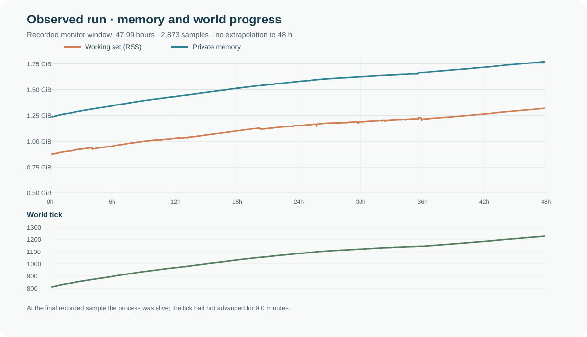

# Run record 01 — Household-world endurance snapshot

**Période observée :** 2026-11-21 11:57:26 UTC – 2026-11-23 11:56:36 UTC
**Statut :** le moniteur a couvert **47.99 h**, soit environ 50 secondes de moins que le seuil nominal de 48 h. Le dernier échantillon indique que le processus était encore actif. La trace séparée atteint le tick 1274, sans horodatage permettant de l’aligner avec le relevé de ressources.

## Scénario exécuté

Une exécution unique d’un monde domestique avec quatre habitants simulés et des mécanismes d’environnement, de ressources, d’état corporel et de groupe. La configuration initiale exacte et la graine restent privées. La trace observée contient 1,274 enregistrements de tick, du tick 1 au tick 1274. L’instantané final de trace est distinct du dernier échantillon du moniteur; aucune heure ne lui est attribuée.

Le moniteur de ressources a échantillonné ce processus environ une fois par minute. Ce dossier public ne conserve que le temps écoulé, le tick, la mémoire, le temps CPU et l’indicateur d’activité du processus. Il retire les identifiants de processus, les noms des habitants, la configuration exacte, les détails de trace et le code source.

## Mesures observées

- Durée du relevé : **47.99 h** (**2,873 mesures**; intervalle médian 60.1 s).
- Processus déclaré actif : **2,873/2,873 mesures**.
- Tick du monde : **809 → 1225** pendant la fenêtre observée (**416 ticks nets**).
- Mémoire résidente (RSS) : **0.87–1.32 Gio**; dernière mesure **1.32 Gio**.
- Mémoire privée : maximum **1.77 Gio**; dernière mesure **1.77 Gio**.
- Temps CPU ajouté pendant le relevé : **43.78 h**.
- Dernier avancement de tick : **11:47:35 UTC**. Le processus est resté actif pendant les **9.0 min** suivantes sans nouvel avancement consigné.

Le fichier `observed-world-output-public.csv` contient seulement 6 instantanés agrégés, aux ticks 1, 809, 900, 1000, 1225, 1274. Ce sont des points de contrôle espacés, pas une trajectoire continue des habitants. Le CSV du moniteur conserve les échantillons de ressources environ chaque minute.

## Portée et limites

L’indicateur « processus actif » décrit l’état du processus logiciel au moment des échantillons; il ne signifie pas que le monde progresse correctement. Le compteur de ticks n’a pas avancé pendant les 9.0 dernières minutes du relevé. Cette fenêtre ne constitue donc pas une démonstration de progression continue ou de bon fonctionnement sur toute sa durée. Le fichier des sorties du monde ne contient que 6 instantanés aux ticks 1, 809, 900, 1000, 1225, 1274; il ne suffit pas à qualifier la trajectoire complète des habitants, leurs actions entre ces points ou la continuité de leur état.

Le relevé couvre **47.99 h**, soit 50 secondes de moins que 48 h; le seuil strict de 48 h n’est donc pas entièrement vérifié par le moniteur. Le processus est déclaré actif au dernier échantillon, et la trace séparée atteint le tick 1274, mais celle-ci n’est pas horodatée et ne permet pas de compléter la mesure temporelle. Un seul passage ne permet pas de généraliser ce résultat à d’autres scénarios ou matériels.

Les mesures proviennent des journaux archivés du projet. Aucun observateur indépendant n’a signé ce relevé; les fichiers sources restent privés. Les empreintes ci-dessous portent sur les préfixes observés au moment de la capture, afin de rester vérifiables si les journaux sources continuent de s’allonger. Elles ne constituent pas une attestation tierce.

## Fichiers publics

- `resource-monitor-public.csv` : toutes les mesures filtrées du moniteur.
- `observed-world-output-public.csv` : 6 instantanés agrégés aux ticks 1, 809, 900, 1000, 1225, 1274; pas une trace complète des habitants.
- `run-metrics.svg` : graphique dérivé des mêmes mesures.
- Empreinte SHA-256 du préfixe du CSV privé (en-tête + 2,873 relevés) : `237e3a2da583a897d19439379fb7b12363bfbc08e501aa4dab14cd96cb7f0aad`.
- Empreinte SHA-256 du préfixe de trace privée (1,274 enregistrements) : `9c39c330abd9ed7ac6c6c4870185260ae4766d567081dedef9d071d21442d19c`.
- Empreinte SHA-256 du CSV public du moniteur : `a20b0f7d2833ed200c19c70e2cdd7c6df66b8a9c1e197da5dfe8c8b54ab0646d`.
- Empreinte SHA-256 du CSV public des sorties agrégées : `b305a4b6c5245d9acfb59e9844392ade4a9ade460fe231011ec26b50dfa38c40`.

## English summary

This record covers one household-world run with four simulated residents. The monitor recorded **47.99 hours** across **2,873 samples**; the world tick moved from **809 to 1225**, a net increase of **416**. The process was reported alive at every sample, but this only means the process had not exited; it does not show that the world was making valid progress. No tick advanced during the final **9.0 minutes** of the monitored window. A separate, untimestamped world trace contains records through tick **1274**. The public world-output CSV contains only **6 aggregate snapshots** at ticks 1, 809, 900, 1000, 1225, 1274, not a continuous resident trajectory. RSS ranged from **0.87 to 1.32 GiB**, and private memory peaked at **1.77 GiB**.

The monitored window reached **47.99 hours**, approximately 50 seconds short of 48 hours; the strict 48-hour threshold is not fully established by the monitor. The process was reported alive at the final sample, after **9.0 minutes** without a tick advance. The later trace reaches tick **1274**, but it has no timestamps and cannot be aligned to the monitor. The original logs remain private; the included files are filtered aggregates. No third party signed this record.
